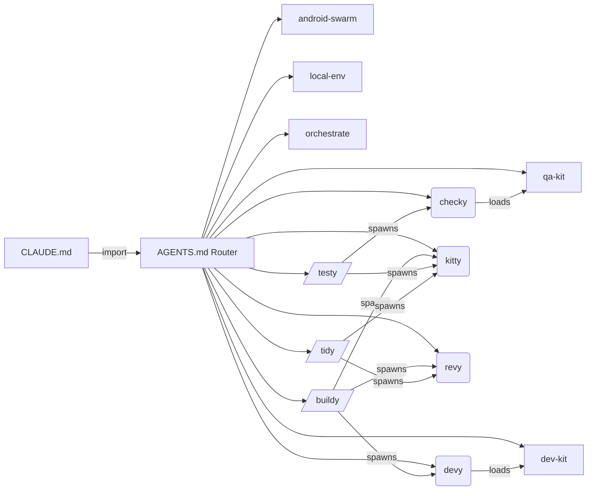
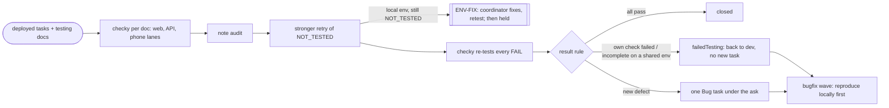
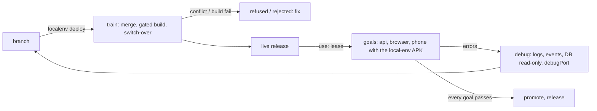
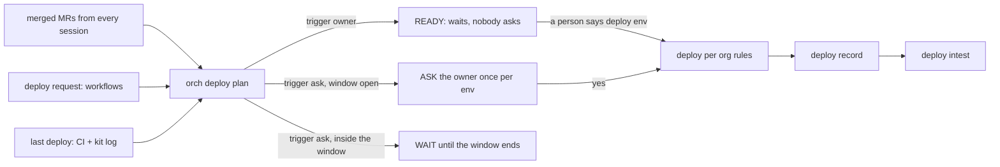

# claude-crew

**[Interactive kit map ->](https://prskid1000.github.io/claude-crew/)** (every command, step, decision and loop; built by `kittool.py flow --public` on each push)

A multi-agent dev + QA kit for Claude Code (with ports for Codex and Antigravity) for **any project type**: any stack (JVM,
.NET, Node / web frameworks, Python, Go, Rust, mobile, native; one repo or many), any migration tool, any local env shape, test
environment, deploy mechanism and issue tracker. Everything org- or product-specific lives in git-ignored config
(`skills/dev-kit/kit.local.json`, `rules/*.local.md`); the kit itself assumes no tenants, no web + API + app trio, no database.

## The crew
Four agents, one per lifecycle job, and no general-purpose agent anywhere (every workflow step names its crew member; a
mechanical step is a `STEP:` prompt). Names, kinds, roles, tools and characters live in the manifest (`kit.example.json`
`_manifest`); this table is generated from it.
<!-- kit-graph:start table-crew -->
| Agent | Job | Kinds / roles | Used in | Can't | Character |
|---|---|---|---|---|---|
| `devy` | builder: makes or changes anything in product repos through the dev flow | feature · fix · refactor · migration · config · doc · tests · spike · repro | /buildy, R5, R6 | deploy, merge into deploy branches, edit the kit | pragmatic builder: "Small, tested, shipped." |
| `revy` | reviewer: reviews anything and suggests concrete changes | mr · kit · doc · qa · plan · module · config | /buildy, R13, R14 | edit anything (suggests only) | sceptical, blunt: "Show me the test." |
| `checky` | tester: tests or verifies anything, always with evidence | task · smoke · regression · repro · data · perf · claim (roles: lead / test / verify) | /testy, R10 | edit code, leave its target, load shared envs | paranoid, evidence-obsessed: "Screenshot or it didn't happen." |
| `kitty` | kit caretaker: the kit and the machine setup | build · fix · audit · retro · setup · env · recover · docs | /tidy, R2, R3 | touch product repos | tidy and frugal: "Measure before and after." |
<!-- kit-graph:end -->
- **Character**: one fixed shape per agent (traits, the bias it brings, a catchphrase, what it never does); it shapes judgement
  and tone, never a rule or the Writing standards.
- **Who is alive**: step 0 of every agent is `orch.ps1 board join -Type <agent>`, which lists every live agent on this machine
  (id, type, run, session process, task, worktrees / phones / seats held, last beat); a holder is asked with `board msg`, never
  collided with.
- **Disputes**: `board dispute` (claim, evidence, proposed outcome); the other answers once with its evidence; still split after
  2 rounds -> `decide ask` with both positions, the owner judges, only that item waits; each verdict is a learn signal.
- **Duels**: `/buildy` `mode: 'duel'`: two devy build one question two ways (own worktrees, goals, evidence), revy compares them,
  they debate (max 3 rounds, revy fact-checks), the owner judges from the debate record; the winner ships, the loser's branch
  closes with its findings kept.

## The two flows
- **Dev** = `devy` -> `revy` -> CI -> merge -> `devy` (doc, tracker): code -> testing-goals doc -> reproduce / debug + test on
  the **local env** (loop, bounded) -> independent review + CI -> merge (producers first), human testing doc, tracker
  `promoted` (no user gate) -> merged work **waits for a person's `deploy <env>`** (nobody asks or proposes; `deploy.trigger`)
  -> the coordinator deploys at once -> `inTest` -> testers close the task, or it fails testing and comes back.
- **Test-only** = `checky` lead -> `checky` test x N -> `checky` verify -> stronger retry -> `checky` lead (result rule): all
  checks pass: closed · an own check failed or testing incomplete: `failedTesting` (back to dev, no new task) · a new defect: one
  `[Bug]` task under the original ask.
- **Kit** = `kitty` -> `revy` -> push main (fast-forward).
- **Decision pauses**: a change to behaviour a user sees that the task did not ask for, or several valid paths -> the agent
  asks; that item waits for the owner's answer while the rest continue.

## Workflows
<!-- kit-graph:start table-workflows -->
| Workflow | Covers | Crew | Router row |
|---|---|---|---|
| `/buildy` | any multi-item build: features, fixes, refactors, migrations, bug waves, resume, duels | `devy`, `revy`, `kitty` | R5 |
| `/testy` | any test run: tracker selection, smoke after a deploy, regression sweep, retest, on local or a test env | `checky`, `kitty` | R8 |
| `/tidy` | kit upkeep: learning signals -> lessons + rule updates, cleanup, the weekly audit kick-off | `kitty` | R4 |
<!-- kit-graph:end -->

## Install
```powershell
git clone https://github.com/prskid1000/claude-crew <workspace>/.claude
pwsh -File <workspace>/.claude/skills/orchestrate/orch.ps1 setup -WriteLocal   # git hooks, excludes, .runtime/.state, local config stubs
```
Prerequisites: PowerShell 7 (`pwsh`), Python 3.8+, git, Node 18+ (browser helper, spec runner), the git-host CLI (`glab` or
`gh`), optionally the tracker CLI (ClickUp), `gws` (Google Docs reports), the Android SDK (phone lanes). Then fill
`skills/dev-kit/kit.local.json`, `skills/qa-kit/targets.local.json` (test logins: the only place for passwords) and, for app
lanes, `skills/android-swarm/swarm.config.json`; `npm install` in `skills/qa-kit`. Update with `git pull`; after an update that
moves state, `orch.ps1 setup -Migrate` once nothing runs.

## Using it
- Ask the main session for work; the Router in `AGENTS.md` picks the flow and launches it (`/buildy`, `/testy`, `/tidy`)
  or spawns one crew member. The coordinator keeps one heartbeat (`orch.ps1 supervise -AutoFix -Brief` on `/loop 10m`) and acts on its flags:
  decisions, failed testing, stopped runs. After a crash or restart: `orch.ps1 recover` (the SessionStart line says so).
- Commands (each prints its usage without arguments): `skills/dev-kit/dev.ps1` (worktrees, gated checks, tracker),
  `skills/local-env/localenv.ps1`, `skills/qa-kit/qa.ps1`, `skills/android-swarm/swarm.ps1`, `skills/orchestrate/orch.ps1`
  (board, learn, track, supervise, deploy, decide, recover, setup, hooks), `skills/dev-kit/devtools.py` (MRs, docs, merge,
  migrations, findings), `kittool.py` (lint, flow, port, audit, cost, new, rename, remove, release).

## Configuration (`skills/dev-kit/kit.local.json`; every key optional; `kit.example.json` shows each)
| Key | Default | Meaning |
|---|---|---|
| `tracker` | `{ "type": "none" }` | `type` clickup / github / gitlab / jira / none; `statuses` maps the logical statuses open, inProgress, review, promoted, inTest, failedTesting, closed; `list`, `repo`, `owner`, `branchTag`, `issueType`, `subtaskType` |
| `gitHost`, `gitHostType`, `githubHost`, `gitlabGroup` | `gitlab.com`, from gitHost, `github.com`, none | the git host and the group/owner for short refs `<repo>!<iid>` |
| `holdMerge` | `[]` | repos (names / aliases, or `true` = all) whose MRs a person merges because their target deploys: `devtools.py merge` answers NOT_MERGED "held for approval" (the /buildy arg `holdMerge` holds them inside a wave) |
| `repos` | none | `[{ name, aliases, checkout, target, linkFrom, linkFromByTarget, linkPaths, deploys }]`; `deploys[]` per test env: CI `branch` + `job`, `awsStack` + `region`, `ssh {host, key, repoDir, appDir, subdir, exclude, service}`, `manual`, `laneApk` |
| `reposRoot`, `worktreeRoots`, `repoAliases`, `protectedBranches` | workspace, `<repos>-wt`, `{}`, `[]` | where checkouts and worktrees live; short repo names; branches never force-pushed |
| `trackerRepos`, `trackerLists`, `productTargets` | `[]` | repos searched for a task's MRs; tracker containers for `deploy intest`; which env a path needs |
| `localEnv` | none | local envs (local-env skill): `envs.<env>.services[] {name, repo, dir, start, build, artifact, port, debugPort, health, dependsOn, hot, external}`, `tasks`, `smoke`, `db {snapshot, restore, rollback, applied, tag}`, `sandbox`, `migrations` rules, lease / idle limits |
| `deploy.trigger` | `owner` | `owner`: nobody asks or proposes a deploy, a person says `deploy <env>` and it runs end to end; `ask`: one batched ask per env (supervise DEPLOY ASK) |
| `deploy.minIntervalHours`, `deploy.planTimeoutSec` | `4`, `180` | `ask` only: one ask per test env per window (a number or `{ "default": 4, "<target>": 24 }`); `deploy plan`'s wall clock |
| `net.timeoutSec` | `60` | per git-host / tracker CLI call; transient failures retry (2 s, 6 s); tracker writes lost to the network wait in `.state/outbox.jsonl` until supervise replays them |
| `tests.<stack>.testFor` | per stack | test names `check -Touched` looks for from a changed file's `{name}` |
| `reports.type`, `driveParent` | gdocs when `gws` exists, else markdown | QA reports and testing docs: Google Docs or files |
| `qa.outOfScope` | `[]` | channels agent QA never tests (OUT_OF_SCOPE) |
| `qa.targets` | `{}` | target groups for `/testy` `select` runs: `<group>: [{ lists?, repos?, nameRegex?, pathRegex?, target, localEnv? }]` (first match = the item's env) |
| `gate.keepFreeGB`, `gate.startHeapGB`, `gate.heapMinGB` | 15% of RAM (min 6), per tool, 4 | the memory gate |
| `supervise.ramActPct`, `supervise.minDiskFreeGB` | 90, 30 | heartbeat thresholds |
| `kitAudit.everyDays`, `cleanup.maxBrowserProfiles`, `memory.keepDefault`, `build.mavenOffline` | 7, 4, false, true | audit nudge, browser profiles kept, auto-memory location, Maven -o |
| `bugfixMandate`, `localOnly`, `orgTerms` | none | words for bug waves; org-only kit paths kept out of git; words the pre-push gate blocks |
| `localFiles` (example only) | — | `orch.ps1 setup -WriteLocal` writes `targets.local.json` and `swarm.config.json` from it |
Env vars: `CLAUDE_RUNTIME`, `CLAUDE_WT_ROOT`, `CLAUDE_AGENT`, `CLAUDE_GATE_KEEP_FREE_GB`, `KIT_TRACKER_TYPE`, `KIT_TRACKER_DRYRUN`,
`KIT_REPORT_TYPE`, `KIT_NET_TIMEOUT_SEC` / `KIT_NET_TRIES` / `KIT_NO_OUTBOX`, `JIRA_BASE_URL` / `JIRA_EMAIL` / `JIRA_API_TOKEN`, `ANDROID_HOME`, `ANDROID_SERIAL`, `CHROME_PATH`.
A repo whose stack is detected wrongly: `.claude-stack.json` next to its build file (`{ "commands": { "test": "make test T={tests}" } }`).

## Layout, state and safety
- Runtime output: `<kit>/.runtime/` (disposable: `work/` runs in flight, `cache/`, `logs/`); durable state: `<kit>/.state/`
  (tracking, learning signals, deploy log, tracker outbox, the `none` tracker, local-env secrets). Both git-ignored; every path is named in
  `skills/dev-kit/kit.example.json` `_paths`. `orch.ps1 cleanup` (daily) removes only kit-created leftovers.
- Guards: the PreToolUse hook blocks `git stash`, `--no-verify`, force-pushes to shared branches, ungated heavy builds, dev
  servers by hand and `adb kill-server`. Deploys start only from a person's word; merges into deploying branches need a yes. Never production.
- Limits: one machine (the memory gate is local); the Workflow tool, hooks and the Skill tool are Claude Code-only (Codex and
  Antigravity get ported agents and manual workflow procedures).

## Extending (change the kit)
The kit is the workspace's `.claude` folder, a git clone of this repo; `kitty` changes it in a kit worktree while runs execute the
live clone, keeps it generic, gets a `revy` review and pushes main. Every part is added, renamed or removed one way:
```powershell
python -X utf8 skills/orchestrate/kittool.py new agent|skill|workflow|rule|event|config-key <name>   # file(s) from its template
python -X utf8 skills/orchestrate/kittool.py rename agent|skill|workflow|rule|event|config-key <old> <new>   # every reference, no alias
python -X utf8 skills/orchestrate/kittool.py new adr <title>   # a LESSONS.md Decisions line
python -X utf8 skills/orchestrate/kittool.py remove <kind> <name>                                     # lists what still refers to it
```
`new` writes the part (front matter, a Character block for an agent, a Files index for a skill, a header doc for a workflow),
registers it in the manifest and adds a Router / Events row stub and a test stub; fill every stub (lint TODO-STUB refuses them),
then `kittool.py port`, lint 0, tests. The standard process:
- **Registry**: `kit.example.json` `_manifest` holds every agent, skill, workflow, Router row, Events row and cap; the README tables,
  the Character blocks and the ports are generated from it; `renamed` (old -> new) is the migration note `orch.ps1 setup
  -Migrate` applies to local state [MANIFEST, OLD-NAME].
- **Formats**: Agent Skills SKILL.md front matter (name, description with Load when / Not when), Claude Code subagent front matter
  (name, description, tools, model) and the Character shape, each validated by a JSON Schema in kittool [SCHEMA]; every workflow
  `agent()` names a crew agentType [AGENT-TYPE].
- **Versions**: Semantic Versioning tags from Conventional Commits; `kittool.py release [--tag] [--publish]` writes the notes
  (breaking changes with their `Migration:` lines, features, fixes, retired lessons): the change log, no CHANGELOG file.
- **Kit decisions**: ADR style (context, decision, consequences) as a LESSONS.md entry or in the release notes, never a new file.
- **Every addition** carries schema-valid front matter, a manifest entry, a reachability edge, a test, a flow-graph node, a
  generated README row and its ports; lint enforces each, so a half-added part cannot be committed.

### Hard rules
- **At most 30 content files** [FILE-CAP] (what an agent or a person reads: docs, agents, workflows, skills, scripts, config
  examples, tests) and **8 plumbing files** [PLUMBING-CAP] (`LICENSE`, `.gitignore`, `.gitattributes`, `.githooks/*`, `.github/*`,
  `settings.json`: git, CI and the harness read them, agents never). Counted: every `git ls-files` path except the generated
  ports (`.codex/`, `.agents/`, `GEMINI.md`); git-ignored local files (`*.local.*`, `swarm.config.json`, `.runtime/`, `.state/`)
  never count. One script per concern area; references and templates fold into a SKILL.md, an agent or `dev-kit/templates.md`;
  tests in `tests/kit-tests.ps1`.
- **Token budgets** [BUDGET] (tokens = UTF-8 bytes / 4 of the LF text; README's generated graph sections excluded): always-loaded (`CLAUDE.md` + `AGENTS.md` + always-on
  rules) 3500 · SKILL.md 3200 · agent 2400 · rule 900 · template 2600 · `dev-kit/templates.md` 4000 · README 7000 · LESSONS.md 30000
  (40 lines per skill section) · workflow 15000 · .ps1 58000 · .py 70000 · .mjs 8000 · json 6000 · tests 28000 · total: the manifest's `caps.totalTokens`.
  `kittool.py lint` prints the top consumers when one is over.
- **Every file reached from the root** [REACH-NONE, REACH-MENTION]: CLAUDE.md -> AGENTS.md (Router) -> skill / workflow / agent
  -> the Files-index row that names the file and the step that reads or runs it. Mentions do not count. Every edge carries its
  reason (the router row, the index step, the hook event, the spawning workflow, the calling verb).
- **Generic and project-agnostic** [ORG-TERM]: no org, product, tenant, host, id, person or local path; no assumed stack,
  migration tool, app trio or database. Org values -> `kit.local.json` keys with today's behaviour as the default; org rules ->
  `rules/*.local.md`; org lessons -> `LESSONS.local.md` (`orch.ps1 learn` routes a line with an `orgTerms` word there itself).

### Shapes
- **Script** [SCRIPT-HEADER]: one entry file per area with verbs; a header block with purpose, usage, verbs, inputs, outputs and
  `Exit codes:` (0 ok · 1 problem found · 2 usage error); shared parameter names `-Env -Run -Task -Repo -Dir -Agent -Mrs -DryRun
  -Json -Quiet`; JSON output for machines; no silent failures (a failed call is UNKNOWN, never a state); idempotent where possible;
  every path through `Get-KitPath` / `kit_path` / `kitPath` / `rp()` [RUNTIME-RAW, RUNTIME-MAP]; network calls bounded (lib.ps1
  sets git timeouts; `Invoke-GitFetch`, memoised host / tracker reads); never opens a file, browser or app on the desktop unless an
  explicit `--open` / `-Open` flag asks [DESKTOP-OPEN] (hooks, lint and generators stay silent; the guard blocks agents' opens too).
  Template: `dev-kit/templates.md` "Script header".
- **Skill** [SKILL-DESC, SKILL-BLOCK, FILES-*]: front matter `description: "Load when: ... Not when: ... -> <sibling>."`; then
  **Load when**, **Not when**, **Hands off to**, **Files** (every file in the folder, plus `<kit>/...` files it binds, each with
  its step), numbered steps, **Rules**, **Learn**. Lessons: the skill's `## <skill>` section of `LESSONS.md` (`learn -Read`).
- **Agent** [AGENT-SPAWN, AGENT-SKILL, SCHEMA]: front matter `name`, `description` ("Spawned by ...", "Precondition", "Not for:
  ..."), `tools` only when the agent needs no MCP servers (devy and checky keep all tools: the local env's DB tool is an MCP
  server), `model`; body: Character, Kind, **Load first** `<kit>/skills/<skill>/SKILL.md`, non-negotiables, the `STEP:` rule, the
  report shape, self-improvement.
- **Workflow** [WF-WHEN, WF-CLOCK, WF-CRLF]: `meta.whenToUse` = its router row's conditions word for word; every arg in the
  header comment with its default; no `Date.now()` / `new Date()`; LF only; ends with a Learn step and cleanup. Both flows return
  the same report shape (`agents|results`, `deployBatch`, `decisions`, `retroDue`). Check: wrap and `node --check`, `kittool.py cost --steps`.
- **Rule**: always-loaded only for short hard rules every session needs; path-scoped (`paths:` front matter) for one kind of file
  (examples: "Rule examples" below).
- **Text** [PROSE]: every artefact type has a row in `dev-kit/templates.md` "Writing standards" (purpose, sections, limits,
  required facts); a new artefact type adds a row; generators call `kittool.py prose` and print findings, never truncate.
- **Config key**: optional, today's behaviour as the default, a row in README "Configuration", a sample in `kit.example.json` [CONFIG-UNDOC].
- **Hook**: `pwsh` exec form with `${CLAUDE_PROJECT_DIR}/.claude/...`; SessionStart work < 2 s, slow work `"async": true`.

### Before every push
```powershell
python -X utf8 skills/orchestrate/kittool.py lint                 # 0 problems and 0 counted flow issues; regenerates the flow page
python -X utf8 skills/orchestrate/kittool.py port; python -X utf8 skills/orchestrate/kittool.py port --check
pwsh -NoProfile -File tests/kit-tests.ps1                         # all areas (or -Area dev|qa|orch|local)
python -X utf8 skills/orchestrate/kittool.py lint --org-terms skills/dev-kit/kit.local.json
python -X utf8 skills/orchestrate/kittool.py cost --steps         # after a workflow change
```
The pre-commit hook regenerates the README graph sections and the ports (`kittool.py port`: `.codex/`, `.agents/`, `GEMINI.md`,
plus the workspace copies when the kit is an installed `<workspace>/.claude`), stages them, and blocks while `port --check`
still differs or lint finds problems (a flow-graph issue counts unless its source line carries a `flow: <reason>` marker:
then it is listed as deliberate in the page's Loops tab); the pre-push hook re-runs `port --check` and blocks stale ports, org terms and ignored /
local files. SessionStart (`orch.ps1 health`) only reports. Generated ports never count toward the file cap. Commit with `dev.ps1 wt commit` (Conventional Commits).

### Rule examples
Copy a block into `rules/<name>.md` (or `rules/<name>.local.md` for org-only conventions, listed in `kit.local.json`
`localOnly`), keep the `paths:` front matter, adapt it to your repo. A path-scoped rule loads only when a matching file is opened.
Org-specific test conventions (frameworks, base classes, fixture helpers, naming) belong in your `rules/*.local.md`.

#### Database migrations (any tool)
```markdown
---
paths: ["**/liquibase/**", "**/db/migration/**", "**/Migrations/**", "**/migrations/**", "**/alembic/versions/**", "**/prisma/migrations/**"]
---
# Database migrations
- Only the id/timestamp range your brief assigns; never edit a merged migration; a rollback / down for every change the tool supports.
- Liquibase: the repo's file naming and include layout; append-only master conflicts: `python <kit>/skills/dev-kit/devtools.py keepboth <file>`;
  `dev.ps1 check -Step migrations` = ISSUES 0 before every push.
- Flyway `V<range>__desc.sql` · Alembic: re-point `down_revision` after a rebase (one head) · EF Core / Prisma / Django: regenerate
  on top of the latest after a rebase, never a merge migration.
```

#### Tests (any stack)
```markdown
---
paths: ["**/src/test/**", "**/*.spec.*", "**/*.test.*", "**/tests/**", "**/test_*.py", "**/*Tests.cs"]
---
# Tests
- One behaviour per test, arrange / act / assert, names `should_<behaviour>_when_<condition>` (or the repo's style).
- Fixed clocks, no sleeps, no shared mutable state, deterministic builders / fixtures, mocks only at boundaries, no network
  unless the test is tagged integration.
- A fixed bug gets a regression test that fails before the fix. Run: `dev.ps1 check -Step test -Tests <names> -Touched`.
```

#### A JVM backend
```markdown
---
paths: ["**/src/main/java/**", "**/src/main/kotlin/**"]
---
# Backend
- DTOs in APIs, never entities; additive changes (optional fields, new endpoints); validation at the boundary.
- Unit tests next to the package (`src/test/...`), integration tests tagged; `dev.ps1 check -Dir <module> -Step test -Touched`.
```

#### A web frontend
```markdown
---
paths: ["**/src/app/**/*.ts", "**/src/**/*.tsx", "**/src/**/*.vue"]
---
# Frontend
- Fix a variant in the component's own style, never a global override; shared formatters keyed by field.
- A logic change ships a spec (`*.spec.ts`); a template-only change attaches a 1366x768 screenshot.
```

## How the kit fits together
Generated by `kittool.py flow --readme` (the pre-commit hook keeps it current); the interactive page:
`<kit>/.runtime/cache/kit-flow.html` (rebuilt on commit, pull and SessionStart; the public build is the kit map linked above).
<!-- kit-graph:start map -->

<!-- kit-graph:end -->

<!-- kit-graph:start flow-dev -->

<!-- kit-graph:end -->

<!-- kit-graph:start flow-test-only -->

<!-- kit-graph:end -->

<!-- kit-graph:start flow-local-env -->

<!-- kit-graph:end -->

<!-- kit-graph:start flow-deploy -->

<!-- kit-graph:end -->

<!-- kit-graph:start skill-android-swarm -->
```mermaid
flowchart LR
  skills_android_swarm_SKILL_md[android-swarm]
  skills_android_swarm_SKILL_md -->|step A0 / L0: orch.ps1 learn -Read -Skill androi| LESSONS_md[LESSONS.md]
  skills_android_swarm_SKILL_md -->|A1-A4 (acquire, ensure, launch, release, status)| skills_android_swarm_swarm_ps1[swarm.ps1]
```
<!-- kit-graph:end -->

<!-- kit-graph:start skill-dev-kit -->
```mermaid
flowchart LR
  skills_dev_kit_SKILL_md[dev-kit]
  skills_dev_kit_SKILL_md -->|step 0: orch.ps1 learn -Read -Skill dev-kit prin| LESSONS_md[LESSONS.md]
  skills_dev_kit_SKILL_md -->|Writing standards at every step that writes text| skills_dev_kit_templates_md[templates.md]
  skills_dev_kit_SKILL_md -->|steps 1-5 (wt, stack, check, gate, tracker), CI | skills_dev_kit_dev_ps1[dev.ps1]
  skills_dev_kit_SKILL_md -->|library dot-sourced by every kit script (config,| skills_dev_kit_lib_ps1[lib.ps1]
  skills_dev_kit_SKILL_md -->|step 6 (mr, doc, finish), step 7 (merge), rebase| skills_dev_kit_devtools_py[devtools.py]
  skills_dev_kit_SKILL_md -->|step 4: the test runner check -Step test uses fo| skills_dev_kit_spec_mjs[spec.mjs]
  skills_dev_kit_SKILL_md -->|setup: orch.ps1 setup -WriteLocal writes kit.loc| skills_dev_kit_kit_example_json[kit.example.json]
```
<!-- kit-graph:end -->

<!-- kit-graph:start skill-local-env -->
```mermaid
flowchart LR
  skills_local_env_SKILL_md[local-env]
  skills_local_env_SKILL_md -->|step 0: orch.ps1 learn -Read -Skill local-env| LESSONS_md[LESSONS.md]
  skills_local_env_SKILL_md -->|steps 1-6 (envs, status, deploy, wait, use, logs| skills_local_env_localenv_ps1[localenv.ps1]
  skills_local_env_SKILL_md -->|run by localenv.ps1 (devtools.py migrations) to | skills_dev_kit_devtools_py[devtools.py]
```
<!-- kit-graph:end -->

<!-- kit-graph:start skill-orchestrate -->
```mermaid
flowchart LR
  skills_orchestrate_SKILL_md[orchestrate]
  skills_orchestrate_SKILL_md -->|step 0: orch.ps1 learn -Read -Skill orchestrate| LESSONS_md[LESSONS.md]
  skills_orchestrate_SKILL_md -->|every event row (supervise, launch, report, boar| skills_orchestrate_orch_ps1[orch.ps1]
  skills_orchestrate_SKILL_md -->|K2 (lint, flow --readme: the kit-flow page's par| skills_orchestrate_kittool_py[kittool.py]
  skills_orchestrate_SKILL_md -->|K1: Extending (file caps, budgets, part shapes, | README_md[README.md]
  skills_orchestrate_SKILL_md -->|K2: pwsh -File kit/tests/kit-tests.ps1 -Area are| tests_kit_tests_ps1[kit-tests.ps1]
  skills_orchestrate_SKILL_md -->|K3: run by git (orch.ps1 setup sets core.hooksPa| _githooks_pre_commit[pre-commit]
  skills_orchestrate_SKILL_md -->|K3: run by git (orch.ps1 setup sets core.hooksPa| _githooks_pre_push[pre-push]
  skills_orchestrate_SKILL_md -->|K3: run by git (orch.ps1 setup sets core.hooksPa| _githooks_post_merge[post-merge]
```
<!-- kit-graph:end -->

<!-- kit-graph:start skill-qa-kit -->
```mermaid
flowchart LR
  skills_qa_kit_SKILL_md[qa-kit]
  skills_qa_kit_SKILL_md -->|step 0 (and H0, L0): orch.ps1 learn -Read -Skill| LESSONS_md[LESSONS.md]
  skills_qa_kit_SKILL_md -->|step 1 (seat), 2 (deployed), 3 (api, ui), 4 (ann| skills_qa_kit_qa_ps1[qa.ps1]
  skills_qa_kit_SKILL_md -->|L1 Selection (tracker list/view/owner; status -E| skills_dev_kit_dev_ps1[dev.ps1]
  skills_qa_kit_SKILL_md -->|L1 Selection (tracker list/view/owner; status -E| skills_local_env_localenv_ps1[localenv.ps1]
  skills_qa_kit_SKILL_md -->|step 3 (web: read its header first; one logged-i| skills_qa_kit_browser_mjs[browser.mjs]
  skills_qa_kit_SKILL_md -->|L0: npm install in this folder (puppeteer-core)| skills_qa_kit_package_json[package.json]
```
<!-- kit-graph:end -->
