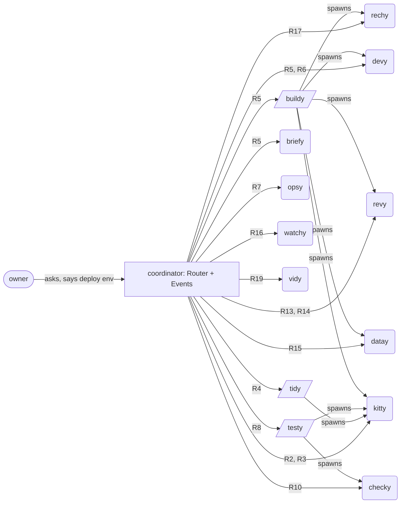
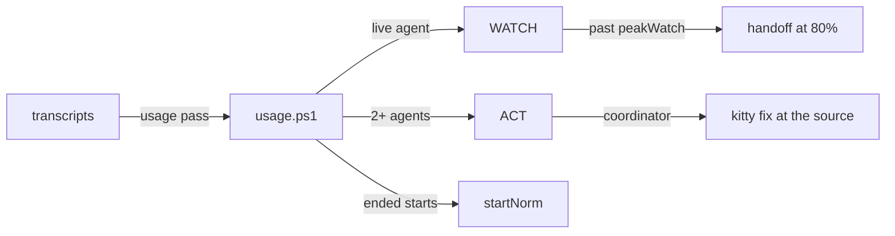
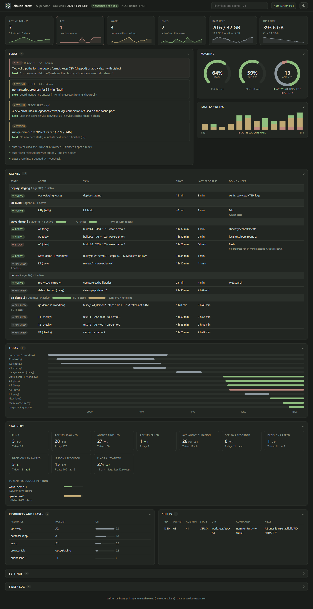
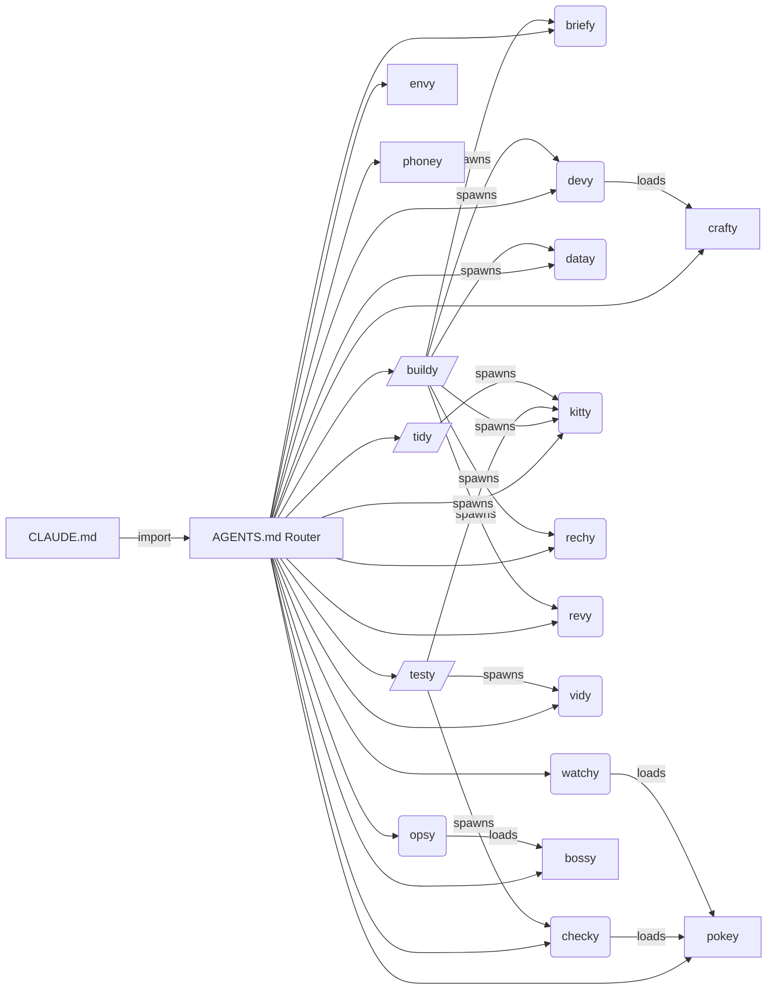
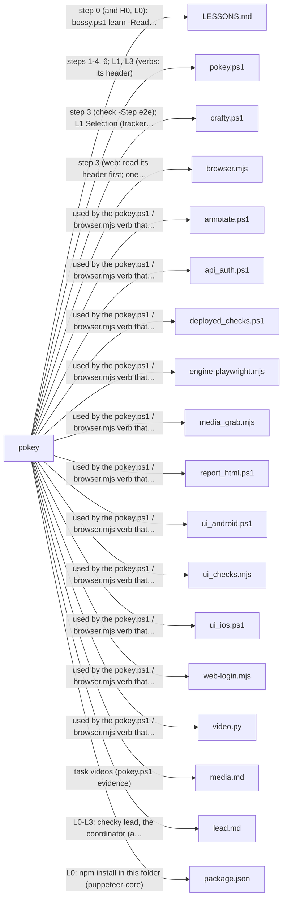
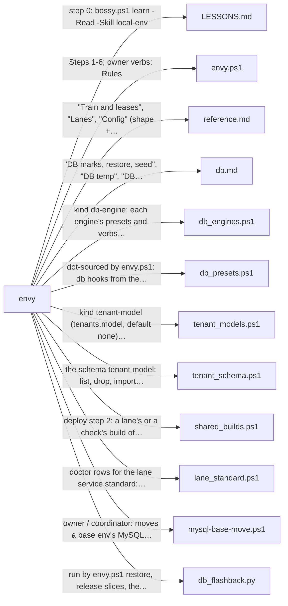
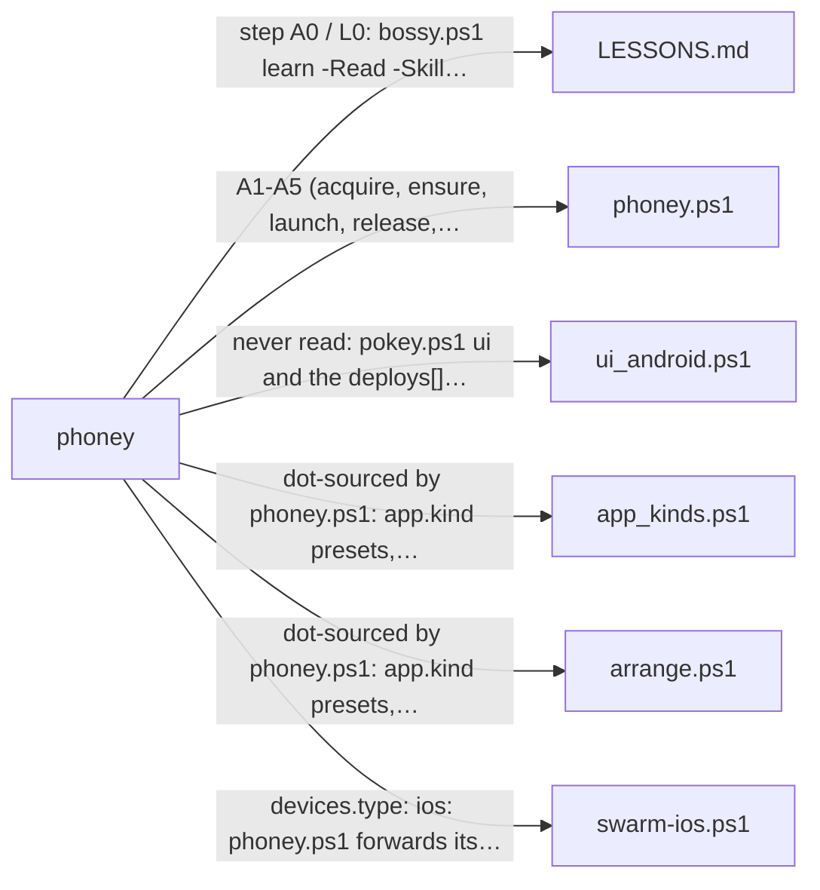

```mermaid
flowchart LR
  skills_bossy_SKILL_md["bossy"]
  skills_bossy_SKILL_md -->|"step 0: bossy.ps1 learn -Read -Skill bossy"| LESSONS_md["LESSONS.md"]
  skills_bossy_SKILL_md -->|"every event row (verbs: its header); hooks:…"| skills_bossy_bossy_ps1["bossy.ps1"]
  skills_bossy_SKILL_md -->|"every event row (verbs: its header); hooks:…"| skills_bossy_ctx_hook_mjs["ctx_hook.mjs"]
  skills_bossy_SKILL_md -->|"a script's state file changes; an agent needs a…"| skills_bossy_STATE_md["STATE.md"]
  skills_bossy_SKILL_md -->|"a timeout, wait or limit is added or changed…"| skills_bossy_params_registry_json["params.registry.json"]
  skills_bossy_SKILL_md -->|"dot-sourced by bossy.ps1"| skills_bossy_adapters_bugbrief_ps1["bugbrief.ps1"]
  skills_bossy_SKILL_md -->|"dot-sourced by bossy.ps1"| skills_bossy_adapters_deploy_merge_ps1["deploy_merge.ps1"]
  skills_bossy_SKILL_md -->|"dot-sourced by bossy.ps1"| skills_bossy_adapters_deploys_ps1["deploys.ps1"]
  skills_bossy_SKILL_md -->|"dot-sourced by bossy.ps1"| skills_bossy_adapters_heartbeat_ps1["heartbeat.ps1"]
  skills_bossy_SKILL_md -->|"dot-sourced by bossy.ps1"| skills_bossy_adapters_kit_admin_ps1["kit_admin.ps1"]
  skills_bossy_SKILL_md -->|"dot-sourced by bossy.ps1"| skills_bossy_adapters_localenv_supervise_ps1["localenv_supervise.ps1"]
  skills_bossy_SKILL_md -->|"dot-sourced by bossy.ps1"| skills_bossy_adapters_os_timer_ps1["os_timer.ps1"]
  skills_bossy_SKILL_md -->|"dot-sourced by bossy.ps1"| skills_bossy_adapters_outcomes_ps1["outcomes.ps1"]
  skills_bossy_SKILL_md -->|"dot-sourced by bossy.ps1"| skills_bossy_adapters_storage_ps1["storage.ps1"]
  skills_bossy_SKILL_md -->|"dot-sourced by bossy.ps1"| skills_bossy_adapters_supervise_resources_ps1["supervise_resources.ps1"]
  skills_bossy_SKILL_md -->|"dot-sourced by bossy.ps1"| skills_bossy_adapters_supervise_stats_ps1["supervise_stats.ps1"]
  skills_bossy_SKILL_md -->|"dot-sourced by bossy.ps1"| skills_bossy_adapters_task_rollup_ps1["task_rollup.ps1"]
  skills_bossy_SKILL_md -->|"dot-sourced by bossy.ps1"| skills_bossy_adapters_track_rebuild_ps1["track_rebuild.ps1"]
  skills_bossy_SKILL_md -->|"dot-sourced by bossy.ps1"| skills_bossy_adapters_usage_ps1["usage.ps1"]
  skills_bossy_SKILL_md -->|"dot-sourced by bossy.ps1"| skills_bossy_adapters_waits_ps1["waits.ps1"]
  skills_bossy_SKILL_md -->|"K3: run by git (bossy.ps1 setup sets…"| _githooks_pre_commit["pre-commit"]
  skills_bossy_SKILL_md -->|"K3: run by git (bossy.ps1 setup sets…"| _githooks_pre_push["pre-push"]
  skills_bossy_SKILL_md -->|"K3: run by git (bossy.ps1 setup sets…"| _githooks_post_merge["post-merge"]
  skills_bossy_SKILL_md -->|"K3: run by git (bossy.ps1 setup sets…"| _githooks_post_rewrite["post-rewrite"]
  skills_bossy_SKILL_md -->|"K1-K3 (the kitty agent runs them); E14: README…"| skills_bossy_kitbag_py["kitbag.py"]
  skills_bossy_SKILL_md -->|"K1-K3 (the kitty agent runs them); E14: README…"| skills_bossy_kitbag_admin_py["kitbag_admin.py"]
  skills_bossy_SKILL_md -->|"K1-K3 (the kitty agent runs them); E14: README…"| skills_bossy_kitbag_flow_py["kitbag_flow.py"]
  skills_bossy_SKILL_md -->|"K1-K3 (the kitty agent runs them); E14: README…"| skills_bossy_kitbag_forget_py["kitbag_forget.py"]
  skills_bossy_SKILL_md -->|"K1-K3 (the kitty agent runs them); E14: README…"| skills_bossy_kitbag_naming_py["kitbag_naming.py"]
  skills_bossy_SKILL_md -->|"K1-K3 (the kitty agent runs them); E14: README…"| skills_bossy_kitbag_ports_py["kitbag_ports.py"]
  skills_bossy_SKILL_md -->|"K1-K3 (the kitty agent runs them); E14: README…"| skills_bossy_kitbag_scaffold_py["kitbag_scaffold.py"]
  skills_bossy_SKILL_md -->|"K1-K3 (the kitty agent runs them); E14: README…"| skills_bossy_lint_vocab_json["lint-vocab.json"]
  skills_bossy_SKILL_md -->|"K1-K3 (the kitty agent runs them); E14: README…"| README_md["README.md"]
  skills_bossy_SKILL_md -->|"K1-K3 (the kitty agent runs them); E14: README…"| tests_kit_tests_ps1["kit-tests.ps1"]
  skills_bossy_SKILL_md -->|"K1-K3: kitty step 0, revy kind kit"| skills_bossy_kit_admin_md["kit-admin.md"]
  skills_bossy_SKILL_md -->|"E5: opsy deploy steps"| skills_bossy_deploys_md["deploys.md"]
```

```mermaid
flowchart LR
  skills_crafty_SKILL_md["crafty"]
  skills_crafty_SKILL_md -->|"step 0 (bossy.ps1 learn -Read -Skill crafty)"| LESSONS_md["LESSONS.md"]
  skills_crafty_SKILL_md -->|"#quot;Writing standards#quot; whenever you write; steps 4…"| skills_crafty_templates_md["templates.md"]
  skills_crafty_SKILL_md -->|"steps 4-5 (Rules #gt; Tests: what to test, how,…"| skills_crafty_testing_md["testing.md"]
  skills_crafty_SKILL_md -->|"steps 6-9 (MR, docs, tracker, merge, deploy…"| skills_crafty_ship_md["ship.md"]
  skills_crafty_SKILL_md -->|"steps 1-5, CI wait (pipes), the PreToolUse hook…"| skills_crafty_crafty_ps1["crafty.ps1"]
  skills_crafty_SKILL_md -->|"the PreToolUse hook: a warm guard (~0.1 s a…"| skills_crafty_guard_client_mjs["guard_client.mjs"]
  skills_crafty_SKILL_md -->|"the PreToolUse hook: a warm guard (~0.1 s a…"| skills_crafty_guard_server_ps1["guard_server.ps1"]
  skills_crafty_SKILL_md -->|"dot-sourced by every kit script; never run by…"| skills_crafty_lib_ps1["lib.ps1"]
  skills_crafty_SKILL_md -->|"run by lib.ps1 / envy.ps1 for the calls pwsh…"| skills_crafty_flagged_ps1["flagged.ps1"]
  skills_crafty_SKILL_md -->|"steps 6-7, rebase conflicts (keepboth)"| skills_crafty_devtools_py["devtools.py"]
  skills_crafty_SKILL_md -->|"loaded by lib.ps1 / devtools.py; a vendor one…"| skills_crafty_adapters_android_sdk_ps1["android_sdk.ps1"]
  skills_crafty_SKILL_md -->|"loaded by lib.ps1 / devtools.py; a vendor one…"| skills_crafty_adapters_azure_devops_ps1["azure_devops.ps1"]
  skills_crafty_SKILL_md -->|"loaded by lib.ps1 / devtools.py; a vendor one…"| skills_crafty_adapters_bitbucket_ps1["bitbucket.ps1"]
  skills_crafty_SKILL_md -->|"loaded by lib.ps1 / devtools.py; a vendor one…"| skills_crafty_adapters_build_heap_ps1["build_heap.ps1"]
  skills_crafty_SKILL_md -->|"loaded by lib.ps1 / devtools.py; a vendor one…"| skills_crafty_adapters_check_stamps_ps1["check_stamps.ps1"]
  skills_crafty_SKILL_md -->|"loaded by lib.ps1 / devtools.py; a vendor one…"| skills_crafty_adapters_ci_jenkins_ps1["ci_jenkins.ps1"]
  skills_crafty_SKILL_md -->|"loaded by lib.ps1 / devtools.py; a vendor one…"| skills_crafty_adapters_container_tests_ps1["container_tests.ps1"]
  skills_crafty_SKILL_md -->|"loaded by lib.ps1 / devtools.py; a vendor one…"| skills_crafty_adapters_gitea_ps1["gitea.ps1"]
  skills_crafty_SKILL_md -->|"loaded by lib.ps1 / devtools.py; a vendor one…"| skills_crafty_adapters_github_ps1["github.ps1"]
  skills_crafty_SKILL_md -->|"loaded by lib.ps1 / devtools.py; a vendor one…"| skills_crafty_adapters_gitlab_ps1["gitlab.ps1"]
  skills_crafty_SKILL_md -->|"loaded by lib.ps1 / devtools.py; a vendor one…"| skills_crafty_adapters_guard_localenv_ps1["guard_localenv.ps1"]
  skills_crafty_SKILL_md -->|"loaded by lib.ps1 / devtools.py; a vendor one…"| skills_crafty_adapters_liquibase_ps1["liquibase.ps1"]
  skills_crafty_SKILL_md -->|"loaded by lib.ps1 / devtools.py; a vendor one…"| skills_crafty_adapters_liquibase_py["liquibase.py"]
  skills_crafty_SKILL_md -->|"loaded by lib.ps1 / devtools.py; a vendor one…"| skills_crafty_adapters_module_audit_py["module_audit.py"]
  skills_crafty_SKILL_md -->|"loaded by lib.ps1 / devtools.py; a vendor one…"| skills_crafty_adapters_process_gates_ps1["process_gates.ps1"]
  skills_crafty_SKILL_md -->|"loaded by lib.ps1 / devtools.py; a vendor one…"| skills_crafty_adapters_report_confluence_py["report_confluence.py"]
  skills_crafty_SKILL_md -->|"loaded by lib.ps1 / devtools.py; a vendor one…"| skills_crafty_adapters_report_gdocs_py["report_gdocs.py"]
  skills_crafty_SKILL_md -->|"loaded by lib.ps1 / devtools.py; a vendor one…"| skills_crafty_adapters_report_notion_py["report_notion.py"]
  skills_crafty_SKILL_md -->|"loaded by lib.ps1 / devtools.py; a vendor one…"| skills_crafty_adapters_report_pdf_py["report_pdf.py"]
  skills_crafty_SKILL_md -->|"loaded by lib.ps1 / devtools.py; a vendor one…"| skills_crafty_adapters_runtimes_ps1["runtimes.ps1"]
  skills_crafty_SKILL_md -->|"loaded by lib.ps1 / devtools.py; a vendor one…"| skills_crafty_adapters_secret_store_ps1["secret_store.ps1"]
  skills_crafty_SKILL_md -->|"loaded by lib.ps1 / devtools.py; a vendor one…"| skills_crafty_adapters_stack_presets_ps1["stack_presets.ps1"]
  skills_crafty_SKILL_md -->|"loaded by lib.ps1 / devtools.py; a vendor one…"| skills_crafty_adapters_supervise_report_ps1["supervise_report.ps1"]
  skills_crafty_SKILL_md -->|"loaded by lib.ps1 / devtools.py; a vendor one…"| skills_crafty_adapters_task_items_ps1["task_items.ps1"]
  skills_crafty_SKILL_md -->|"loaded by lib.ps1 / devtools.py; a vendor one…"| skills_crafty_adapters_tracker_azure_ps1["tracker_azure.ps1"]
  skills_crafty_SKILL_md -->|"loaded by lib.ps1 / devtools.py; a vendor one…"| skills_crafty_adapters_tracker_clickup_ps1["tracker_clickup.ps1"]
  skills_crafty_SKILL_md -->|"loaded by lib.ps1 / devtools.py; a vendor one…"| skills_crafty_adapters_tracker_jira_ps1["tracker_jira.ps1"]
  skills_crafty_SKILL_md -->|"loaded by lib.ps1 / devtools.py; a vendor one…"| skills_crafty_adapters_tracker_linear_ps1["tracker_linear.ps1"]
  skills_crafty_SKILL_md -->|"loaded by lib.ps1 / devtools.py; a vendor one…"| skills_crafty_adapters_tracker_local_ps1["tracker_local.ps1"]
  skills_crafty_SKILL_md -->|"loaded by lib.ps1 / devtools.py; a vendor one…"| skills_crafty_adapters_tracker_youtrack_ps1["tracker_youtrack.ps1"]
  skills_crafty_SKILL_md -->|"loaded by lib.ps1 / devtools.py; a vendor one…"| skills_crafty_adapters_ts_typecheck_ps1["ts_typecheck.ps1"]
  skills_crafty_SKILL_md -->|"loaded by lib.ps1 / devtools.py; a vendor one…"| skills_crafty_adapters_video_ps1["video.ps1"]
  skills_crafty_SKILL_md -->|"loaded by lib.ps1 / devtools.py; a vendor one…"| skills_crafty_adapters_wt_pool_ps1["wt_pool.ps1"]
  skills_crafty_SKILL_md -->|"step 4: check -Step test runs it for a web…"| skills_crafty_spec_mjs["spec.mjs"]
  skills_crafty_SKILL_md -->|"revy kind module (devtools.py findings)"| skills_crafty_module_audit_md["module-audit.md"]
  skills_crafty_SKILL_md -->|"setup (bossy.ps1 setup -WriteLocal; keys:…"| skills_crafty_kit_example_json["kit.example.json"]
  skills_crafty_SKILL_md -->|"built-in defaults (statuses, tracker vendor ids…"| skills_crafty_vocab_json["vocab.json"]
```

<p align="center"></p>
<p align="center"><b>A crew of AI agents that builds, tests, ships and watches your code, with one coordinator in charge.</b></p>
<p align="center"></p>

# claude-crew

**[Interactive kit map ->](https://prskid1000.github.io/claude-crew/)** (every command, step, decision and loop; built on each push from `kitbag_flow.py`)

A multi-agent dev + QA kit for Claude Code (ports for Codex and Antigravity) for **any project type**: any stack, migration tool,
local env shape, test env, deploy mechanism and tracker. Org specifics live only in git-ignored config
(`skills/crafty/kit.local.json`, `rules/*.local.md`). Core defaults assume no tenants, no web + API + app trio, no database
engine, migration tool, testing docs or deploy mechanism: each is a built-in or adapter that runs only when config selects it.
Every diagram is generated at pre-commit (`kitbag.py flow --readme`) from the manifest, Router and flow model.

## The crew
The owner talks to the coordinator; it routes each request to a workflow or one crew member (`kit.example.json` `_manifest`).
<!-- kit-graph:start crew -->

<!-- kit-graph:end -->
<!-- kit-graph:start table-crew -->
| Agent | Job | Kinds / roles | Used in | Can't | Character |
|---|---|---|---|---|---|
| `devy` | builder: makes or changes anything in product repos through the dev flow | feature · fix · refactor · migration · config · doc · tests · foundation · spike · repro | /buildy, R5, R6 | deploy, merge into deploy branches, edit the kit | pragmatic builder: "Small, tested, shipped." |
| `revy` | reviewer: reviews anything and suggests concrete changes | mr · kit · doc · qa · plan · module · config · dispute | /buildy, R13, R14 | edit anything (suggests only) | sceptical, blunt: "Show me the test." |
| `checky` | tester: tests or verifies anything, always with evidence | task · smoke · regression · repro · data · perf · claim (roles: lead / test / verify) | /testy, R10 | edit code, leave its target, load shared envs | paranoid, evidence-obsessed: "Screenshot or it didn't happen." |
| `kitty` | kit caretaker: the kit and the machine setup | build · fix · audit · retro · setup · env · recover · docs | /tidy, R2, R3 | touch product repos | tidy and frugal: "Measure before and after." |
| `briefy` | spec + brief writer: specs, /buildy brief, contracts, rule changes | spec · brief · bugfix · rule-change | R5, E8 | write code, launch runs | system architect: "Who owns this field?" |
| `rechy` | researcher: cited answers before building or deciding | question · compare · library · licence · spike · debate | /buildy, R17 | edit anything but its findings | skeptical librarian: "Cite it or drop it." |
| `datay` | data guardian: test data, local DB, migration data, backfills | cleanup · fixture · migration · localdb · backfill · check | /buildy, R15, E2, E7 | write production, edit code or the kit | meticulous archivist: "Mark it, count it, then touch it." |
| `opsy` | deploy pilot: deploys on a person's word, verifies, rolls back | deploy · rollback · status · secret | R7, E5 | deploy without a person's word, edit code | cautious pilot: "Checklist first." |
| `watchy` | on-call watcher: errors of deployed envs, one [Bug] per issue | window · sweep · triage | R16, E15 | change systems, deploy, move tasks | calm on-call engineer: "What changed, and since when?" |
| `vidy` | video reader: exact screen text, timed answers | question · index · segment | R19 | edit code, tracker, kit | frame-by-frame witness: "Which frame shows it?" |
<!-- kit-graph:end -->
Board and disagreements: AGENTS.md "Crew".

## Flows
- `/buildy`: devy codes and tests on the local env in a loop, revy reviews, the workflow merges; only a person's `deploy <env>`
  ships it (`deploy.trigger`).
- `/testy`: checky lead / test / verify per testing doc; the result rule closes the task, fails it back to dev or files one [Bug].
- Every task the kit builds: rendered from a spec (`skills/crafty/crafty.ps1` "task spec": description, Items and Decisions checklists, its
  line on the parent's Items; `tracker create` refuses free text but a QA / watch defect keyed `qa-` / `watch-`, `tracker describe` one that drops a section), the process.docs links before promoted; a parent with every subtask closed closes only on the owner's
  answer to its one close ask.
- **Status roles**: tasks move through fixed roles, never board names: open -> inProgress -> review -> promoted (all MRs merged)
  -> inTest (deployed) -> closed; review -> failedReview (a person or revy rejects) or inProgress (review changes); failedReview,
  failedTesting -> inProgress; inTest (or promoted: undeployed) -> failedTesting; any role -> inProgress on a new code round
  (`tracker status -Back '<why>'`). Forward skips pass; other moves, a sibling agent's write while the task's round owner is live,
  repeats and stale QA results (MRs merged after the run started) are refused; a parent = its least complete open child. Per scope
  (ClickUp list, Jira project, Linear team, repo) the adapter verb `statuses` reads the live names (cached a day, again on an
  unknown name) and maps them to roles by name and type; `tracker.statusMap.<scope>.<role>` overrides, `tracker.statuses` holds the
  default names. A role the scope lacks: that step is skipped; a live name of no role: supervise WATCH. Check: `crafty.ps1 tracker
  roles <scope>`. The local env: one shared
  instance per env, branches as layers. WIP commits after every dev-flow step: a fresh agent loses nothing after a crash. The kit
  learns from every run (`/tidy`) and fixes itself in a kit worktree.
<!-- kit-graph:start table-workflows -->
| Workflow | Covers | Crew | Router row |
|---|---|---|---|
| `/buildy` | any multi-item build: features, fixes, refactors, migrations, bug waves, resume, disputes, debates | `rechy`, `devy`, `revy`, `datay`, `kitty` | R5 |
| `/testy` | any test run: tracker selection, smoke after a deploy, regression sweep, retest, on local or a test env | `checky`, `kitty` | R8 |
| `/tidy` | kit upkeep in 2-5 min: `bossy.ps1 tidy prep` (digest of signals and task outcomes, standing-rule asks from repeated owner answers, upkeep; no LLM), then one kitty: lessons + rule updates | `kitty` | R4 |
<!-- kit-graph:end -->

## Budget and handoff
The rule: "Configuration" `budget`; per-tool defaults in the table. Models (`MODELS` in each workflow; `agents[].model` / `items[].model`
win): devy, revy, checky test / verify / prepare = sonnet; close, ci, ship, learn = haiku; one stronger retry = opus; `complex` (buildy,
`bugbrief -Complex`) = the session model. Agents spawned by hand: their agent file's `model`.
<!-- kit-graph:start table-budget -->
| Tool / window | Budget | Source |
|---|---|---|
| claude-1m | 967000 | Claude Code docs: 1M models compact at ~967k |
| claude-200k | 167000 | conservative 83.5% of 200k (docs: at the limit) |
| codex | 0.9 x window | 0.9 x the models_cache.json window; auto_compact_token_limit wins |
| antigravity | 800000 | unverified: 0.8 x the model window (no window: 0.8 x a 1M Gemini window) |
| local | 32000 | a locally served model (llama.cpp -c, Ollama num_ctx): set tokens to its context; KIT_TOOL=local or a model id under local/ |
| unknown | 160000 | 0.8 x 200k |
<!-- kit-graph:end -->

Handoff: the first of 80% x the tool's cap and `budget.agentCap.<role>`; kit sized to
min(`budget.window`, the cap) (past: WATCH; self-check: C1); instructions over `budget.instructions.cap`: handoff.<!-- kit-graph:start flow-context -->

<!-- kit-graph:end -->

## Leases
One rule (`lib.ps1` `Update-KitLease`, lint LEASE-HOLDER) for env services, browser tabs, phones, builds, runtimes, worktree slots;
only owner holds (`envy.ps1 up -Owner`, phone `manual`) keep minutes, with a reminder.
Worktree slots (`crafty.ps1 wt lease / release / pool`): a fixed pool per repo (`pool.size`), created lazily, never deleted; a
released slot keeps its build caches and goes detached, a fair queue when all are leased. One naming scheme, shown on the
dashboard: member n of any pool (slot, env lane, phone lane) is the n-th bird of `pool.names` (`backend·Falcon`, `shop·Kestrel`).
The local STT server (`local-stt`; `skills/pokey/media.md`): one job at a time, bound to the job's process, its RAM through the memory gate.
GPU (`gpu.exclusive.<kind>`, `lib.ps1` `Use-KitGpu`): one kind at a time (e.g. lane emulators), others wait (`waiting for GPU:
held by <holder>`); `processes` (regex) hold it; `idleExcept` (the kind's own backend): also waits on any other nvidia-smi process,
or over `idleMaxMB` (512) with its backend down; `minFreeMB` (caller's, lanes 2048; 0 off): waits while `memory.free` is lower,
then refuses naming the processes; no nvidia-smi: one warning.
Test locks (`repos[].exclusiveTests` `[{dir, match, lock}]`, `lib.ps1` `Use-KitLock`): a `check -Step test` under `dir` whose test
names or sources match `match` (no names: all) holds `lock`; others queue up to the learned `gate.waitMinutes` (context
`lock:<name>`), then exit 3; an ended holder is dropped; supervise RAM rows show `lock <name>`.
- **End:** an agent ends with `bossy.ps1 release -Agent <id>` (every lease of that id: lane + its emulator, env and its layers, GPU, build, tabs);
  `board leave` and /buildy, /testy after each agent stage repeat it. A holder on the board with no live entry is dead (its holder
  pid is the shared session process); `supervise -AutoFix` reclaims every kind after the grace (lanes stop with `emu kill`).
- **Activity** (`lib.ps1` `Get-KitLastActivity`, for leases, STUCK and stale board rows, shell owners): the newest board beat or
  transcript write (+ task outputs it names); a workflow step counts under any run name it joined with.
- **Log:** `.state/leases.jsonl` (`lib.ps1` `Write-KitLeaseLog`): a line per acquire / release / reclaim / down (kind, name, agent,
  session, run, since, reason); past 1 MB the newest half kept. Last used: `bossy.ps1 status`, lane and env status.

## Worktrees and lanes
- **Pool slots** (`crafty.ps1 wt lease`): per repo, folder `<bird>-<repo>`, shown as `<repo>·<Bird>`; agents lease one per branch
  and release it; a free slot sits detached at `origin/<target>`, never on a stale branch; warm free slots: 7-day p90 + 1 (`pool.warm` first).
- **Lanes** (envy): lane k of env `<product>` runs from worktrees `lane-<product>-<bird>-<repo>` on local branch
  `lane/<product>-<bird>` (never pushed): the target + task branches merged as layers. Old names (`localenv-<env>-<repo>`,
  `localenv/<env>`) move when the lane is idle (`envy.ps1 lanes -Migrate [-DryRun]`; supervise each sweep, `-LanesOnly`), which
  also removes clean worktrees of `localenv/*` branches no lane owns, deletes `[gone]` branches merged into the target and
  backups fully on origin, and lists the rest.
- **One lane name:** output shows `<product>·<Bird>`; state and logs keep the id (records with an old id show and group as its bird); `-Env` takes either (ui-check: LANE-ID).
- **Lanes in sync** (`wt pool -Sync` -> `envy.ps1 lanes -Sync`): an idle lane is rebuilt as a build would (`origin/<target>` +
  open layers + prepare; merged layers dropped; a conflict: left as it was, listed); `lane/*` track no upstream; Branches tile:
  `base @ <sha> · behind N · test merges N`.
- **Many to many:** any task branch builds into any lane (merged onto its target); the slot keeps the task's own code. A lane
  branch no worktree holds is pruned (commits on no remote kept first as tag `backup/<branch>-<yyyyMMdd>-<sha>`).
- **Repo sync** (`wt pool -Sync`, plain `wt pool` previews it; supervise every `sync.everyMinutes`): one fetch per repo, every local branch strictly behind its
  upstream fast-forwarded (checked out: only when clean), merged branches whose upstream is gone deleted; diverged or dirty ones
  are listed (dashboard Branches tile), never touched.

## Pause and resume
- **Checkpoints** (both paths): each agent runs `crafty.ps1 checkpoint` at every step boundary (worktree, commit, testing goals,
  loop round, MR, review, CI, testing doc, tracker, merge; QA: each check): `work/agents/<id>/resume-<run>.json` + `.md` (per run: same-named agents never overwrite; an old `resume.json` is still read). Kit
  state is written atomically (temp + rename) or appended; leases, gate slots and board entries keep their process id with its
  start time (a pid reused after a cold boot holds nothing); a lock whose holder died is taken at once (Windows).
- **Pause** (power off, a day offline): `bossy.ps1 pause -All | -Run <run> [-Reason]` returns in seconds; `pause -Status`
  says "safe to power off" (exit 1 until then; `-Wait <min>` blocks): every agent left, or at a checkpoint with a clean
  worktree and no build. The paused agents' gated builds stop at once (queued ones never start: `redo`); agents read PAUSE on
  their next `board beat` (and inbox), let a git or MR call finish, checkpoint `-Next 'redo: <step>'`, commit WIP locally,
  release leases, leave the board `paused`; a background finisher stops env services no live holder needs;
  `.state/pauses/` records runs, launch records, agents, checkpoints and worktree heads. Nothing after it needs the network.
- **Crash** (power loss, kill): SessionStart `health` marks dead board entries and launch records crashed: `paused/crashed runs: N -> bossy.ps1 resume`.
- **Resume**: `bossy.ps1 resume -All | -Run <run> [-Wait <min>] [-Hours 24] [-MaxSeconds 150]`: paused runs and runs crashed
  in `-Hours` (a journal ended at its last phase: closed, not listed; also `health`, `pause`); lines stream; past `-MaxSeconds`
  a `partial:` line names the rest; offline: says so, stops. Per agent a brief (`work/agents/<id>/resume-<run>-brief.md`) AT
  its next step: done steps verified (commit, MR state), never redone; the interrupted step's diff and journal results
  (`resumeFromRunId`) kept; a run with all MRs merged skipped; then the exact Workflow call; `board join` shows the CHECKPOINT.
  `launch -RunId` re-binds the self record to the new session; a run is live while a record's holder lives or its folder was
  written within `supervise.stuckMinutes` (then STUCK; STOPPED when every holder is gone).
- Kept: commits, diffs, MRs, tracker, decisions, checkpoints, launch records, program state (`bossy.ps1 program set|get`).
  Lost: agent conversations (fresh agent from its brief), running builds (rerun), env processes (next lease), browser logins.

## Install
```powershell
git clone https://github.com/prskid1000/claude-crew <workspace>/.claude
pwsh -File <workspace>/.claude/skills/bossy/bossy.ps1 setup -WriteLocal   # git hooks, excludes, .runtime/.state, local config stubs
```
Needs pwsh 7, Python 3.8+, git, Node 18+, `glab` or `gh`; optional: the tracker CLI, `gws`, the Android SDK. Fill
`skills/crafty/kit.local.json`, `skills/pokey/targets.local.json` (the only place for passwords), phones: `swarm.config.json`;
`npm install` in `skills/pokey`. Update: `git pull` once nothing runs.
Org specifics: settings in `kit.local.json` (keys: "Configuration"); org rules, house style, extra CLIs, **Org router rows**,
products, repos, test envs (names only), deploy rules and tracker statuses in `rules/*.local.md`; org-only skills in `localOnly`; per-role ones: `ROLES.local.md` (learn -Read).
Codex / Antigravity (`kitbag.py port`): off by default; `kit.local.json` `ports.targets: codex | antigravity | both` deploys
them (`none` removes the kit-written copies; unset keeps an earlier deploy). Start them in the workspace root (Codex: hooks approved once with `/hooks`); the port writes absolute hook paths, `.agents/skills/<name>` links, the org rules (`.agents/rules/` always-on,
`AGENTS.override.md`; local only) and each CLI's mechanics (GEMINI.md, AGENTS.override.md). Antigravity runs the workflows
(`run_workflow` on `.agents/kit-workflows/<name>.py`, journal in `<runtime>/work/port-runs/`); Codex follows
`.codex/workflows/*.md` by hand (each phase with the engine's gates). Codex config: `approval_policy = "never"`, workspace-write
with network (trusted project; Windows: `~/.codex/config.toml` `[windows] sandbox`). Not ported: the SendMessage guard, the guard on non-shell
edits, per-agent tool lists (all tools load, Codex agents workspace-write; the guard covers both),
Artifacts, the CronList check (heartbeat: agy `schedule`, Codex `bossy.ps1 heartbeat`), Codex blocking questions outside Plan
mode, Codex run journals (Runs band, stuck checks, `recover`: Claude Code + Antigravity), the Monitor / background-shell check
(reads Claude transcripts). Test logins: Claude's Read deny, the guard (shell), an agy always-on rule, Codex `kit.rules`
(best-effort); agy's file viewer rests on the rule alone.

## Using it
- Ask the main session; the Router launches the rest. The heartbeat (`bossy.ps1 supervise -AutoFix -Brief`: a recurring durable
  session cron, plus the opt-in OS timer `bossy.ps1 heartbeat install|uninstall|status` that ticks every `supervise.osTimerTickMinutes` (5) and runs it once the last sweep is a beat old (a session skips one under half a beat),
  `adapters/os_timer.ps1`) writes the dashboard ("Live supervisor dashboard" below; alone: `bossy.ps1 status
  [-Watch]`). Its stdout (`supervise.output`): `html` (default) = the page link, one line per ACT /
  WATCH and auto-fix, a count line; `chat` = the tables; `both`. `supervise.publish` (unset = off): a pwsh command run detached
  after each write, `$env:KIT_SUPERVISE_HTML` = the page, `$env:KIT_SUPERVISE_RUNS` = its run pages folder (linked as
  `supervise-runs/`: upload both; the bytes never pass through the model). After a restart: `bossy.ps1 resume -All`.
  Every script prints its usage without arguments.

## Live supervisor dashboard
<p align="center"></p>

Each sweep, the script (no model tokens) rewrites `<runtime>/logs/supervise-report.html` and its `.json` (compact data):
- header, one row from 1100 px: staleness (amber past 2x NEXT, red past 4x), next sweep, jump links, ACT / WATCH counts, filter
  (`/`), auto-refresh 60 s and light / dark icon buttons;
Each number appears once, in the order the owner acts on (owner 2026-11-13). Every section and sub-section is a `<details>` whose
summary reads `<title> (<count>)` (count 0: the summary line only); open by default flags, runs, machine and resources,
trends; shells with none and kit internals folded; the page keeps each one the owner toggles (localStorage `kc-open`). Tables show 10
rows, then "Show all (N)" (kept); the filter (`/`) searches every section, opens the matches, says "No match"; the header holds
jump links and the ACT / WATCH counts; times read `HH:mm · <age>` in local time (zone in the footer); on a phone a row is a card
of two fields a line, low-value columns hidden; tone-coloured text is mixed toward the foreground (WCAG AA in both themes):
- every heatmap: one renderer, a number in each cell, now / today outlined; hours (24 clock hours) or days (`Format-KitDayHeat`:
  rows = series, columns = days, a total); rows from config + data only; rows with no data in the window fold ("N idle rows");
  each widget names its metric (`data-mk`, once per page); kit pages open in an in-page drawer, web links in a new tab;
- flags (owner 2026-11-19): one table, ACT first (level, kind, who, problem, next step, age), a repeat one row with its count,
  auto-fixes and notes one folded row, the 24 h flags heatmap behind a header toggle; promotion holds folded under it;
- split cells (owner 2026-11-20): every token count and $ is a row of small muted tiles, one per type (output, fresh in, cache
  write, cache read; a $ each at the model's per-type price) + the total, every duration model / tools / waiting + elapsed
  (transcript gaps; a tool's kind from its command; the gate's printed queue time = waiting); the cell's width picks the form
  (container query): wide all tiles, medium work / cache + total, narrow the total over a 4-part bar; the tooltip holds every
  value; a heatmap's split column names its tiles in the column head; a transcript first read before the split: "split not
  recorded", a duration "wall clock" (a run: "split: N of M steps"); time counts inside the 7-day window only;
- palette: muted sage / slate / stone / clay tokens, each fill capped (`--kcap`) so text keeps 4.5:1 in both themes; every
  legend one short line of swatches and 1-2 word keys, the explanation in an (i) tooltip;
- runs: one runs x hour heatmap (a cell = minutes active under that hour's output tokens), live runs on top over the last 24 h,
  ended ones by day (today open on the same 24 h axis, older days folded), in each day a fold per kind (build, test, kit, deploy,
  agents: its sums; the newest open); a run row: short title (run name + task codes; the mandate in its tooltip), kind, its steps page, tokens · cost, time (agent minutes
  added up; elapsed = to its last step's write in the tooltip); agents (steps by agent code, live board rows with
  state and age) under it on a tap; board agents outside a workflow run grouped by their run (in one only by proof: its run name or transcript folder), with no run a row each (agents kind);
- machine and resources: tiles (RAM used, builds running / queued / today, longest gate wait, QA seats, phone lanes,
  emulators, test browsers) and one RAM bar (used / promised to builds / free above the floor / floor); Resources · 24 h: one
  heatmap, metric switch CPU · RAM | Writes GB | Waits min | Builds min, rows in folding groups (count + the worst state): the
  machine (whole machine, a row per internal drive with free GB, % used, fill rate and full-in under 72 h, kit-owned, other
  processes), env services, builds, worktree slots, phones, browser tabs, shells, shared; a row: holder + branch / task; the
  builds group: a row per gate kind, its owners today as chips, today / build-min / failed (red chip) / wait avg / peak; then
  the top other processes (10%+) folded; Disk writes · 7 days (day x hour, machine over kit-owned) with free GB per day per
  drive; shells: their own section;
- trends (7 calendar days ending today; usage: `bossy.ps1 budget -Usage` reads the transcripts incrementally, `_paths`
  `usage-cache` + `.cold.json`; `budget.prices` per model; delivery: `.state/outcomes.jsonl`): one tile strip (QA first pass %,
  came back %, median fix rounds, p50 hours to promoted, output tokens per merged MR, review + fix share, a tile per step outcome: a tap
  shows the runs with it); ONE day heatmap (MRs merged per repo, tasks closed, came back, runs started: a cell filters the task
  list or the runs; est. cost, tokens, sweep s, agents failed / finished, branches, worktrees); tasks per repo by outcome, work in
  flight, test runs; Spend per role (roles x steps, tokens · est. cost, share, avg / p90 time = active minutes, wall clock where no split, and the 3 biggest models' share);
  Repos now (repo x branches, worktrees, kept, dirty amber, diverged red);
- context: a run row's peak cell (bar by source, waste in the tooltip); Trends "Context mix", "Peak context"; the per-role
  table; flags (`usage.context.*`): WATCH per live agent (`peakWatch`,
  `rereadWatch`, `bigResultTokens`, `logTokens`, `startFactor` x role norm), ACT per source class in `actRuns`+ agents; ended
  starts learn `startNorm`;
- kit internals (folded): Tuning: Settings = a tile map of key groups (width = keys, sage = changed this week, a source strip; a
  tap opens the group as a full row: a tile per key, colour = learned / shadow / local / default, the value inside, changed in 7
  days outlined), keys changed in 7 days as a key + scope x day heatmap (latest change first; a cell = old→new, up slate,
  down plum, →default = a reset; the value now on the right; full key and reason in the tooltip), the rows as TSV on a tap.

One self-contained file: inline CSS, JS and SVG, no request leaves it; every data value is HTML-escaped. Layout rule: every list of
short items (tiles, cards, bars, key-value pairs) goes through one grid helper (`$grid`, CSS `.cg`: a wrapping row, a min width per item,
optional max across, top-aligned, the last row's items grow; card grids pack as masonry: each card in page order into the
shortest column; a tile grid (`data-fill`) takes the column count, of up to 3, with the least empty area, and each column's
last tile stretches to the tallest, its last graph growing (capped at 170 px; under 2 points: "no trend yet")), never one full-width row per item; repeated words (running, queued, today, wait, RAM) are one icon set
(`Format-KitIcon`, a title and aria-label each); a flag text over 25 words shows a one-line summary that opens to the full text;
tables only for many-column rows; 8-12 px gaps, every card
as tall as its content. Content never truncates; it wraps (every kit page: `kitbag.py ui-check <page>` fails on clipped text at
1920, 1366, 900 and 390 px (390: touch emulation, taps), on a `data-fit` card with 24+ px blank below its content, on a card row
24+ px short of its box at 1280+ px (an empty column), on a canvas page's
`window.uiBoxes()` node or label off-screen or overlapping, and on each issue a page's own `window.uiChecks()` returns: the
dashboard checks a one-row header at desktop width, a text label on every bar and sparkline, and no card under a column with
48+ px free above it). It checks a page at rest, never after a fixed sleep: fonts loaded, finite animations done, each toggle event
run and the page's own `window.uiBusy()` false (the kit map: a pending resize).

## Configuration
`skills/crafty/kit.local.json`, every key optional; the table is generated from `kit.example.json` (`_readme` / `_doc`).
<!-- kit-graph:start table-config -->
| Key | Example / default | Meaning |
|---|---|---|
| `gitHost`, `gitHostType`, `githubHost`, `gitHostGroup` | gitlab.com | git host (no default), owner in &lt;repo&gt;!&lt;n&gt; (was gitlabGroup) |
| `reposRoot`, `worktreeRoots`, `repoAliases`, `protectedBranches` | /path/to/src | checkouts (default the workspace), worktrees (&lt;repos&gt;-wt); short repo names; branches never force-pushed; `protectedBranchesMode` extend (replace: without main/master/develop) |
| `commitStyle`, `mrTitleFormat`, `commitFormat`, `commit.ignore`, `locale.testCommentPattern`, `locale.proseTerms` |  | subject rule conventional (free / a regex); formats: devtools.py render; globs wt commit never stages; English defaults: testing comment, prose required words ({expected: regex, ...}) |
| `devices` | {"type": "none"} | type: none (default: verbs refuse, app checks NOT_TESTED) / android / ios (swarm-ios.ps1); avd {api, device, tag, extra: {config.ini key: value}}; phoneGB (4.5: memory gate need per phone); snapshotSave (false: no multi-GB snapshot save on each close) |
| `trackerRepos`, `trackerLists`, `productTargets` | ["backend", "frontend", "mobile-app"] | repos searched for a task's MRs; containers for deploy intest and tracker list without -List / tracker.list; env per path |
| `holdMerge` | [] | repos (or true = all) whose MRs a person merges (their target deploys): merge prints NOT_MERGED, held |
| `repos` | [{"name": "backend", "aliases": ["api"], "checkout":… | poolSize: worktree slots (pool.size; 0 = none); role producer / consumer; migrations.check, else migrations.tool (envy db.md); exclusiveTests: README Leases; regenerate: wt sync conflicts -&gt; target's copy, run ({mr} {target}), amend, push; ci.mrPipelines false = CI on deploy branches only: pipes no-ci, devtools.py merge on review + local checks; deploys[] per env (production: untested): CI branch + job (= target: trunk), laneApk; ssh, awsStack, probe, tag, manual, from, paths, serves; kind: bossy deploys.md; localTest required (default) / optional / none -&gt; localFallback ci (default) / unit |
| `driveParent` | &lt;Drive folder or shared-drive id (gdocs)&gt; | Drive folder or shared drive for testing docs, reports (gdocs) |
| `supervise` | {"ramActPct": 90, "minDiskFreeGB": 30, "briefSeconds": 40,… | heartbeat: ramActPct, ramCleanupPct (85: RAM % to clean), minDiskFreeGB, ramNames (_manifest.ram), briefSeconds; heartbeatMinutes (15): NEXT=&lt;n&gt; (5-30; manyAgents 8); stuckMinutes (20) / shellStuckMinutes (30, learned): an idle agent = STUCK / a shell with no CPU, IO, output = STALLED; finishedMinutes (30): -Brief drops older FINISHED; output, historySweeps, publish: README Using it; sectionMinutes: section cadence |
| `idle` | {"graceMinutes": 10} | README Leases: no live holder for graceMinutes -&gt; released; a board beat counts for beatMinutes |
| `cleanup` | {"maxBrowserProfiles": 4} | maxBrowserProfiles: profiles kept; worktreeDays (7): idle days before a clean worktree with a gone upstream goes; idle build daemons to stop: [{process, match, label, busyKinds}] |
| `kitBranch`, `models` |  | kit branch (origin/HEAD); &lt;phase&gt;: tier fast / balanced / strong / inherit, or a model id; tiers.&lt;tool&gt;: tier -&gt; model (unset: next stronger) |
| `localOnly`, `orgTerms` | ["skills/&lt;org-only-skill&gt;", "&lt;another org-only path&gt;"] | org-only kit paths kept out of git; words pre-push blocks |
| `localFiles` | {"skills/pokey/targets.local.json": {"_readme": "One entry per TEST… | example only (setup -WriteLocal) |
| `localEnv` |  | local envs the dev flow tests on; `defaults` / `envs.&lt;env&gt;.extends` share one shape (shape, example: envy reference.md); baseMove {targets, bin, service, adminSchema, registryTable, poolTable}: mysql-base-move.ps1 |
| `runtimes` |  | runtimes agents lease (container engine, WSL distro, VM): &lt;name&gt;: isUp, up, down, match |
| `media` |  | evidence videos -&gt; text index (pokey media.md) |
| `findings` |  | required: the fields every module-audit finding fills (revy kind module; default root_cause, why_today, why_not_prod, db_migration, code_location) |
| `gpu` |  | exclusive.&lt;kind&gt;.processes (regex): one kind on the GPU at a time; unset: no limit |
| `process` |  | gates.&lt;promote/merge/finish/bugFix/mrBody&gt;: unset = pass, builtin:testingDocs / builtin:reproRow, or a hook (payload JSON on stdin, exit 0 = pass); docs[] {key, label, linkRx, headerRx, required, columns} (unset: vocab.json pair, [] = none); humanDocUiOnly (default true); bugFixRx; qaResult {fail: role (default) / reopen / none, newDefect: collector (default) / per-defect / none} |
| `mr` |  | footer: last line of every MR body ("" = none); sections, uiFilesRx: devtools.py render |
| `protectedBranchesBase`, `linkDefaults`, `stack.presets` |  | protected branches (main/master/develop/release/*): never swept, force-pushed or pushed to (MR only), a deploy-MR source; dep folders wt lease / new link; false = no built-in stack presets |
| `api`, `auth` |  | api.defaultUser (unset: a target's only user), api.tokenFields (login answer token fields, [] = none); targets: auth.tokenField / auth.preset oauth2 / oidc; userAuth.&lt;user&gt; = that login's auth fields (path, body, tokenField, ...) over auth + its tenant; profiles.&lt;name&gt; {login, secret, auth, fields (tenant, {placeholders})} |
| `secrets` |  | store: file (default: targets.local.json) / env (KIT_SECRET_&lt;NAME&gt;) / keychain / command (secrets.command.&lt;verb&gt;); &lt;store&gt;.paths: guard-denied; secret:&lt;name&gt; values resolve through it |
| `masking`, `migrations` |  | masking.rules {table.column glob: kind}, logins, names {first, last, streets} (envy db.md); migrations.tool (none), lbcheck.*, historyTables (envy db.md) |
| `configVersion` | 3 | below 3: migrate adds old defaults |
| `gitHostApi` | {"commands": {}} | commands: host verb -&gt; command; hostCli: more MR CLIs [{exe, noun, type, allow (setup -Allow entries), source, target, title, valued}] |
| `ci` | {"type": "host"} |  |
| `naming` | {"products": {}} | products / areas {CODE: name}, digits (3): &lt;PRODUCT&gt;-&lt;AREA&gt;-&lt;nnn&gt; keys |
| `tracker` | {"type": "none", "repo": "&lt;owner/name, for github issues&gt;", "list":… | type: none (default) / command / a vendor adapter. Status roles (fixed: open inProgress review failedReview promoted inTest failedTesting closed; transitions: README "Flows"): statuses = default names per role (first set, all match; null skips the step); caps.&lt;cap&gt; false switches a capability off (checklist, commentEdit, commentDelete, statuses, move, attach; README Adapters); statusMap.&lt;scope&gt;.&lt;role&gt; = overrides for one scope (ClickUp list id, Jira project, Linear team, repo; .other = names that are no role) over its live names (crafty.ps1 tracker roles &lt;scope&gt;); statusLabelPrefix: github status labels (status:); priorities: names of 1-4; branchTag: branch / MR task tag; bugPrefix: defect names; bugBranchPrefix: bug-fix brief branches (fix/); ciTaskPattern: CI-raised test task names, closed when their job passes (unset: off). branchRx, bugBranchRx, kindPrefixes, nameFormat, taskTemplate, commentTemplates, urlFragment, bugCollectorTitle: vocabulary (default: vocab.json). |
| `reports` | {"type": "markdown"} | type: markdown, html (a kept file) / command ('&lt;cli&gt; {title} {path} {parent}' prints the URL); gdocs (Google Doc + Drive evidence via gws), pdf, confluence, notion: adapters. share (gdocs): anyone (default) / domain:&lt;domain&gt; / none. evidence: report (default: the type's host) / local / command (evidenceCommand {name} {parent} {files} prints '&lt;file&gt; &lt;URL&gt;' lines) |
| `qa` | {"seatGB": {"web": 1.5, "api": 0.4, "app": 0.4}, "matrix":… | lanes {&lt;lane&gt;: {kind, parallel, followUp, devices}} (unset: one web lane); newDefectIdRx, holdCauses (none), guideDoc (first process doc). shutterText / confirmText: camera label regexes. outOfScope: channels QA never tests (OUT_OF_SCOPE). targets: /testy env rules (target: '&lt;group&gt;'; first match of lists / repos / nameRegex / pathRegex; localEnv: live = in its running release). seatGB: RAM per QA seat. matrix: UI cases at viewports (WxH) x fontScales x themes. notLocal: [{ name, match: row regex }] deps no local env runs (PASS -&gt; NOT_TESTED_LOCAL). qualityWords: stated-quality regex ('' = off). intermittentRx: FAIL text verified 5 times (JS regex, any case; default testy.js INTERMITTENT). userRecipes {&lt;name&gt;: {targets (target regex), roles {&lt;role&gt;: template vars}, email, find, create [], deactivate [] (steps {method, path, body / from + set, match, name, save {var: field}}; '{x}' = a var), check (GET as the new login), app.steps [{into, text, optional} / {key} / {tap} / {wait}]}}:… |
| `deploy` | {"trigger": "owner", "minIntervalHours": {"default": 4, "&lt;target&gt;":… | trigger: owner (default: a person says deploy &lt;env&gt;) / ask (one batched ask per env, at most one per minIntervalHours: a number or per target + default); minIntervalScope: repo (default: a repo's own last deploy to the env starts its window) / env; planTimeoutSec bounds supervise's plan per env (late = UNKNOWN); hold: [&lt;env&gt;] never asked; triggers {&lt;env / repo&gt;: auto}: standing word; answerWords {yes, no, noAll, wait}: more answer words; productionPattern, branchPrefix, mergeMethod, commitTemplate, ssh: bossy deploys.md. deploy run -To &lt;env&gt;: each row's kind deploy verb |
| `net` | {"timeoutSec": 60} | timeoutSec per git-host / tracker CLI call; transient errors retry; lost tracker writes wait in .state/outbox.jsonl (supervise replays) |
| `tests` | {"maven": {"testFor": ["{name}Test", "{name}IT"]}} | Per stack: testFor = test names -Touched derives from a changed file's name ({name}). e2e (check -Step e2e): specs (default *.cy.*, e2e/*.spec, *.e2e.*), map[] {dir?, paths, specs}, else folder, name, import, route; run[] {dir, cmd?, env?, split?: folder}. |
| `browsers` | {"chromePolicies": {}} | chromePolicies: {&lt;key under Software/Policies, e.g. Google/Chrome&gt;: {&lt;policy&gt;: &lt;number or text&gt;}}: bossy.ps1 setup writes them per user (HKCU; an admin-only key: prints the elevated command), e.g. GenAILocalFoundationalModelSettings 1 + ComponentUpdatesEnabled 0 = no on-device AI model downloads; setup -BrowserPolicy -Undo removes them, -Clean deletes model folders in kit and Cypress profiles. Kit Chromium gets vocab.json chromeQuietArgs. |
| `guard` | {"layout": "warn", "writeRoots": []} | heavyPatterns / e2ePatterns: commands that need the gate. layout: warn (default) / block: an agent's own write into .runtime / .state outside the _paths names (crafty.ps1 dir; kit scripts exempt). writeRoots: more folders agents may create files in; envChangeCommands: more deployed-env change commands to deny (regexes; built-in: vocab.json); a new file at a drive root or outside the workspace, kit, repos, worktree roots, temp, ~/.claude, ~/Downloads is denied. |
| `ports` | {"targets": "none", "models": {"haiku": "flash"}} | kitbag.py port workspace copies: none (default) / codex / antigravity / both. models: {&lt;Claude model&gt;: &lt;agy model&gt;} for the runner (default haiku -&gt; flash) |
| `memory` | {"keepDefault": false} | false = auto memory off (settings.json); true = on (settings.local.json). |
| `kitAudit` | {"everyDays": 7} | everyDays: SessionStart nudges a kitty audit past it (default 7; 0 = off). |
| `build` | {"mavenOffline": false} | mavenOffline: Maven -o when ~/.m2/repository exists (default false). |
| `gate` | {} | Memory gate. keepFreeGB (default 15% of RAM, min 6) = RAM every build leaves free; startHeapGB, heapMinGB: adapters/build_heap.ps1; cacheFlush (unset) = a command supervise -AutoFix runs when a gate head waited 10+ min and the file cache is 25%+ of RAM (at most every 30 min). labels {row: kindRx}. |
| `storage` | {"watch": [], "sampleSeconds": 60, "keepDays": 30, "watchFreeGB": 50,… | storage: free GB/drive per sampleSeconds (keepDays). ACT+rescue: 10 min fill, full in actHours or factor x normal (&gt;= minRateGBh) below watchFreeGB; kit-drive floors. Rescue: kill db temp holder, hold builds holdMinutes. Scans: drop &gt;= scanDropGB (scanCooldownMin), scanHours; toolCaches (~, {localAppData}), watch[], learned (drillGB, flatDays). db.use: &lt;id&gt; &lt;GB&gt; &lt;s&gt; &lt;query&gt;; db.kill {id}; db.maxGB. TODO-PARAM. |
| `watch` | {"windows": ["15m", "2h", "24h"], "rising": {"factor": 3, "hits": 10}} | watchy after a deploy: windows = one-shot timers (default 15m, 2h, 24h; bossy E15); rising = a signature at factor x its baseline and at least hits (default 3, 10) |
| `pool` | {"size": 10} | Worktree pool: size = slots per repo (default 10; repos[].poolSize per repo, 0 = no pool: wt new), created on lease, never deleted; warm = free slots kept made (default 2; repos[].poolWarm); sync.everyMinutes (60): supervise runs wt pool -Sync (fetch, fast-forward, prune, idle slots at origin/&lt;target&gt;); names: the n-th member of every pool (slot, env lane, phone lane) |
| `params` | {"learning": "on", "shadowDays": 14} | Tunables (param show; keys: params.registry.json) learn both ways per machine (.state/params.json) within default/4..x4: a failure (timeout, OOM, short: holder back past grace, handoff, 2+ new ACTs a sweep) steps safe next use (x1.5 or the need); risky steps &lt;= 10%/day after 5 new samples, none 7 d after a failure; shadowDays: shown, then used; past 2x default: param approve (owner). kit.local.json value = pin; learning on / shadow / off. |
| `budget` | {"window": 200000, "agentCap": {"_readme": "the kit's own handoff… | Budget = an agent tool's compaction point: handoff at handoffAt x it or a step &gt; stepHours (0: off); run cap = planned budgets: estimate &gt; runStopAt x cap refused (split), at it no new item; defaults.&lt;tool&gt;: its compaction point; models: claude id -&gt; row; estimate per agent, item |
<!-- kit-graph:end -->
Env vars: `CLAUDE_RUNTIME`, `CLAUDE_WT_ROOT`, `CLAUDE_AGENT`, `CLAUDE_GATE_KEEP_FREE_GB`, `KIT_TRACKER_TYPE`, `KIT_TRACKER_DRYRUN`,
`KIT_REPORT_TYPE`, `KIT_NET_TIMEOUT_SEC` / `KIT_NET_TRIES` / `KIT_NO_OUTBOX`, `CHROME_PATH`; adapters name theirs (file header).
A repo whose stack is detected wrongly: `.claude-stack.json` next to its build file (`{ "commands": { "test": "make test T={tests}" } }`).

## Adapters
One interface per kind, chosen by config; `command` = your CLI per verb (`{placeholders}` in, JSON out); `kitbag.py new adapter <kind> <name>` scaffolds one.
Vendor adapters sit in `skills/crafty/adapters/` and load only when config selects them (env vars / keys: each file's header).
<!-- kit-graph:start table-adapters -->
| Kind | Selected by | Interface (verbs; caps: Test-KitCap) | Built in | Vendor (config-selected) | Code |
|---|---|---|---|---|---|
| tracker | `tracker.type` | view url status statuses comment comments create describe rename move attach list owner; caps: checklist commentEdit commentDelete statuses move attach | command, none | clickup, github, gitlab, jira, jira-server, linear, youtrack, azure | `skills/crafty/adapters/tracker_local.ps1` |
| git-host | `gitHostType` | mr.get mr.list mr.changes mr.create mr.merge mr.unauto mr.url mr.parseRef whoami repo.base repo.commit repo.compare branch.protect | command | github, gitlab, bitbucket, azure, gitea | `skills/crafty/lib.ps1` |
| report | `reports.type` | publish; caps: evidence | markdown, html, command | gdocs, pdf, confluence, notion | `skills/crafty/devtools.py` |
| ci | `ci.type` | runs jobs log status config failure parseUrl | command, none | github, gitlab, bitbucket, azure, gitea, jenkins | `skills/crafty/lib.ps1` |
| transcript | `board tool` | root last | claude, codex, antigravity, none |  | `skills/crafty/lib.ps1` |
| deploy-kind | `repos[].deploys[] (kind)` | isDeployed; caps: deploy | command, ci-job, branch-mr, ssh, tag, probe, manual, awsStack, laneApk |  | `skills/pokey/adapters/deployed_checks.ps1` |
| secret-store | `secrets.store` | get; caps: write list rotate | file, env, keychain, command |  | `skills/crafty/adapters/secret_store.ps1` |
| process-gate | `process.gates.<gate>` | promote merge finish bugFix mrBody |  | testingDocs, reproRow | `skills/crafty/adapters/process_gates.ps1` |
| db-engine | `localEnv db.engine` | query exec jdbc schemaSizes; caps: marks temp sizes |  | mysql, mariadb, postgres, sqlserver, sqlite, oracle, mongodb, redis, elasticsearch, opensearch | `skills/envy/adapters/db_engines.ps1` |
| tenant-model | `localEnv tenants.model` | list drop import footprint scopes; caps: create drop snapshot |  | none, schema, database, column, instance | `skills/envy/adapters/tenant_models.ps1` |
| migration | `migrations.tool` | check discover pendingSql tag rollback resetEdited missingRoutines rerunRoutines historyScopes |  | liquibase | `skills/crafty/adapters/liquibase.ps1` |
| envy-verb | `adapters/*.local.ps1` | ops run |  | tenant | `skills/envy/adapters/tenant_models.ps1` |
| api-auth | `targets auth.type` | invoke |  |  | `skills/pokey/pokey.ps1` |
<!-- kit-graph:end -->

## Layout, state and safety
- `<kit>/.runtime/` disposable (`work/` runs, `cache/` rebuildable, `logs/` service logs), `<kit>/.state/` durable; both
  git-ignored. `kit.example.json` `_paths` is the one map: scripts resolve names (`Get-KitPath`, `kit_path`, `kitPath`, `rp()`;
  lint RUNTIME-RAW), `_paths.keep` the retention per name, `_paths.schema` the schema per name (`skills/bossy/STATE.md`, `kitbag.py state lint`). Agents write only under `crafty.ps1 dir`: `work/agents/<agent>/[<item>/]`
  (scratch) and `work/evidence/<item>/` (`<agent>-<what>.<ext>`); names lowercase-kebab, dates ISO. The guard notes any other
  write into either root (`guard.layout: block` denies it).
- Logs: every line through kitlog (`Write-KitLog`, `kitlog()`; lint LOG-DIRECT), masked, with time, run, agent, task, script,
  verb: streams `calls` (each verb's start / end, rc, ms), `builds` (gate wait, peak, code), `env`, `guard` in
  `.state/audit/<date>/<stream>.jsonl` (30 d); `signals`, `decisions-log`, `deploy-log`, `scope-log` in their `.state` files (raw for the learned
  `logs.keepDays`, then one line per month in `logs-summary.jsonl`: cleanup); `params-changes` (append-only).
  `bossy.ps1 audit -Run | -Agent | -Task [-Since]` merges them with the workflow journal and the board into one timeline.
- `bossy.ps1 cleanup [-DryRun]` removes only kit-created leftovers: `_paths.keep` ages, entries off the layout (runtime root
  after 3 d, `work/` 14 d, `cache/`, `logs/` 30 d; durable ones listed only), and, in every repo (`repos[].checkout`, git
  checkouts under `reposRoot`, the kit), local branches (merged, MR merged at the tip, upstream gone or a local copy, its tip on the host;
  never protected, checked out or unpushed), clean idle worktrees no board agent or process holds, records of missing folders
  and worktree-root folders no repo lists (links unlinked, never followed; files only when all are in git) (`-WorktreesOnly`;
  `-Detail`: each item and what stays, why; counts per repo: health line, dashboard); Claude session temp: reported only.
  `crafty.ps1 wt remove` prunes and deletes its branch by the same rule.
- The PreToolUse guard blocks `git stash`, `--no-verify`, force-pushes to shared branches, pushes to a deploy branch (`repos[].deploys[].branch`: a deploy MR only, `bossy.ps1 deploy merge -Mr`), ungated builds, hand-started dev
  servers, `adb kill-server`, whole-drive searches (`find /`, `grep -r C:/`, `Get-ChildItem -Recurse C:\`: Glob / Grep on a scoped path), a file or folder path as the command or opened by `start` / `ii` / `code` (a desktop app: use the Read tool), Git Bash `/d/...` paths handed to Windows programs (node, python, java, curl, ...), new files at a drive root or outside the workspace, kit, repo, worktree, temp, `~/.claude`, `~/Downloads` and `guard.writeRoots` roots (a redirect, `tee`, `cp`, `Out-File`, `Set-Content`, `WriteAllText`, the Write tool: `crafty.ps1 dir` instead) and edits
  to the live kit clone's tracked or new files (edit a kit worktree; a deliberate live edit: `KIT_LIVE_EDIT=1` in the session env or the command),
  a raw `glab mr create` / `gh pr create` without `<tag><id>` in title or branch and a raw `glab mr merge` / `gh pr merge` of an MR no
  task tracks (an MR with no task: `KIT_NO_TASK=<reason>`, logged). Deploys start only from a person's word. Never production. One
  machine (the memory gate is local); Codex runs no workflows (ported procedures, "Install").
## Extending (change the kit)
The kit is the workspace's `.claude` folder, a git clone of this repo; `kitty` changes it in a kit worktree while runs execute the
live clone, keeps it generic, gets a `revy` review and pushes main (`main` is protected:
fast-forward pushes only, never force or delete; the guard denies force, delete and move from the kit clone and its worktrees;
`bossy.ps1 setup` sets it on the origin (host verb `branch.protect`; else the by-hand line), `health` reports it missing).
The rules, part shapes, lint codes and pre-push checks: `skills/bossy/kit-admin.md`. A script over
~2,000 tokens opens each part with a `# ---- <name>: <what>` line (`// ----` in JS) and maps them in a `Sections:` header line
(`kitbag.py sections --fix`; lint SECTION-MAP, SECTION-UNMAPPED; a section over 600 lines: audit WARN SECTION-BIG). Token budgets
(UTF-8 bytes / 4, README graph sections excluded): what a role loads at start (always-loaded files + its agent file, skill and
lessons; lint START-BUDGET), per file (lint BUDGET), docs reached only through a SKILL.md pointer (lint ORPHAN-DOC); scripts are
run, never named as files to read. `kitbag.py budget` prints each role's start and the repo / tests totals (INFO, no cap):
<!-- kit-graph:start table-caps -->
always 3500 · skill 3000 · agent 2400 · rule 900 · template 2600 · templates 4000 · doc 7000 · lessons 30000 · workflow 16500 · ps1 58000 · py 77000 · mjs 8000 · json 7000 · config 9500 · tests 9000 · start per role 12000 · files:30 content + 9 plumbing
<!-- kit-graph:end -->

One behaviour, one test case: in `tests/`, shared setup in `tests/harness.ps1`; a case name
(its PASS / FAIL line) seen twice fails `tests/kit-tests.ps1` (TEST-DUP).

## Rule examples
Path-scoped rule templates to copy into `rules/` (database migrations, any tool):
`skills/bossy/kit-admin.md` "Rule examples".

## How the kit fits together
Generated by `kitbag.py flow --readme` (pre-commit); interactive: `kitbag_flow.py` (public: the kit map above).
<!-- kit-graph:start map -->

<!-- kit-graph:end -->

<!-- kit-graph:start skill-bossy -->

<!-- kit-graph:end -->

<!-- kit-graph:start skill-crafty -->

<!-- kit-graph:end -->

<!-- kit-graph:start skill-pokey -->

<!-- kit-graph:end -->

<!-- kit-graph:start skill-envy -->

<!-- kit-graph:end -->

<!-- kit-graph:start skill-phoney -->

<!-- kit-graph:end -->
