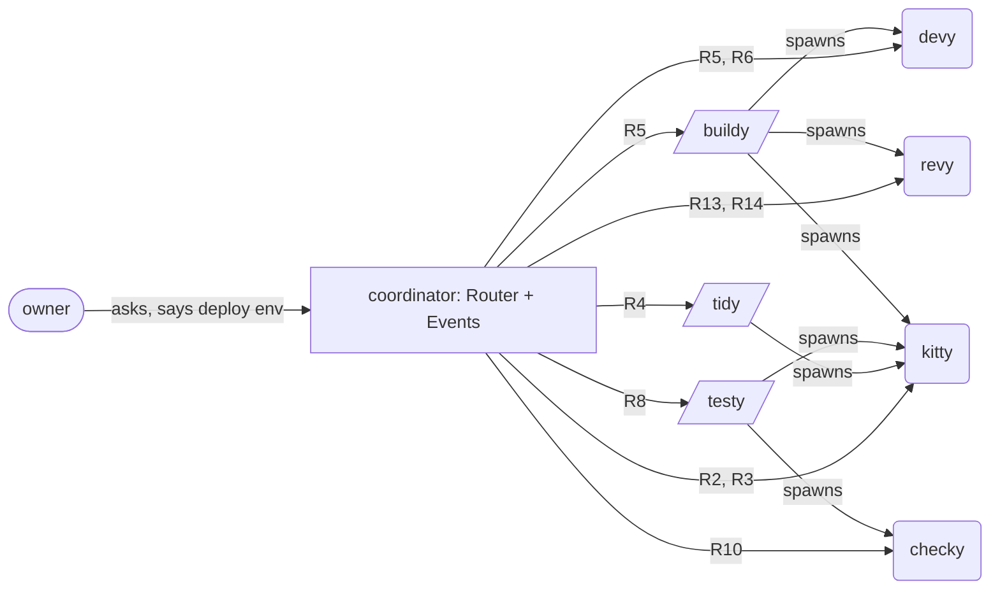
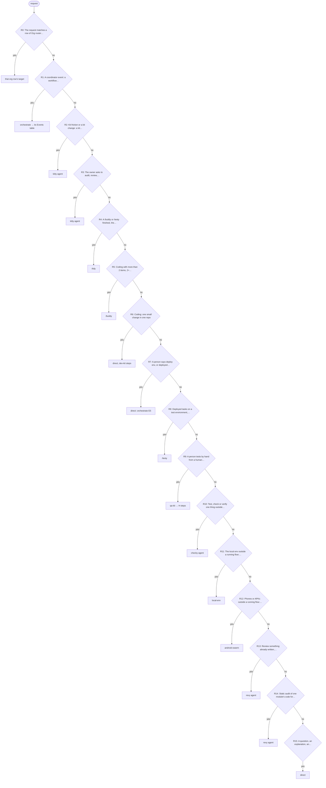
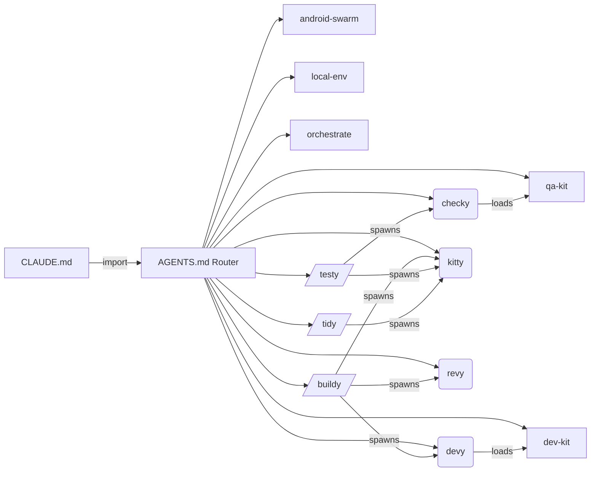

# claude-crew

**[Interactive kit map ->](https://prskid1000.github.io/claude-crew/)** (every command, step, decision and loop; built on each push with the `flow-map` extra)

A multi-agent dev + QA kit for Claude Code (ports for Codex and Antigravity) for **any project type**: any stack, migration tool,
local env shape, test env, deploy mechanism and tracker. Org specifics live only in git-ignored config
(`skills/dev-kit/kit.local.json`, `rules/*.local.md`); the kit assumes no tenants, no web + API + app trio, no database.
Every diagram is generated at pre-commit (`kittool.py flow --readme`) from the manifest, the Router and the flow model.

## The crew
The owner talks to the coordinator; it routes each request to a workflow or one crew member (`kit.example.json` `_manifest`).
<!-- kit-graph:start crew -->

<!-- kit-graph:end -->
<!-- kit-graph:start table-crew -->
| Agent | Job | Kinds / roles | Used in | Can't | Character |
|---|---|---|---|---|---|
| `devy` | builder: makes or changes anything in product repos through the dev flow | feature · fix · refactor · migration · config · doc · tests · spike · repro | /buildy, R5, R6 | deploy, merge into deploy branches, edit the kit | pragmatic builder: "Small, tested, shipped." |
| `revy` | reviewer: reviews anything and suggests concrete changes | mr · kit · doc · qa · plan · module · config | /buildy, R13, R14 | edit anything (suggests only) | sceptical, blunt: "Show me the test." |
| `checky` | tester: tests or verifies anything, always with evidence | task · smoke · regression · repro · data · perf · claim (roles: lead / test / verify) | /testy, R10 | edit code, leave its target, load shared envs | paranoid, evidence-obsessed: "Screenshot or it didn't happen." |
| `kitty` | kit caretaker: the kit and the machine setup | build · fix · audit · retro · setup · env · recover · docs | /tidy, R2, R3 | touch product repos | tidy and frugal: "Measure before and after." |
<!-- kit-graph:end -->
Board and disagreements: AGENTS.md "Crew".

## Router
First matching row wins (from the `AGENTS.md` Router table).
<!-- kit-graph:start router -->

<!-- kit-graph:end -->

## Dev flow (/buildy)
devy codes and tests on the local env in a loop, revy reviews, the workflow merges; only a person's `deploy <env>` ships it.

## Test-only flow (/testy)
checky lead / test / verify per testing doc; the result rule closes the task, fails it back to dev or files one [Bug].
<!-- kit-graph:start table-workflows -->
| Workflow | Covers | Crew | Router row |
|---|---|---|---|
| `/buildy` | any multi-item build: features, fixes, refactors, migrations, bug waves, resume, duels | `devy`, `revy`, `kitty` | R5 |
| `/testy` | any test run: tracker selection, smoke after a deploy, regression sweep, retest, on local or a test env | `checky`, `kitty` | R8 |
| `/tidy` | kit upkeep: learning signals -> lessons + rule updates, cleanup, the weekly audit kick-off | `kitty` | R4 |
<!-- kit-graph:end -->

## Task lifecycle
Logical tracker statuses (`tracker.statuses` maps them to your board's names).

## Local env and deploys
One shared instance per env, branches as layers; deploys wait for a person's word (`deploy.trigger`).

## Budget and handoff
The rule: "Configuration" `budget`; per-tool defaults in the table.
<!-- kit-graph:start table-budget -->
| Tool / window | Budget | Source |
|---|---|---|
| claude-1m | 967000 | Claude Code docs: 1M models compact at ~967k |
| claude-200k | 167000 | conservative 83.5% of 200k (docs: at the limit) |
| codex | 0.9 x window | 0.9 x the models_cache.json window; auto_compact_token_limit wins |
| antigravity | 0.8 x window | unverified: 0.8 x the model window |
| unknown | 160000 | 0.8 x 200k |
<!-- kit-graph:end -->

## Leases
One rule (lib.ps1 `Update-KitLease`, lint LEASE-HOLDER) for env services, browser tabs, phones, builds; only owner
holds (`localenv.ps1 up -Owner`, phone `manual`) keep minutes, with a reminder.

## Recovery after a crash or restart
WIP commits after every dev-flow step, so a fresh agent loses nothing.

## Kit upkeep
The kit learns from every run and fixes itself in a kit worktree.

## Install
```powershell
git clone https://github.com/prskid1000/claude-crew <workspace>/.claude
pwsh -File <workspace>/.claude/skills/orchestrate/orch.ps1 setup -WriteLocal   # git hooks, excludes, .runtime/.state, local config stubs
```
Needs pwsh 7, Python 3.8+, git, Node 18+, `glab` or `gh`; optional: the tracker CLI, `gws`, the Android SDK. Fill
`skills/dev-kit/kit.local.json`, `skills/qa-kit/targets.local.json` (the only place for passwords), `swarm.config.json` (phones);
`npm install` in `skills/qa-kit`. Update: `git pull` once nothing runs.
Org specifics: settings in `kit.local.json` (keys: "Configuration"); org rules, house style, extra CLIs and **Org router rows** (the
Router's columns) in `rules/*.local.md`; products, repos, test envs (names only), deploy rules and tracker statuses there too; org-only
skills listed in `localOnly`.
Not ported to Codex / Antigravity: the SendMessage guard hook, the Workflow and Skill tools, the Antigravity tools allow-list; the
board, learn signals and decision pauses run by hand from the ported procedures.

## Using it
- Ask the main session; the Router launches the rest. The heartbeat (`orch.ps1 supervise -AutoFix -Brief`, every 10 min)
  prints the owner's report: resources and their holders, flags (ACT, WATCH, ❓ ASK). After a restart: `orch.ps1 recover`.
  Every script prints its usage without arguments.

## Extras
Optional parts (more trackers, git hosts, CI and report types, stack presets, kit admin and scaffolding, the duel mode) live on
the `extras` branch, one folder each (`extras/<name>/EXTRA.md`: what, when it is needed, how it is wired):
`python -X utf8 skills/orchestrate/kittool.py extra list | add <name> | remove <name> | check`. `add` writes its files into the
kit as local-only files (`.git/info/exclude`: never pushed, outside the budget). A script that needs a missing one stops with
`<feature> is an extra: run kittool.py extra add <name>`; `orch.ps1 health` / `setup` print the same for config that asks for one.

## Configuration
`skills/dev-kit/kit.local.json`, every key optional; the table is generated from `kit.example.json` (`_readme` / `_doc`).
<!-- kit-graph:start table-config -->
| Key | Example / default | Meaning |
|---|---|---|
| `gitHost`, `gitHostType`, `githubHost`, `gitlabGroup` | gitlab.com | the git host (type from the host) and the group / owner for short refs &lt;repo&gt;!&lt;iid&gt; |
| `reposRoot`, `worktreeRoots`, `repoAliases`, `protectedBranches` | /path/to/src | checkouts (default the workspace), worktrees (&lt;repos&gt;-wt); short repo names; branches never force-pushed; protectedBranchesMode extend (replace: without main/master/develop) |
| `commitStyle`, `locale.cosmeticPattern`, `locale.testCommentPattern`, `locale.proseTerms` |  | subject rule conventional (free / a regex); English defaults: small QA check, testing comment, prose required words ({expected: regex, ...}) |
| `devices` | {"type": "android"} | type: android (default) / ios (Simulators, macOS) / none (verbs refuse, app checks NOT_TESTED) |
| `trackerRepos`, `trackerLists`, `productTargets` | ["backend", "frontend", "mobile-app"] | repos searched for a task's MRs; tracker containers for deploy intest; which env a path needs |
| `holdMerge` | [] | repos (or true = all) whose MRs a person merges (their target deploys): devtools.py merge says NOT_MERGED held for approval |
| `repos` | [{"name": "backend", "aliases": ["api"], "checkout":… | role producer / consumer; migrations.check = the repo's own migration check (else lbcheck; another tool: UNRUN); deploys[] per env (production: true = never tested): CI branch + job (= target: trunk), tag ({date}), probe + probeField / probeRegex (first group; a URL or command printing the live sha), awsStack + region, ssh {host, key, repoDir, appDir, subdir, exclude, service}, manual, laneApk |
| `driveParent` | &lt;Drive folder or shared-drive id (gdocs)&gt; | Drive folder or shared drive for testing docs and reports (reports.type gdocs) |
| `supervise` | {"ramActPct": 90, "minDiskFreeGB": 30, "askOwnerGB": 2,… | heartbeat: ramActPct, minDiskFreeGB, askOwnerGB (a bigger, idle or growing app: one ASK), ramNames (default _manifest.ram), briefSeconds (one -Brief round) |
| `idle` | {"graceMinutes": 10, "beatMinutes": 20} | README Leases: no live holder for graceMinutes -&gt; released; a board beat counts for beatMinutes |
| `cleanup` | {"maxBrowserProfiles": 4} | maxBrowserProfiles: browser profiles kept |
| `bugfixMandate`, `localOnly`, `orgTerms` | ["&lt;the owner's own words asking the coordinator to fix QA-raised… | words for bug waves; org-only kit paths kept out of git; words the pre-push gate blocks |
| `findings` |  | required: the QA finding fields (default root_cause, why_today, why_not_prod, db_migration, code_location) |
| `localFiles` | {"skills/qa-kit/targets.local.json": {"_readme": "One entry per TEST… | example only: orch.ps1 setup -WriteLocal writes targets.local.json and swarm.config.json from it |
| `gitHostApi` | {"commands": {}} |  |
| `ci` | {"type": "host"} |  |
| `tracker` | {"type": "none", "repo": "&lt;owner/name or group/project, for… | type: none (default) / clickup / github / gitlab / jira (Cloud) / jira-server / linear / azure / youtrack / command. Env: jira JIRA_BASE_URL + JIRA_EMAIL + JIRA_API_TOKEN (jira-server or JIRA_TOKEN), linear LINEAR_API_KEY, azure AZURE_DEVOPS_EXT_PAT, youtrack YOUTRACK_URL + YOUTRACK_TOKEN. statuses maps the logical statuses to your board's names (a list = the first is set, all match); statusLabelPrefix: github / gitlab status labels (status:); priorities: names of 1-4, space separated. Examples: _examples. |
| `reports` | {"type": "markdown"} | type: gdocs (Google Doc + Drive evidence via gws; default with gws) / markdown, html, pdf (a kept file; pdf: headless Chrome / Edge or pdfCommand '{in} {out}') / confluence (env CONFLUENCE_URL, CONFLUENCE_TOKEN [+ CONFLUENCE_EMAIL]; space, parent page id) / notion (env NOTION_TOKEN; parent page id) / command (command '&lt;cli&gt; {title} {path} {parent}' printing the URL). share (gdocs): anyone (default) / domain:&lt;domain&gt; / none; confluence / notion: the space / parent page permissions |
| `qa` | {"seatGB": {"web": 1.5, "api": 0.4, "app": 0.4}, "outOfScope": ["&lt;a… | shutterText / confirmText: camera label regexes. outOfScope: channels agent QA never tests (their steps are OUT_OF_SCOPE: reported, never counted). targets: target groups for /testy select runs (target: '&lt;group&gt;'): per task the first rule whose lists / repos / nameRegex / pathRegex match gives its env (localEnv: a local env, live = in its running release). seatGB: RAM one QA seat promises per kind. |
| `deploy` | {"trigger": "owner", "minIntervalHours": {"default": 4, "&lt;target&gt;":… | trigger: owner (default: nobody asks or proposes a deploy; a person says deploy &lt;env&gt; and the coordinator deploys at once) or ask (one batched ask per env, at most one per minIntervalHours: a number, or per target with a default). planTimeoutSec bounds orch.ps1 deploy plan; productionPattern ((?i)prod/critical): production by name when production is unset. |
| `net` | {"timeoutSec": 60} | timeoutSec per git-host / tracker CLI call; transient errors retry, lost tracker writes wait in .state/outbox.jsonl (supervise replays them) |
| `tests` | {"maven": {"testFor": ["{name}Test", "{name}IT"]}} | Per stack (dev.ps1 stack names): the test names -Touched looks for, from a changed source file's base name ({name}). Defaults: maven/gradle {name}Test, {name}Tests, {name}IT; dotnet {name}Tests, {name}Test; python test_{name}, {name}_test; go {name}_test; web {name}.spec, {name}.test. |
| `localEnv` | {"maxLeaseMinutes": 120, "idle": {"minMinutes": 15, "maxMinutes":… | Local envs (local-env skill): the dev flow tests every change here before merge. Any shape: a service is a start command in a folder; envs.&lt;env&gt;.db.engine (postgres, mysql, mariadb, sqlserver, sqlite, oracle, mongodb) + name / user fill the DB hooks. Secrets: &lt;kit&gt;/.state/localenv/&lt;env&gt;.env (dotenv), never here. |
| `memory` | {"keepDefault": false} | keepDefault: false = Claude Code auto memory lives in &lt;kit&gt;/memory/ (git-ignored); true = keep the user's own setting. |
| `kitAudit` | {"everyDays": 7} | everyDays: the SessionStart nudge asks for a kitty audit when the last audit is older (default 7; 0 = off). |
| `build` | {"mavenOffline": true} | mavenOffline: Maven runs with -o when ~/.m2/repository exists (default true). |
| `gate` | {"heapMinGB": 4, "startHeapGB": {"gradle": 12, "maven": 8, "node": 4}} | Memory gate. keepFreeGB (default 15% of RAM, min 6) = RAM every build leaves free; startHeapGB = first heap for a project with no history; heapMinGB = the floor. |
| `budget` | {"handoffAt": 0.8, "runStopAt": 0.8, "estimate": {"devy": 70000,… | An agent's budget = its tool's default compaction point (orch.ps1 budget; defaults below); handoff at handoffAt x budget; a run's cap = its planned agents' budgets (launch -Self -Plan): an estimate over runStopAt x cap is refused with the split, at runStopAt x cap no new item starts (the rest = next). estimate: per agent / item |
<!-- kit-graph:end -->
Env vars: `CLAUDE_RUNTIME`, `CLAUDE_WT_ROOT`, `CLAUDE_AGENT`, `CLAUDE_GATE_KEEP_FREE_GB`, `KIT_TRACKER_TYPE`, `KIT_TRACKER_DRYRUN`,
`KIT_REPORT_TYPE`, `KIT_NET_TIMEOUT_SEC` / `KIT_NET_TRIES` / `KIT_NO_OUTBOX`, `JIRA_BASE_URL` / `JIRA_EMAIL` / `JIRA_API_TOKEN`, `ANDROID_HOME`, `ANDROID_SERIAL`, `CHROME_PATH`.
A repo whose stack is detected wrongly: `.claude-stack.json` next to its build file (`{ "commands": { "test": "make test T={tests}" } }`).

## Adapters
One interface per kind, chosen by config; `command` = your CLI per verb (`{placeholders}` in, JSON out); `kittool.py new adapter <kind> <name>` scaffolds one.
<!-- kit-graph:start table-adapters -->
| Kind | Selected by | Interface (verbs) | Built in | Code |
|---|---|---|---|---|
| tracker | `tracker.type` | view url status comment comments create describe rename attach list owner | clickup, github, gitlab, command, none | `skills/dev-kit/lib.ps1` |
| git-host | `gitHostType` | mr.get mr.list mr.changes mr.create mr.merge mr.unauto mr.url repo.base repo.commit repo.compare | gitlab, github, command | `skills/dev-kit/lib.ps1` |
| report | `reports.type` | publish | gdocs, markdown, html, command | `skills/dev-kit/devtools.py` |
| ci | `ci.type` | runs jobs log status config | gitlab, github, command, none | `skills/dev-kit/lib.ps1` |
| db-engine | `` | snapshot restore | postgres, mysql, sqlserver, sqlite, oracle, mongodb | `skills/local-env/localenv.ps1` |
<!-- kit-graph:end -->

## Layout, state and safety
- `<kit>/.runtime/` disposable (`work/`, `cache/`, `logs/`), `<kit>/.state/` durable; both git-ignored, every path named in
  `kit.example.json` `_paths`; `orch.ps1 cleanup` removes only kit-created leftovers.
- The PreToolUse guard blocks `git stash`, `--no-verify`, force-pushes to shared branches, ungated builds, hand-started dev
  servers and `adb kill-server`. Deploys start only from a person's word. Never production. One machine (the memory gate is
  local); workflows, hooks and skills are Claude Code-only (Codex / Antigravity get ported agents and procedures).
## Extending (change the kit)
The kit is the workspace's `.claude` folder, a git clone of this repo; `kitty` changes it in a kit worktree while runs execute the
live clone, keeps it generic, gets a `revy` review and pushes main. Parts are added, renamed or removed with the `scaffold` extra
(`kittool.py new | rename | remove <kind> <name>`, `new adr <title>`: template, manifest, Router / Events rows, test stub; lint
TODO-STUB refuses unfilled ones); then `port`, lint 0, tests. An optional feature goes to the `extras` branch, not the core.
- **Registry** [MANIFEST, OLD-NAME]: `_manifest` holds every agent, skill, workflow, Router / Events row and cap; README tables,
  Character blocks and ports are generated from it; `renamed` lists old names (no aliases).
- **Formats** [SCHEMA, AGENT-TYPE]: SKILL.md and subagent front matter + the Character shape, JSON-Schema checked; every workflow
  `agent()` names a crew agentType. **Versions**: SemVer tags from Conventional Commits (`kittool.py release`; no CHANGELOG).
  **Decisions**: ADR lines in LESSONS.md "Decisions". Every addition: front matter, manifest entry, reachability edge,
  test, flow node, README row, ports; lint refuses a half-added part.

### Hard rules
- **30 content + 8 plumbing files** [FILE-CAP, PLUMBING-CAP] (`git ls-files` minus the ports and `tests/`; plumbing = LICENSE, .gitignore,
  .gitattributes, .githooks/*, .github/*, settings.json; git-ignored local files never count). One script per area; templates
  fold into a SKILL.md, an agent or `skills/dev-kit/templates.md`; tests in `tests/<area>.tests.ps1` (shared helpers: `tests/harness.ps1`).
- **Token budgets** [BUDGET] (UTF-8 bytes / 4; README graph sections excluded; LESSONS.md: 40 lines per skill), from kittool
  `BUDGETS` and `_manifest.caps`:
<!-- kit-graph:start table-caps -->
always 3500 · skill 3200 · agent 2400 · rule 900 · template 2600 · templates 4000 · doc 7000 · lessons 30000 · workflow 15000 · ps1 58000 · py 77000 · mjs 8000 · json 6600 · tests 39300 · total 428000 · files: 30 content + 8 plumbing
<!-- kit-graph:end -->
  Over a budget: trim first (dense prose, dedupe, never golf that hurts reading); only when trimming cannot make room,
  `kittool.py budget raise -Reason "<why>"` (x1.1, rounded to 1k; the reason goes in the commit message) [BUDGET-CAP refuses any
  other change of the total].
- **Reached from the root** [REACH-NONE, REACH-MENTION]: CLAUDE.md -> AGENTS.md Router -> skill / workflow / agent -> its Files
  row; mentions do not count; every edge has its reason.
- **Generic** [ORG-TERM]: no org, product, tenant, host, id, person, local path or assumed stack; org values -> `kit.local.json`
  (today's behaviour as default), org rules -> `rules/*.local.md`, org lessons -> `LESSONS.local.md`.

### Shapes
- **Script** [SCRIPT-HEADER, RUNTIME-RAW, RUNTIME-MAP, DESKTOP-OPEN]: one entry file per area with verbs; header with usage and
  `Exit codes:` (0 ok · 1 problem · 2 usage); shared params `-Env -Run -Task -Repo -Dir -Agent -Mrs -DryRun -Json -Quiet`; a
  failed call is UNKNOWN, never a state; paths via `Get-KitPath` / `kit_path` / `kitPath` / `rp()`; bounded network calls; no
  desktop opens without `--open` / `-Open` (templates.md "Script header").
- **Skill** [SKILL-DESC, SKILL-BLOCK, FILES-*]: `description: "Load when: ... Not when: ... -> <sibling>."`; blocks Load when,
  Not when, Hands off to, Files (each file with its step), steps, Rules, Learn.
- **Agent** [AGENT-SPAWN, AGENT-SKILL]: description with "Spawned by", "Precondition", "Not for"; `tools` only without MCP needs;
  body: Character, Kind, Load first, non-negotiables (incl. Budget), the `STEP:` rule, report shape, self-improvement.
- **Workflow** [WF-WHEN, WF-CLOCK, WF-CRLF]: `whenToUse` = its router row; every arg in the header; no clock calls; LF; plan +
  budget gate (README "Configuration" `budget`); ends with Learn + cleanup; check with `node --check` and `cost --steps`.
- **Rule**: always-loaded only for short hard rules; else `paths:` front matter ("Rule examples"). **Text** [PROSE]: a row in
  templates.md "Writing standards" per artefact type. **Config key** [CONFIG-UNDOC]: optional, a README "Configuration" row, a
  `kit.example.json` sample. **Hook**: `pwsh` exec form, SessionStart < 2 s, slow work async.

### Before every push
`agents/kitty.md` step 8: `kittool.py lint` (0 problems, 0 counted flow issues), `port` + `port --check`, `tests/kit-tests.ps1
[-Area <area>]` (areas in parallel), `lint --org-terms <kit.local.json>`, `cost --steps` after a workflow change.
pre-commit regenerates README graph sections and ports and blocks on lint (a flow issue with a `flow: <reason>` marker is
deliberate); pre-push blocks stale ports, org terms and local files; commit with `dev.ps1 wt commit`.
### Rule examples
Copy the block into `rules/<name>.md` (org-only: `rules/<name>.local.md`, in `localOnly`) and adapt it; a `paths:` rule loads only
when a matching file is opened.

#### Database migrations (any tool)
```markdown
---
paths: ["**/liquibase/**", "**/db/migration/**", "**/Migrations/**", "**/migrations/**", "**/alembic/versions/**", "**/prisma/migrations/**"]
---
# Database migrations
- Only the id/timestamp range your brief assigns; never edit a merged migration; a rollback / down for every change the tool supports.
- Liquibase: the repo's file naming and include layout; append-only master conflicts: `python <kit>/skills/dev-kit/devtools.py keepboth <file>`;
  `dev.ps1 check -Step migrations` = ISSUES 0 before every push.
- Flyway `V<range>__desc.sql` · Alembic: re-point `down_revision` after a rebase (one head) · EF Core / Prisma / Django: regenerate
  on top of the latest after a rebase, never a merge migration.
```

## How the kit fits together
Generated by `kittool.py flow --readme` (pre-commit); interactive: the `flow-map` extra (public: the kit map above).
<!-- kit-graph:start map -->

<!-- kit-graph:end -->

<!-- kit-graph:start skill-android-swarm -->
```mermaid
flowchart LR
  skills_android_swarm_SKILL_md[android-swarm]
  skills_android_swarm_SKILL_md -->|step A0 / L0: orch.ps1 learn -Read -Skill androi| LESSONS_md[LESSONS.md]
  skills_android_swarm_SKILL_md -->|A1-A4 (acquire, ensure, launch, release, status)| skills_android_swarm_swarm_ps1[swarm.ps1]
```
<!-- kit-graph:end -->

<!-- kit-graph:start skill-dev-kit -->
```mermaid
flowchart LR
  skills_dev_kit_SKILL_md[dev-kit]
  skills_dev_kit_SKILL_md -->|step 0: orch.ps1 learn -Read -Skill dev-kit prin| LESSONS_md[LESSONS.md]
  skills_dev_kit_SKILL_md -->|Writing standards at every step that writes text| skills_dev_kit_templates_md[templates.md]
  skills_dev_kit_SKILL_md -->|steps 1-5 (wt, stack, check, gate, tracker), CI | skills_dev_kit_dev_ps1[dev.ps1]
  skills_dev_kit_SKILL_md -->|library dot-sourced by every kit script (config,| skills_dev_kit_lib_ps1[lib.ps1]
  skills_dev_kit_SKILL_md -->|step 6 (mr, doc, finish), step 7 (merge), rebase| skills_dev_kit_devtools_py[devtools.py]
  skills_dev_kit_SKILL_md -->|step 4: the test runner check -Step test uses fo| skills_dev_kit_spec_mjs[spec.mjs]
  skills_dev_kit_SKILL_md -->|setup: orch.ps1 setup -WriteLocal writes kit.loc| skills_dev_kit_kit_example_json[kit.example.json]
```
<!-- kit-graph:end -->

<!-- kit-graph:start skill-local-env -->
```mermaid
flowchart LR
  skills_local_env_SKILL_md[local-env]
  skills_local_env_SKILL_md -->|step 0: orch.ps1 learn -Read -Skill local-env| LESSONS_md[LESSONS.md]
  skills_local_env_SKILL_md -->|steps 1-6 (envs, status, deploy, wait, use, logs| skills_local_env_localenv_ps1[localenv.ps1]
  skills_local_env_SKILL_md -->|run by localenv.ps1 (devtools.py migrations) to | skills_dev_kit_devtools_py[devtools.py]
```
<!-- kit-graph:end -->

<!-- kit-graph:start skill-orchestrate -->
```mermaid
flowchart LR
  skills_orchestrate_SKILL_md[orchestrate]
  skills_orchestrate_SKILL_md -->|step 0: orch.ps1 learn -Read -Skill orchestrate| LESSONS_md[LESSONS.md]
  skills_orchestrate_SKILL_md -->|every event row (supervise, launch, report, boar| skills_orchestrate_orch_ps1[orch.ps1]
  skills_orchestrate_SKILL_md -->|K2 (lint, flow --readme: the kit-flow page's par| skills_orchestrate_kittool_py[kittool.py]
  skills_orchestrate_SKILL_md -->|K1: Extending (file caps, budgets, part shapes, | README_md[README.md]
  skills_orchestrate_SKILL_md -->|K2: pwsh -File kit/tests/kit-tests.ps1 -Area are| tests_kit_tests_ps1[kit-tests.ps1]
  skills_orchestrate_SKILL_md -->|K3: run by git (orch.ps1 setup sets core.hooksPa| _githooks_pre_commit[pre-commit]
  skills_orchestrate_SKILL_md -->|K3: run by git (orch.ps1 setup sets core.hooksPa| _githooks_pre_push[pre-push]
  skills_orchestrate_SKILL_md -->|K3: run by git (orch.ps1 setup sets core.hooksPa| _githooks_post_merge[post-merge]
```
<!-- kit-graph:end -->

<!-- kit-graph:start skill-qa-kit -->
```mermaid
flowchart LR
  skills_qa_kit_SKILL_md[qa-kit]
  skills_qa_kit_SKILL_md -->|step 0 (and H0, L0): orch.ps1 learn -Read -Skill| LESSONS_md[LESSONS.md]
  skills_qa_kit_SKILL_md -->|step 1 (seat), 2 (deployed), 3 (api, ui), 4 (ann| skills_qa_kit_qa_ps1[qa.ps1]
  skills_qa_kit_SKILL_md -->|L1 Selection (tracker list/view/owner; status -E| skills_dev_kit_dev_ps1[dev.ps1]
  skills_qa_kit_SKILL_md -->|L1 Selection (tracker list/view/owner; status -E| skills_local_env_localenv_ps1[localenv.ps1]
  skills_qa_kit_SKILL_md -->|step 3 (web: read its header first; one logged-i| skills_qa_kit_browser_mjs[browser.mjs]
  skills_qa_kit_SKILL_md -->|L0: npm install in this folder (puppeteer-core)| skills_qa_kit_package_json[package.json]
```
<!-- kit-graph:end -->
