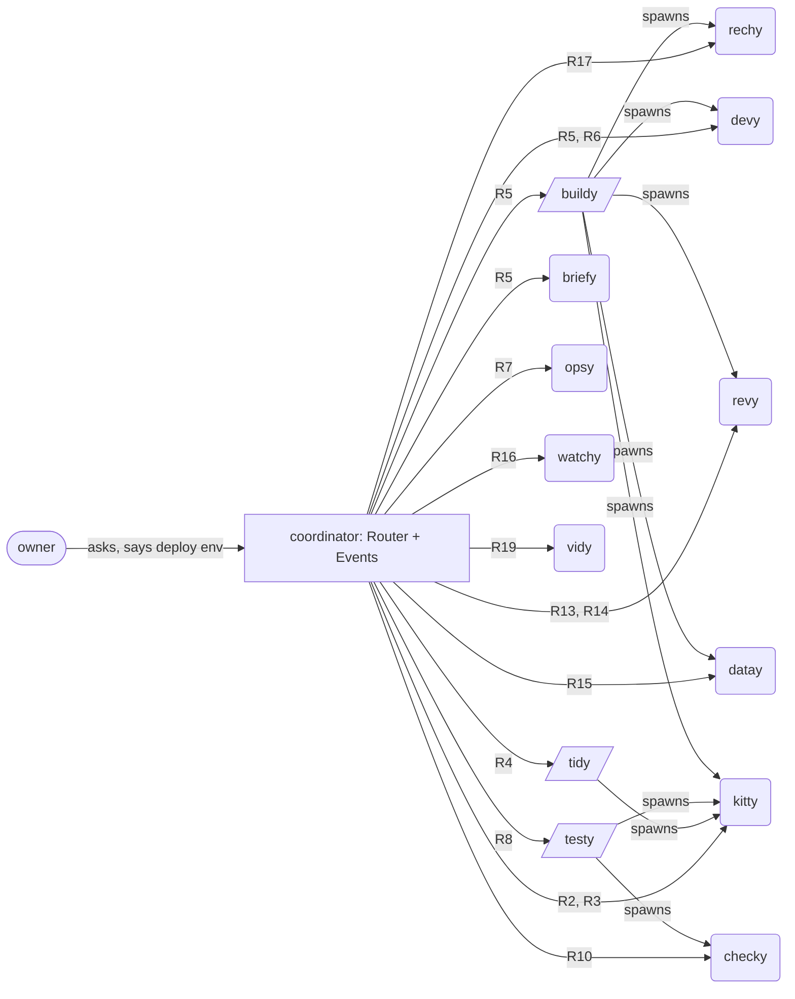
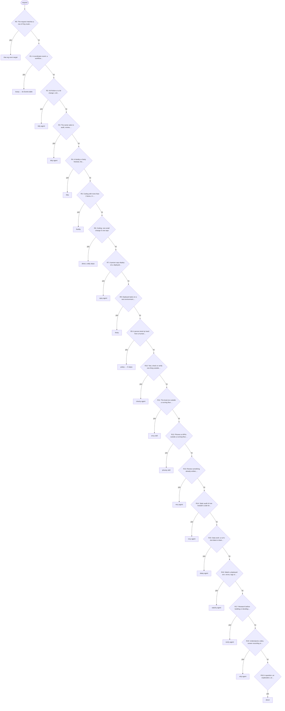
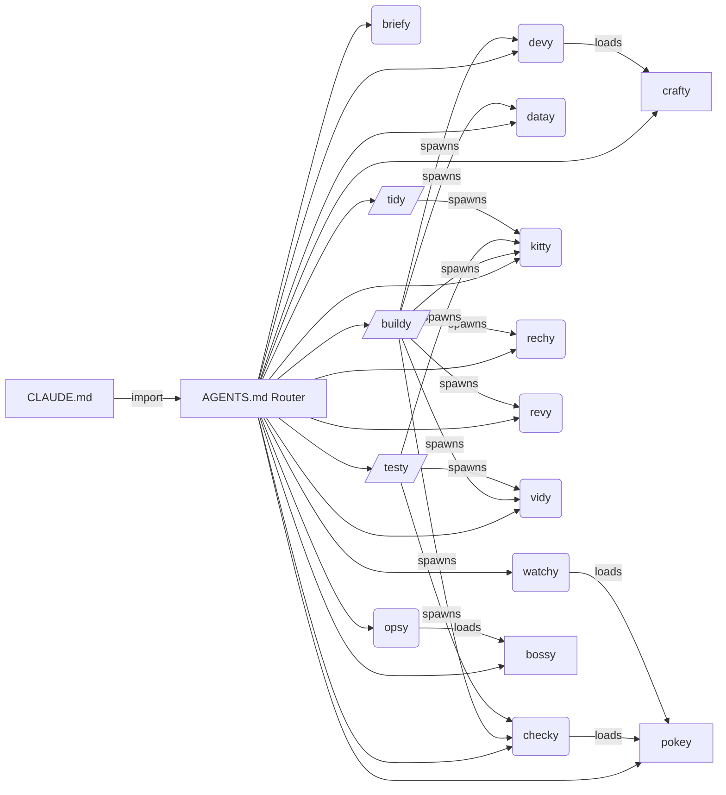
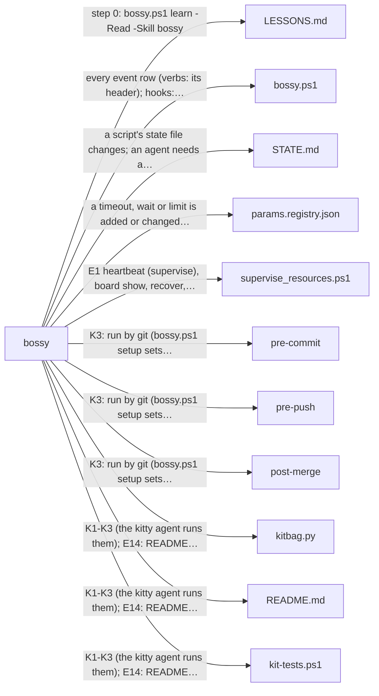
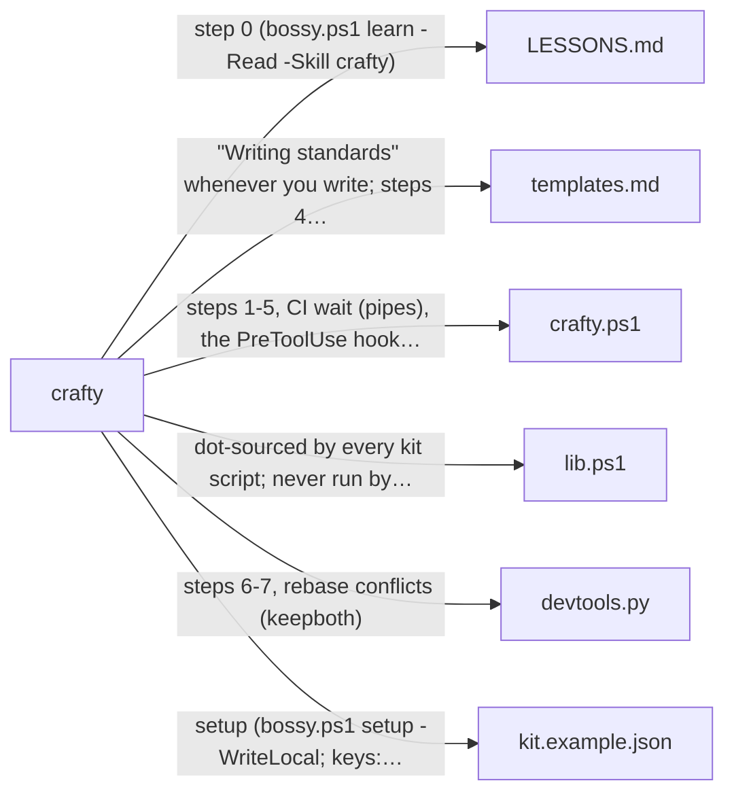
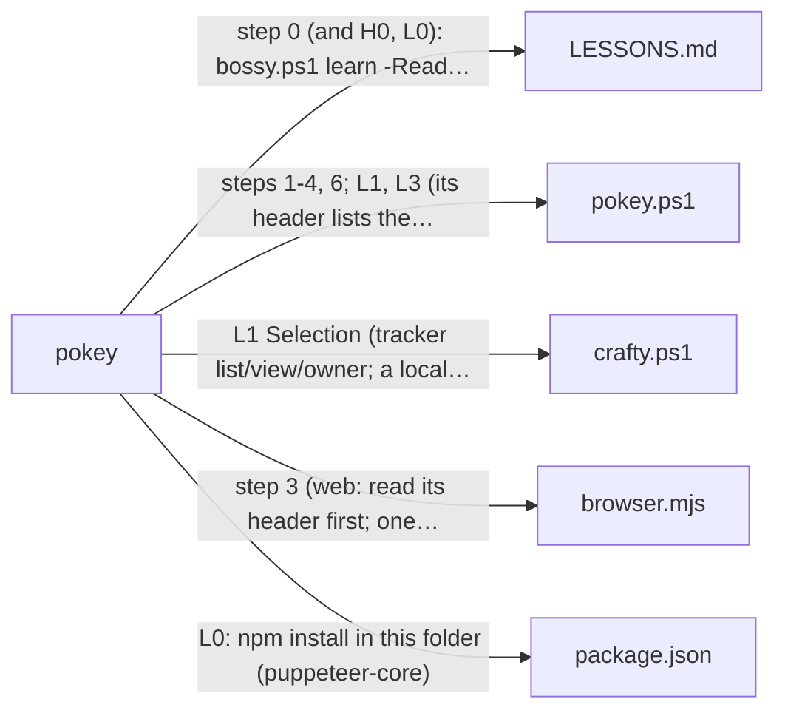

# claude-crew

**[Interactive kit map ->](https://prskid1000.github.io/claude-crew/)** (every command, step, decision and loop; built on each push with the `flow-map` goody)

A multi-agent dev + QA kit for Claude Code (ports for Codex and Antigravity) for **any project type**: any stack, migration tool,
local env shape, test env, deploy mechanism and tracker. Org specifics live only in git-ignored config
(`skills/crafty/kit.local.json`, `rules/*.local.md`); the kit assumes no tenants, no web + API + app trio, no database.
Every diagram is generated at pre-commit (`kitbag.py flow --readme`) from the manifest, Router and flow model.

## The crew
The owner talks to the coordinator; it routes each request to a workflow or one crew member (`kit.example.json` `_manifest`).
<!-- kit-graph:start crew -->

<!-- kit-graph:end -->
<!-- kit-graph:start table-crew -->
| Agent | Job | Kinds / roles | Used in | Can't | Character |
|---|---|---|---|---|---|
| `devy` | builder: makes or changes anything in product repos through the dev flow | feature · fix · refactor · migration · config · doc · tests · spike · repro | /buildy, R5, R6 | deploy, merge into deploy branches, edit the kit | pragmatic builder: "Small, tested, shipped." |
| `revy` | reviewer: reviews anything and suggests concrete changes | mr · kit · doc · qa · plan · module · config | /buildy, R13, R14 | edit anything (suggests only) | sceptical, blunt: "Show me the test." |
| `checky` | tester: tests or verifies anything, always with evidence | task · smoke · regression · repro · data · perf · claim (roles: lead / test / verify) | /testy, R10 | edit code, leave its target, load shared envs | paranoid, evidence-obsessed: "Screenshot or it didn't happen." |
| `kitty` | kit caretaker: the kit and the machine setup | build · fix · audit · retro · setup · env · recover · docs | /tidy, R2, R3 | touch product repos | tidy and frugal: "Measure before and after." |
| `briefy` | brief writer: /buildy brief, contracts, impact check, rule changes | brief · bugfix · rule-change | R5, E8 | write code, launch runs | exacting planner: "Who owns this field?" |
| `rechy` | researcher: cited answers before building or deciding | question · compare · library · licence · spike | /buildy, R17 | edit anything but its findings | skeptical librarian: "Cite it or drop it." |
| `datay` | data guardian: test data, local DB, migration data, backfills | cleanup · fixture · migration · localdb · backfill · check | /buildy, R15, E2, E7 | write production, edit code or the kit | meticulous archivist: "Mark it, count it, then touch it." |
| `opsy` | deploy pilot: deploys on a person's word, verifies, rolls back | deploy · rollback · status · secret | R7, E5 | deploy without a person's word, edit code | cautious pilot: "Checklist first." |
| `watchy` | on-call watcher: errors of deployed envs, one [Bug] per issue | window · sweep · triage | R16, E15 | change systems, deploy, move tasks | calm on-call engineer: "What changed, and since when?" |
| `vidy` | video reader: exact screen text, timed answers | question · index · segment | R19 | edit code, tracker, kit | frame-by-frame witness: "Which frame shows it?" |
<!-- kit-graph:end -->
Board and disagreements: AGENTS.md "Crew".

## Router
First matching row wins (from the `AGENTS.md` Router table).
<!-- kit-graph:start router -->

<!-- kit-graph:end -->

## Flows
- `/buildy`: devy codes and tests on the local env in a loop, revy reviews, the workflow merges; only a person's `deploy <env>`
  ships it (`deploy.trigger`).
- `/testy`: checky lead / test / verify per testing doc; the result rule closes the task, fails it back to dev or files one [Bug].
- Tasks move through logical tracker statuses (`tracker.statuses` maps them to your board's names). The local env: one shared
  instance per env, branches as layers. WIP commits after every dev-flow step: a fresh agent loses nothing after a crash. The kit
  learns from every run (`/tidy`) and fixes itself in a kit worktree.
<!-- kit-graph:start table-workflows -->
| Workflow | Covers | Crew | Router row |
|---|---|---|---|
| `/buildy` | any multi-item build: features, fixes, refactors, migrations, bug waves, resume, duels | `rechy`, `devy`, `revy`, `datay`, `kitty` | R5 |
| `/testy` | any test run: tracker selection, smoke after a deploy, regression sweep, retest, on local or a test env | `checky`, `kitty` | R8 |
| `/tidy` | kit upkeep in 2-5 min: `bossy.ps1 tidy prep` (digest + upkeep, no LLM), then one kitty: lessons + rule updates | `kitty` | R4 |
<!-- kit-graph:end -->

## Budget and handoff
The rule: "Configuration" `budget`; per-tool defaults in the table. Models (`MODELS` in each workflow; `agents[].model` / `items[].model`
win): devy, revy, checky test / verify / prepare = sonnet; close, ci, ship, learn = haiku; one stronger retry = opus; `complex` (buildy,
`bugbrief -Complex`) = the session model. Agents spawned by hand: their agent file's `model`.
<!-- kit-graph:start table-budget -->
| Tool / window | Budget | Source |
|---|---|---|
| claude-1m | 967000 | Claude Code docs: 1M models compact at ~967k |
| claude-200k | 167000 | conservative 83.5% of 200k (docs: at the limit) |
| codex | 0.9 x window | 0.9 x the models_cache.json window; auto_compact_token_limit wins |
| antigravity | 0.8 x window | unverified: 0.8 x the model window |
| unknown | 160000 | 0.8 x 200k |
<!-- kit-graph:end -->

## Leases
One rule (`lib.ps1` `Update-KitLease`, lint LEASE-HOLDER) for env services, browser tabs, phones, builds, runtimes (goody `runtimes`);
only owner holds (`envy.ps1 up -Owner`, phone `manual`; goody `local-env`, goody `android-swarm`) keep minutes, with a reminder.
The local STT server (`local-stt`; goody `media-evidence`): one job at a time, bound to the job's process, its RAM through the memory gate.
The GPU (`gpu.exclusive.<kind>`, `lib.ps1` `Use-KitGpu`): one kind at a time (e.g. lane emulators); another kind waits, supervise
shows `waiting for GPU: held by <holder>`. `processes` (regex): running processes that hold it; `idleExcept` (regex of the kind's own backend):
it also waits while nvidia-smi shows any other GPU process, or `idleMaxMB` (512) used with its backend down; `minFreeMB` (default: the
caller's, lanes 2048; 0 off): waits while nvidia-smi `memory.free` is lower, then refuses naming the GPU processes; no nvidia-smi: one warning, no check.
Test locks (`repos[].exclusiveTests` `[{dir, match, lock}]`, `lib.ps1` `Use-KitLock`): `check -Step test` under `dir` whose test names or
sources match the regex `match` (no names: all) holds lock `lock`;
others queue (`waiting for lock <name> held by <holder> since <t>`), cap = learned `gate.waitMinutes` (context `lock:<name>`), then exit 3; an ended holder is dropped; supervise RAM rows show `lock <name>`.
- **End:** an agent ends with `bossy.ps1 release -Agent <id>` (every lease of that id: lane + its emulator, env and its layers, GPU, build, tabs);
  `board leave` and /buildy, /testy after each agent stage repeat it. A holder on the board with no live entry is dead (its holder
  pid is the shared session process); `supervise -AutoFix` reclaims every kind after the grace (lanes stop with `emu kill`).
- **Log:** `.state/leases.jsonl` (`lib.ps1` `Write-KitLeaseLog`): one line per acquire / release / reclaim / down (kind, name, agent,
  session, run, since, reason); the newest half kept past 1 MB. Last used: `bossy.ps1 status`, the lane and env status (goody `android-swarm`, goody `local-env`).

## Pause and resume
- **Checkpoints** (both paths): each agent runs `crafty.ps1 checkpoint` at every step boundary (worktree, commit, testing goals,
  loop round, MR, review, CI, testing doc, tracker, merge; QA: each check): `work/agents/<id>/resume.json` + `resume.md`. Kit
  state is written atomically (temp + rename) or appended; leases, gate slots and board entries keep their process id with its
  start time (a pid reused after a cold boot holds nothing); a lock whose holder died is taken at once (Windows).
- **Pause** (power off, a day offline): `bossy.ps1 pause -All | -Run <run> [-Reason] [-Wait 10]`. Agents read PAUSE on their
  next `board beat` (and inbox), checkpoint, commit WIP locally, release leases and leave the board `paused`; env services no
  live holder needs stop (goody `local-env`); `.state/pauses/` records runs, launch records, agents, checkpoints and worktree
  heads; it prints "safe to power off". Nothing after it needs the network.
- **Crash** (power loss, kill): SessionStart `health` marks dead board entries and launch records crashed and prints
  `paused/crashed runs: N -> bossy.ps1 resume`.
- **Resume**: `bossy.ps1 resume -All | -Run <run> [-Wait <min>]`. Offline -> says so, stops. Per agent a brief
  (`work/agents/<id>/resume-brief.md`) starting AT its next step: done steps verified (commit present, MR state), never
  redone; the uncommitted diff kept for the interrupted step; journal results kept (`resumeFromRunId`); a run whose MRs all
  merged skipped; then the exact Workflow call. `board join` shows each relaunched agent its CHECKPOINT.
- Kept: commits, diffs, MRs, tracker state, decisions, checkpoints, launch records, coordinator program state (`bossy.ps1
  program set|get`). Lost: agent conversations (a fresh agent from its brief), running builds and tests (rerun), env service
  processes (started on the next lease), browser logins.

## Install
```powershell
git clone https://github.com/prskid1000/claude-crew <workspace>/.claude
pwsh -File <workspace>/.claude/skills/bossy/bossy.ps1 setup -WriteLocal   # git hooks, excludes, .runtime/.state, local config stubs
```
Needs pwsh 7, Python 3.8+, git, Node 18+, `glab` or `gh`; optional: the tracker CLI, `gws`, the Android SDK. Fill
`skills/crafty/kit.local.json`, `skills/pokey/targets.local.json` (the only place for passwords), phones: `swarm.config.json` (goody `android-swarm`);
`npm install` in `skills/pokey`. Update: `git pull` once nothing runs.
Org specifics: settings in `kit.local.json` (keys: "Configuration"); org rules, house style, extra CLIs and **Org router rows** (the
Router's columns) in `rules/*.local.md`; products, repos, test envs (names only), deploy rules and tracker statuses there too; org-only
skills listed in `localOnly`.
Not ported to Codex / Antigravity: the SendMessage guard hook, the live-kit edit guard on Antigravity file edits, the Workflow
and Skill tools, the Antigravity tools allow-list; the board, learn signals and decision pauses run by hand from the ported
procedures.

## Using it
- Ask the main session; the Router launches the rest. The heartbeat (`bossy.ps1 supervise -AutoFix -Brief`; its stderr `NEXT=<n>`
  sets the next one, 5-30 min by state) prints the owner's report: one row per agent / run (ACTIVE, WAITING, FINISHED, STUCK,
  STOPPED; alone: `bossy.ps1 status [-Watch]`), flags (ACT, WATCH, ❓ ASK), then RAM and the resources' holders. After a restart: `bossy.ps1 resume -All`.
  Every script prints its usage without arguments.

## Goodies
Optional parts (more trackers, git hosts, CI and report types, stack presets, the local env, phone lanes, deploys, kit admin and
scaffolding, the duel mode, evidence videos to a text index) live on the origin's `goodies` branch, one folder each; the core stays small.

**Use** (`python -X utf8 skills/bossy/kitbag.py goody <verb>`):
- `list`: the goodies on `origin/goodies` (`*` = installed) · `check`: config that needs a missing goody · `add <name>` /
  `remove <name>`: install / delete its files and list / unlist it in kit.local.json `goodies` (always installed) · `sync`:
  installs every goody whose "Needed when" matches, updates changed ones only while the kit is not behind origin/main (then a
  goody merged into another or into the core, kitbag `MERGED_EXTRAS`, is swapped: old files out, a listed old name relisted) ·
  `test [<name>]`: installed goodies' tests · `prune [--days N] [--dry-run]`: drops goodies unused > N days (default 30;
  /tidy prep passes the learned value) that no "Needed when" asks for and `goodies` does not list.
- Files install at their kit path, local-only (`.git/info/exclude`: never pushed, outside the budget). `sync` runs in
  SessionStart `health`, `setup` and the post-merge hook (a pull is followed by a sync: an old goody may need the new core).
- On demand: a config-named adapter (tracker, git host, ci) missing at lib.ps1 load, or a verb that needs a missing goody, runs
  `goody add <name> --auto` (unlisted) and runs the verb again once; a failed try waits 1 h; `KIT_EXTRA_AUTO=0` turns it off
  (tests). Offline or refused: the stop line `<feature> is a goody: run kitbag.py goody add <name>`.
- Use: the code that runs a goody's adapter, verb, hook or command touches `<state>/extras-used/<file>` once a day.

**Write one** (`kitty`):
- Shape: `goodies/<name>/files/<kit path>` (each file where it installs), `goodies/<name>/GOODY.md` (What; `Needed when:`;
  Wiring), `goodies/<name>/tests.ps1` (`tests/harness.ps1` helpers; runs the `tests-*.ps1` of goodies merged into it).
- `Needed when:` forms, `,` = any: `` `key` = `v` | `w` `` (`` = `*` ``: set; `*` in a key walks keys and list items:
  `repos.*.ci`), `` `key` ~ `v` `` (contains), `` `<path>` exists ``, `` `<glob>` in a repo `` (a `repos[].checkout` tracks one),
  `` `<os>` OS `` (windows, linux, macos), `` origin ~ `v` `` (the kit's or a repo's origin URL); `Needed when (<file>.json):` reads that
  file. Listed in `goodies`: always installed.
- Seam: core calls the goody when it is loaded, else prints the stop line; never a broken reference (lint and tests pass without
  it).
- Move a core part out: `git grep` its callers, a seam at each, its files + tests to `goodies/<name>/`, README / Files rows /
  manifest updated; lint + tests on main, `goody test <name>` with it.
- Publish: `git -C <kit> worktree add -b kit/goodies-<date> <dir> origin/goodies`, commit, `git push origin HEAD:goodies`.
- `main` and `goodies` are protected: fast-forward pushes only (on a reject: fetch, rebase), never force or delete. The guard
  denies force, delete and move from the kit clone and its worktrees; `bossy.ps1 setup` sets it on the kit origin (host verb `branch.protect`;
  hosts without it: the by-hand line), `health` reports it missing.

## Configuration
`skills/crafty/kit.local.json`, every key optional; the table is generated from `kit.example.json` (`_readme` / `_doc`).
<!-- kit-graph:start table-config -->
| Key | Example / default | Meaning |
|---|---|---|
| `gitHost`, `gitHostType`, `githubHost`, `gitlabGroup` | gitlab.com | the git host (type from the host) and the group / owner for short refs &lt;repo&gt;!&lt;iid&gt; |
| `reposRoot`, `worktreeRoots`, `repoAliases`, `protectedBranches` | /path/to/src | checkouts (default the workspace), worktrees (&lt;repos&gt;-wt); short repo names; branches never force-pushed; `protectedBranchesMode` extend (replace: without main/master/develop) |
| `commitStyle`, `locale.testCommentPattern`, `locale.proseTerms` |  | subject rule conventional (free / a regex); English defaults: testing comment, prose required words ({expected: regex, ...}) |
| `devices` | {"type": "android"} | type: android (default) / none (verbs refuse, app checks NOT_TESTED); ios: goody ios-simulator |
| `trackerRepos`, `trackerLists`, `productTargets` | ["backend", "frontend", "mobile-app"] | repos searched for a task's MRs; tracker containers for deploy intest; which env a path needs |
| `holdMerge` | [] | repos (or true = all) whose MRs a person merges (their target deploys): devtools.py merge says NOT_MERGED held for approval |
| `repos` | [{"name": "backend", "aliases": ["api"], "checkout":… | role producer / consumer; migrations.check = its own check (else Liquibase: goody liquibase; another tool: UNRUN); exclusiveTests: README Leases; regenerate: wt sync conflicts in them -&gt; target's copy, run ({mr} {target}), amend, push; ci.mrPipelines false = MRs get no pipeline (CI only on deploy branches): pipes says no-ci, devtools.py merge merges on review + local checks; deploys[] per env (production: true = never tested): CI branch + job (= target: trunk), laneApk; ssh, awsStack, probe, tag, manual: goody deploys |
| `driveParent` | &lt;Drive folder or shared-drive id (gdocs)&gt; | Drive folder or shared drive for testing docs and reports (reports.type gdocs) |
| `supervise` | {"ramActPct": 90, "minDiskFreeGB": 30, "askOwnerGB": 2,… | heartbeat: ramActPct, minDiskFreeGB, askOwnerGB (a big, idle or growing app: one ASK), ramNames (_manifest.ram), briefSeconds; heartbeatMinutes (15): base of NEXT=&lt;n&gt; (5-30; manyAgents 8); stuckMinutes (20): idle, no named wait = STUCK; shellStuckMinutes (30, learned): a flat-CPU agent shell older = STUCK; finishedMinutes (30): -Brief drops older FINISHED rows |
| `idle` | {"graceMinutes": 10} | README Leases: no live holder for graceMinutes -&gt; released; a board beat counts for beatMinutes |
| `cleanup` | {"maxBrowserProfiles": 4} | maxBrowserProfiles: browser profiles kept; worktreeDays (7): a clean worktree whose remote branch is gone goes after that idle time (branch kept); dirty: only reported |
| `localOnly`, `orgTerms`, `goodies` | ["skills/&lt;org-only-skill&gt;", "&lt;another org-only path&gt;"] | org-only kit paths kept out of git; words the pre-push gate blocks; goodies: goody sync always installs them (add lists, remove unlists) |
| `localFiles` | {"skills/pokey/targets.local.json": {"_readme": "One entry per TEST… | example only (setup -WriteLocal) |
| `localEnv` |  | local envs the dev flow tests on before merge; `defaults` / `envs.&lt;env&gt;.extends` share one shape (shape + example: goody local-env SKILL.md) |
| `runtimes` |  | machine runtimes agents lease (container engine, WSL distro, VM): &lt;name&gt;: isUp, up, down, match (shape: goody runtimes GOODY.md) |
| `media` |  | evidence videos -&gt; text index (goody media-evidence GOODY.md) |
| `gpu` |  | exclusive.&lt;kind&gt;.processes (regex): one kind on the GPU at a time; unset: no limit |
| `gitHostApi` | {"commands": {}} |  |
| `ci` | {"type": "host"} |  |
| `tracker` | {"type": "none", "repo": "&lt;owner/name, for github issues&gt;", "list":… | type: none (default) / command; github, clickup, gitlab, jira, jira-server, linear, azure, youtrack: goodies (kitbag.py goody list). statuses maps logical statuses to your board's names (a list = the first is set, all match); statusLabelPrefix: github status labels (status:); priorities: names of 1-4, space separated; branchTag: branch / MR task tag; bugPrefix: defect names. Examples: _examples, a goody's GOODY.md. |
| `reports` | {"type": "markdown"} | type: markdown, html (a kept file) / command ('&lt;cli&gt; {title} {path} {parent}' prints the URL); gdocs (Google Doc + Drive evidence via gws; default with gws), pdf, confluence, notion: goodies. share (gdocs): anyone (default) / domain:&lt;domain&gt; / none |
| `qa` | {"seatGB": {"web": 1.5, "api": 0.4, "app": 0.4}, "outOfScope": ["&lt;a… | shutterText / confirmText: camera label regexes. outOfScope: channels agent QA never tests (steps OUT_OF_SCOPE: reported, not counted). targets: target groups for /testy select runs (target: '&lt;group&gt;'): per task the first rule matching lists / repos / nameRegex / pathRegex gives its env (localEnv: a local env, live = in its running release). seatGB: RAM one QA seat promises per kind. |
| `deploy` | {"trigger": "owner", "minIntervalHours": {"default": 4, "&lt;target&gt;":… | trigger: owner (default: a person says deploy &lt;env&gt;; nobody asks) or ask (one batched ask per env, at most one per minIntervalHours: a number or per target, with a default). planTimeoutSec bounds supervise's deploy plan per test env (late = UNKNOWN; direct: -TimeoutSec 100); productionPattern ((?i)prod/critical): production by name when production is unset. |
| `net` | {"timeoutSec": 60} | timeoutSec per git-host / tracker CLI call; transient errors retry; lost tracker writes wait in .state/outbox.jsonl (supervise replays) |
| `tests` | {"maven": {"testFor": ["{name}Test", "{name}IT"]}} | Per stack (crafty.ps1 stack names): test names -Touched derives from a changed file's base name ({name}). Defaults: maven/gradle {name}Test, {name}Tests, {name}IT; dotnet {name}Tests, {name}Test; python test_{name}, {name}_test; go {name}_test; web {name}.spec, {name}.test. |
| `guard` | {"layout": "warn"} | layout: warn (default) / block: an agent's own write into .runtime / .state outside the _paths names (crafty.ps1 dir gives its place; kit scripts are exempt). |
| `memory` | {"keepDefault": false} | keepDefault: false = Claude Code auto memory lives in &lt;kit&gt;/memory/ (git-ignored); true = the user's own setting. |
| `kitAudit` | {"everyDays": 7} | everyDays: SessionStart nudges a kitty audit when the last is older (default 7; 0 = off). |
| `build` | {"mavenOffline": true} | mavenOffline: Maven runs with -o when ~/.m2/repository exists (default true). |
| `gate` | {} | Memory gate. keepFreeGB (default 15% of RAM, min 6) = RAM every build leaves free; startHeapGB, heapMinGB: goody build-heap; cacheFlush (unset) = a command supervise -AutoFix runs when a gate head waited 10+ min and the file cache is 25%+ of RAM (at most every 30 min). |
| `storage` | {"watch": [], "sampleSeconds": 60, "keepDays": 30, "watchFreeGB": 50,… | bossy.ps1 storage: free space per fixed drive every sampleSeconds, .state/storage (keepDays). ACT + rescue: a fill sustained 10 min, full within actHours or factor x the learned normal (&gt;= minRateGBh) below watchFreeGB; floors (watchFreeGB, supervise.minDiskFreeGB) on kit-path drives only. Rescue: the db query holding temp killed, builds held holdMinutes. Scans (background): a drop &gt;= scanDropGB (scanCooldownMin), scanHours, ACT; defaults + watch[] + learned children (drillGB, flatDays). db.use: &lt;id&gt; &lt;temp GB&gt; &lt;seconds&gt; &lt;query&gt; per query; db.kill: {id}; over db.maxGB (5): killed. TODO-PARAM. |
| `params` | {"learning": "on", "shadowDays": 14} | Tunable parameters (bossy.ps1 param show): skills/bossy/params.registry.json lists every key (config: a fixed default); each learned key starts at its default, learns both ways from live observations (.state/params.json, per machine) within default/4..x4: a failure (timeout, OOM, short: a holder back after its grace, a handoff, 2+ new ACTs in one sweep) steps to the safe side from the next use (x1.5 or the need); a risky step &lt;= 10% a day after 5 new observations, none for 7 d after a failure; shadowDays: shown only, then applied; past 2x the default: an owner yes (param approve). A kit.local.json value = a pin (no learning); learning on / shadow / off. |
| `budget` | {"handoffAt": 0.8, "runStopAt": 0.8, "estimate": {"devy": 70000,… | An agent's budget = its tool's default compaction point (bossy.ps1 budget; defaults below); handoff at handoffAt x budget; a run's cap = its planned agents' budgets (launch -Self -Plan): an estimate over runStopAt x cap is refused with the split; at runStopAt x cap no new item starts (rest = next). estimate: per agent / item |
<!-- kit-graph:end -->
Env vars: `CLAUDE_RUNTIME`, `CLAUDE_WT_ROOT`, `CLAUDE_AGENT`, `CLAUDE_GATE_KEEP_FREE_GB`, `KIT_TRACKER_TYPE`, `KIT_TRACKER_DRYRUN`,
`KIT_REPORT_TYPE`, `KIT_NET_TIMEOUT_SEC` / `KIT_NET_TRIES` / `KIT_NO_OUTBOX`, `CHROME_PATH`; goodies name their own (GOODY.md).
A repo whose stack is detected wrongly: `.claude-stack.json` next to its build file (`{ "commands": { "test": "make test T={tests}" } }`).

## Adapters
One interface per kind, chosen by config; `command` = your CLI per verb (`{placeholders}` in, JSON out); `kitbag.py new adapter <kind> <name>` scaffolds one.
<!-- kit-graph:start table-adapters -->
| Kind | Selected by | Interface (verbs) | Built in | Code |
|---|---|---|---|---|
| tracker | `tracker.type` | view url status comment comments create describe rename attach list owner | command, none | `skills/crafty/lib.ps1` |
| git-host | `gitHostType` | mr.get mr.list mr.changes mr.create mr.merge mr.unauto mr.url repo.base repo.commit repo.compare branch.protect | command | `skills/crafty/lib.ps1` |
| report | `reports.type` | publish | markdown, html, command | `skills/crafty/devtools.py` |
| ci | `ci.type` | runs jobs log status config | command, none | `skills/crafty/lib.ps1` |
| transcript | `board tool` | root last | claude, codex, antigravity, none | `skills/crafty/lib.ps1` |
<!-- kit-graph:end -->

## Layout, state and safety
- `<kit>/.runtime/` disposable (`work/` runs, `cache/` rebuildable, `logs/` service logs), `<kit>/.state/` durable; both
  git-ignored. `kit.example.json` `_paths` is the one map: scripts resolve names (`Get-KitPath`, `kit_path`, `kitPath`, `rp()`;
  lint RUNTIME-RAW), `_paths.keep` the retention per name, `_paths.schema` the schema per name (`skills/bossy/STATE.md`, `kitbag.py state lint`). Agents write only under `crafty.ps1 dir`: `work/agents/<agent>/[<item>/]`
  (scratch) and `work/evidence/<item>/` (`<agent>-<what>.<ext>`); names lowercase-kebab, dates ISO. The guard notes any other
  write into either root (`guard.layout: block` denies it).
- Logs: every line through kitlog (`Write-KitLog`, `kitlog()`; lint LOG-DIRECT), masked, with time, run, agent, task, script,
  verb: streams `calls` (each verb's start / end, rc, ms), `builds` (gate wait, peak, code), `env`, `guard` in
  `.state/audit/<date>/<stream>.jsonl` (30 d); `signals`, `decisions-log`, `deploy-log` in their `.state` files (raw for the learned
  `logs.keepDays`, then one line per month in `logs-summary.jsonl`: cleanup); `params-changes` (append-only).
  `bossy.ps1 audit -Run | -Agent | -Task [-Since]` merges them with the workflow journal and the board into one timeline.
- `bossy.ps1 cleanup [-DryRun]` removes only kit-created leftovers: `_paths.keep` ages, entries off the layout (runtime root
  after 3 d, `work/` 14 d, `cache/`, `logs/` 30 d; durable ones listed only), worktrees + local branches whose MR merged at the
  tip or whose tip is in origin's default branch (clean, unclaimed; `-WorktreesOnly`); Claude session temp: reported only.
- The PreToolUse guard blocks `git stash`, `--no-verify`, force-pushes to shared branches, ungated builds, hand-started dev
  servers, `adb kill-server`, Git Bash `/d/...` paths handed to Windows programs (node, python, java, curl, ...) and edits
  to the live kit clone's tracked or new files (edit a kit worktree; a deliberate live edit: `KIT_LIVE_EDIT=1` in the session env or the command),
  a raw `glab mr create` / `gh pr create` without `<tag><id>` in title or branch and a raw `glab mr merge` / `gh pr merge` of an MR no
  task tracks (an MR with no task: `KIT_NO_TASK=<reason>`, logged). Deploys start only from a person's word. Never production. One
  machine (the memory gate is local); workflows, hooks and skills are Claude Code-only (Codex / Antigravity get ported agents and procedures).
## Extending (change the kit)
The kit is the workspace's `.claude` folder, a git clone of this repo; `kitty` changes it in a kit worktree while runs execute the
live clone, keeps it generic, gets a `revy` review and pushes main; an optional feature goes to the `goodies` branch, not the core.
The rules, part shapes, lint codes and pre-push checks: `skills/bossy/kit-admin.md` (goody `kit-admin`). A script over
~2,000 tokens opens each part with a `# ---- <name>: <what>` line (`// ----` in JS) and maps them in a `Sections:` header line
(`kitbag.py sections --fix`; lint SECTION-MAP, SECTION-UNMAPPED; a section over 600 lines: audit WARN SECTION-BIG). Token budgets
(lint BUDGET; UTF-8 bytes / 4, README graph sections excluded; `kitbag.py budget` prints both totals). The kit total measures
what agents load; `tests/` has its own cap (all tests, lint BUDGET-TESTS) because agents never load it:
<!-- kit-graph:start table-caps -->
always 3500 · skill 3200 · agent 2400 · rule 900 · template 2600 · templates 4000 · doc 7000 · lessons 30000 · workflow 15000 · ps1 58000 · py 77000 · mjs 8000 · json 7000 · tests 9000 · total 322000 · all tests 65000 · files: 33 content + 8 plumbing
<!-- kit-graph:end -->

One behaviour, one test case: core in `tests/`, a goody's in `goodies/<name>/tests.ps1`, shared setup in `tests/harness.ps1`; a case name
(its PASS / FAIL line) seen twice fails `tests/kit-tests.ps1` (TEST-DUP).

## Rule examples
Path-scoped rule templates to copy into `rules/` (database migrations, any tool):
`skills/bossy/kit-admin.md` "Rule examples" (goody `kit-admin`).

## How the kit fits together
Generated by `kitbag.py flow --readme` (pre-commit); interactive: the `flow-map` goody (public: the kit map above).
<!-- kit-graph:start map -->

<!-- kit-graph:end -->

<!-- kit-graph:start skill-bossy -->

<!-- kit-graph:end -->

<!-- kit-graph:start skill-crafty -->

<!-- kit-graph:end -->

<!-- kit-graph:start skill-pokey -->

<!-- kit-graph:end -->
