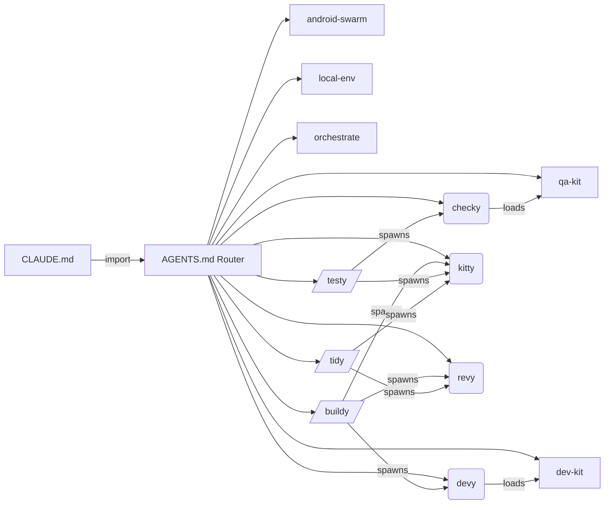
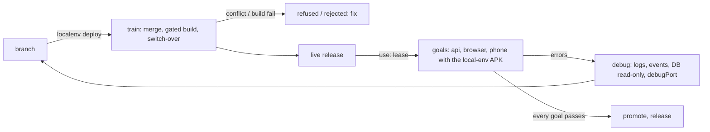
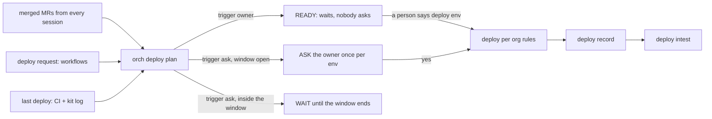

```mermaid
flowchart LR
  T([task / bug]) --> C[devy: code]
  C --> G[testing-goals doc]
  G --> R{bug?}
  R -->|yes| RP[reproduce on the local env]
  R -->|no| L
  RP --> L[local test loop: deploy branch, lease, run every goal]
  L -->|goal fails, < 3 rounds| C
  L -->|3 rounds failed| SR[one stronger fix round]
  SR -->|still failing| B[[held: the coordinator decides]]
  L -.->|coordinator-only env fix| EF[[ENV-FIX: the coordinator fixes, the item waits]]
  EF -.->|done| L
  C -.->|behaviour not asked for / several paths| D[[decision request: the item waits]]
  D -.->|owner answers| C
  L -->|every goal passes| V[review + CI]
  V -->|findings / red| C
  V -->|clean, green| M[merge, producers first]
  M --> H[human testing doc + tracker promoted]
  H --> DB[merged work waits: nobody asks]
  DB -->|a person says deploy env| DP[deploy at once + record]
  DP --> IT[tracker inTest]
  IT --> HT([testers close it, or failedTesting -> back to dev])
```

# claude-crew

**[Interactive kit map ->](https://prskid1000.github.io/claude-crew/)** (every command, step, decision and loop; built by `kittool.py flow --public` on each push)

A multi-agent dev + QA kit for Claude Code (with ports for Codex and Antigravity) for **any project type**: any stack (JVM,
.NET, Node / web frameworks, Python, Go, Rust, mobile, native; one repo or many), any migration tool, any local env shape, test
environment, deploy mechanism and issue tracker. Everything org- or product-specific lives in git-ignored config
(`skills/dev-kit/kit.local.json`, `rules/*.local.md`); the kit itself assumes no tenants, no web + API + app trio, no database.

## The crew
Four agents, one per lifecycle job, no general-purpose agent (a mechanical step is a `STEP:` prompt); the table is generated
from the manifest (`kit.example.json` `_manifest`).
<!-- kit-graph:start table-crew -->
| Agent | Job | Kinds / roles | Used in | Can't | Character |
|---|---|---|---|---|---|
| `devy` | builder: makes or changes anything in product repos through the dev flow | feature · fix · refactor · migration · config · doc · tests · spike · repro | /buildy, R5, R6 | deploy, merge into deploy branches, edit the kit | pragmatic builder: "Small, tested, shipped." |
| `revy` | reviewer: reviews anything and suggests concrete changes | mr · kit · doc · qa · plan · module · config | /buildy, R13, R14 | edit anything (suggests only) | sceptical, blunt: "Show me the test." |
| `checky` | tester: tests or verifies anything, always with evidence | task · smoke · regression · repro · data · perf · claim (roles: lead / test / verify) | /testy, R10 | edit code, leave its target, load shared envs | paranoid, evidence-obsessed: "Screenshot or it didn't happen." |
| `kitty` | kit caretaker: the kit and the machine setup | build · fix · audit · retro · setup · env · recover · docs | /tidy, R2, R3 | touch product repos | tidy and frugal: "Measure before and after." |
<!-- kit-graph:end -->
- **Character** (traits, bias, catchphrase, never) shapes judgement and tone, never a rule. **Board**: every agent's step 0
  `orch.ps1 board join` lists the live agents on this machine; holders are asked with `board msg`. **Disputes**: `board dispute`,
  one evidence answer, still split after 2 rounds -> the owner judges (`decide ask`). **Duels**: `/buildy mode: 'duel'`, two devy
  POCs, revy compares and fact-checks a 3-round debate, the owner picks the winner.

## The two flows
- **Dev** = `devy` -> `revy` -> CI -> merge: code -> testing-goals doc -> local env test loop (bounded) -> review + CI -> merge
  (producers first), human testing doc, `promoted` -> waits for a person's `deploy <env>` -> `inTest` -> closed, or failed testing.
- **Test-only** = `checky` lead / test / verify: all pass -> closed · own check failed or incomplete -> `failedTesting` · new
  defect -> one `[Bug]` under the ask. **Kit** = `kitty` -> `revy` -> push main.
- **Budget** and **decision pauses**: AGENTS.md "The two flows"; the rule: "Configuration" `budget`.
## Workflows
<!-- kit-graph:start table-workflows -->
| Workflow | Covers | Crew | Router row |
|---|---|---|---|
| `/buildy` | any multi-item build: features, fixes, refactors, migrations, bug waves, resume, duels | `devy`, `revy`, `kitty` | R5 |
| `/testy` | any test run: tracker selection, smoke after a deploy, regression sweep, retest, on local or a test env | `checky`, `kitty` | R8 |
| `/tidy` | kit upkeep: learning signals -> lessons + rule updates, cleanup, the weekly audit kick-off | `kitty` | R4 |
<!-- kit-graph:end -->

## Install
```powershell
git clone https://github.com/prskid1000/claude-crew <workspace>/.claude
pwsh -File <workspace>/.claude/skills/orchestrate/orch.ps1 setup -WriteLocal   # git hooks, excludes, .runtime/.state, local config stubs
```
Needs pwsh 7, Python 3.8+, git, Node 18+, `glab` or `gh`; optional: the tracker CLI, `gws`, the Android SDK. Fill
`skills/dev-kit/kit.local.json`, `skills/qa-kit/targets.local.json` (the only place for passwords), `swarm.config.json` (phones);
`npm install` in `skills/qa-kit`. Update: `git pull`, then `orch.ps1 setup -Migrate` once nothing runs if health says so.

## Using it
- Ask the main session; the `AGENTS.md` Router launches `/buildy`, `/testy`, `/tidy` or one crew member. One heartbeat
  (`orch.ps1 supervise -AutoFix -Brief`, every 10 min) prints the owner's report (RAM, resources, flags) and the coordinator
  acts on its flags; after a restart `orch.ps1 recover`.
- Every script prints its usage without arguments.
## Configuration (`skills/dev-kit/kit.local.json`; every key optional; `kit.example.json` shows each)
| Key | Default | Meaning |
|---|---|---|
| `tracker` | `{ "type": "none" }` | `type` clickup / github / gitlab / jira / none; `statuses` maps open, inProgress, review, promoted, inTest, failedTesting, closed; `list`, `repo`, `owner`, `branchTag`, `issueType`, `subtaskType` |
| `gitHost`, `gitHostType`, `githubHost`, `gitlabGroup` | `gitlab.com`, from gitHost, `github.com`, none | the git host and the group/owner for short refs `<repo>!<iid>` |
| `holdMerge` | `[]` | repos (or `true` = all) whose MRs a person merges (their target deploys): `devtools.py merge` says NOT_MERGED "held for approval" |
| `repos` | none | `[{ name, aliases, checkout, target, linkFrom, linkFromByTarget, linkPaths, deploys }]`; `deploys[]` per test env: CI `branch` + `job`, `awsStack` + `region`, `ssh {host, key, repoDir, appDir, subdir, exclude, service}`, `manual`, `laneApk` |
| `reposRoot`, `worktreeRoots`, `repoAliases`, `protectedBranches` | workspace, `<repos>-wt`, `{}`, `[]` | where checkouts and worktrees live; short repo names; branches never force-pushed |
| `trackerRepos`, `trackerLists`, `productTargets` | `[]` | repos searched for a task's MRs; tracker containers for `deploy intest`; which env a path needs |
| `localEnv` | none | local envs (local-env skill): `envs.<env>.services[] {name, repo, dir, start, build, artifact, port, debugPort, health, dependsOn, hot, external}`, `tasks`, `smoke`, `db {snapshot, restore, rollback, applied, tag}`, `sandbox`, `migrations` rules, lease / idle limits |
| `deploy.trigger` | `owner` | `owner`: nobody asks or proposes a deploy, a person says `deploy <env>` and it runs end to end; `ask`: one batched ask per env (supervise DEPLOY ASK) |
| `deploy.minIntervalHours`, `deploy.planTimeoutSec` | `4`, `180` | `ask` only: one ask per test env per window (a number or `{ "default": 4, "<target>": 24 }`); `deploy plan`'s wall clock |
| `budget.handoffAt`, `runStopAt`, `estimate`, `defaults` | `0.8`, `0.8`, per role, the table below | **The budget rule:** an agent's budget = the DEFAULT compaction point of its tool, detected at runtime (`orch.ps1 budget`; the kit writes no compaction setting); handoff at `handoffAt` x budget (resume brief, fresh agent); a run's cap = the sum of its planned agents' budgets (`launch -Self -Plan`): estimate over `runStopAt` x cap = refused with the split (`batch`), at `runStopAt` x cap no new item starts, the rest returns as `next` |
| `net.timeoutSec` | `60` | per git-host / tracker call (devtools.py: one deadline for all tries, max 120 s); reads retry transient failures, writes never; lost tracker writes wait in `.state/outbox.jsonl` (supervise replays) |
| `tests.<stack>.testFor` | per stack | test names `check -Touched` looks for from a changed file's `{name}` |
| `reports.type`, `driveParent` | gdocs when `gws` exists, else markdown | QA reports and testing docs: Google Docs or files |
| `qa.outOfScope` | `[]` | channels agent QA never tests (OUT_OF_SCOPE) |
| `qa.targets` | `{}` | target groups for `/testy` `select` runs: `<group>: [{ lists?, repos?, nameRegex?, pathRegex?, target, localEnv? }]` (first match = the item's env) |
| `gate.keepFreeGB`, `gate.startHeapGB`, `gate.heapMinGB` | 15% of RAM (min 6), per tool, 4 | the memory gate |
| `supervise.ramActPct`, `supervise.minDiskFreeGB` | 90, 30 | heartbeat thresholds |
| `kitAudit.everyDays`, `cleanup.maxBrowserProfiles`, `memory.keepDefault`, `build.mavenOffline` | 7, 4, false, true | audit nudge, browser profiles kept, auto-memory location, Maven -o |
| `bugfixMandate`, `localOnly`, `orgTerms` | none | words for bug waves; org-only kit paths kept out of git; words the pre-push gate blocks |
| `localFiles` (example only) | — | `orch.ps1 setup -WriteLocal` writes `targets.local.json` and `swarm.config.json` from it |
Env vars: `CLAUDE_RUNTIME`, `CLAUDE_WT_ROOT`, `CLAUDE_AGENT`, `CLAUDE_GATE_KEEP_FREE_GB`, `KIT_TRACKER_TYPE`, `KIT_TRACKER_DRYRUN`,
`KIT_REPORT_TYPE`, `KIT_NET_TIMEOUT_SEC` / `KIT_NET_TRIES` / `KIT_NO_OUTBOX`, `JIRA_BASE_URL` / `JIRA_EMAIL` / `JIRA_API_TOKEN`, `ANDROID_HOME`, `ANDROID_SERIAL`, `CHROME_PATH`.
A repo whose stack is detected wrongly: `.claude-stack.json` next to its build file (`{ "commands": { "test": "make test T={tests}" } }`).

<!-- kit-graph:start table-budget -->
| Tool / window | Budget | Source |
|---|---|---|
| claude-1m | 967000 | Claude Code model-config docs: 1M models compact at ~967k |
| claude-200k | 167000 | conservative 83.5% of 200k (docs: at the limit) |
| codex | 0.9 x window | community-derived: 0.9 x ~/.codex/models_cache.json window x effective %; auto_compact_token_limit wins |
| antigravity | 0.8 x window | unverified: 0.8 x the model window |
| unknown | 160000 | 0.8 x 200k |
<!-- kit-graph:end -->

## Layout, state and safety
- `<kit>/.runtime/` disposable (`work/`, `cache/`, `logs/`), `<kit>/.state/` durable; both git-ignored, every path named in
  `kit.example.json` `_paths`; `orch.ps1 cleanup` removes only kit-created leftovers.
- The PreToolUse guard blocks `git stash`, `--no-verify`, force-pushes to shared branches, ungated builds, hand-started dev
  servers and `adb kill-server`. Deploys start only from a person's word. Never production. One machine (the memory gate is
  local); workflows, hooks and skills are Claude Code-only (Codex / Antigravity get ported agents and procedures).
## Extending (change the kit)
The kit is the workspace's `.claude` folder, a git clone of this repo; `kitty` changes it in a kit worktree while runs execute the
live clone, keeps it generic, gets a `revy` review and pushes main. Every part is added, renamed or removed one way:
```powershell
python -X utf8 skills/orchestrate/kittool.py new agent|skill|workflow|rule|event|config-key <name>   # file(s) from its template
python -X utf8 skills/orchestrate/kittool.py rename agent|skill|workflow|rule|event|config-key <old> <new>   # every reference, no alias
python -X utf8 skills/orchestrate/kittool.py new adr <title>   # a LESSONS.md Decisions line
python -X utf8 skills/orchestrate/kittool.py remove <kind> <name>                                     # lists what still refers to it
```
`new` writes the part from its template, registers it in the manifest, adds Router / Events and test stubs (lint TODO-STUB
refuses unfilled ones); then `port`, lint 0, tests.
- **Registry** [MANIFEST, OLD-NAME]: `_manifest` holds every agent, skill, workflow, Router / Events row and cap; README tables,
  Character blocks and ports are generated from it; `renamed` drives `orch.ps1 setup -Migrate`.
- **Formats** [SCHEMA, AGENT-TYPE]: SKILL.md and subagent front matter + the Character shape, JSON-Schema checked; every workflow
  `agent()` names a crew agentType. **Versions**: SemVer tags from Conventional Commits (`kittool.py release`; no CHANGELOG).
  **Decisions**: ADR lines in LESSONS.md "Decisions" (`new adr`). Every addition: front matter, manifest entry, reachability edge,
  test, flow node, README row, ports; lint refuses a half-added part.

### Hard rules
- **30 content + 8 plumbing files** [FILE-CAP, PLUMBING-CAP] (`git ls-files` minus the ports; plumbing = LICENSE, .gitignore,
  .gitattributes, .githooks/*, .github/*, settings.json; git-ignored local files never count). One script per area; templates
  fold into a SKILL.md, an agent or `dev-kit/templates.md`; tests in `tests/kit-tests.ps1`.
- **Token budgets** [BUDGET] (UTF-8 bytes / 4; README graph sections excluded): always-loaded 3500 · SKILL.md 3200 · agent 2400 ·
  rule 900 · template 2600 · templates.md 4000 · README 7000 · LESSONS.md 30000 (40 lines per skill) · workflow 15000 · .ps1
  58000 · .py 70000 · .mjs 8000 · json 6000 · tests 30000 · total: `_manifest.caps.totalTokens`.
- **Reached from the root** [REACH-NONE, REACH-MENTION]: CLAUDE.md -> AGENTS.md Router -> skill / workflow / agent -> its Files
  row; mentions do not count; every edge has its reason.
- **Generic** [ORG-TERM]: no org, product, tenant, host, id, person, local path or assumed stack; org values -> `kit.local.json`
  (today's behaviour as default), org rules -> `rules/*.local.md`, org lessons -> `LESSONS.local.md`.

### Shapes
- **Script** [SCRIPT-HEADER, RUNTIME-RAW, RUNTIME-MAP, DESKTOP-OPEN]: one entry file per area with verbs; header with usage and
  `Exit codes:` (0 ok · 1 problem · 2 usage); shared params `-Env -Run -Task -Repo -Dir -Agent -Mrs -DryRun -Json -Quiet`; a
  failed call is UNKNOWN, never a state; paths via `Get-KitPath` / `kit_path` / `kitPath` / `rp()`; bounded network calls; no
  desktop opens without `--open` / `-Open` (templates.md "Script header").
- **Skill** [SKILL-DESC, SKILL-BLOCK, FILES-*]: `description: "Load when: ... Not when: ... -> <sibling>."`; blocks Load when,
  Not when, Hands off to, Files (each file with its step), steps, Rules, Learn.
- **Agent** [AGENT-SPAWN, AGENT-SKILL]: description with "Spawned by", "Precondition", "Not for"; `tools` only without MCP needs;
  body: Character, Kind, Load first, non-negotiables (incl. Budget), the `STEP:` rule, report shape, self-improvement.
- **Workflow** [WF-WHEN, WF-CLOCK, WF-CRLF]: `whenToUse` = its router row; every arg in the header; no clock calls; LF; plan +
  budget gate (README "Configuration" `budget`); ends with Learn + cleanup; check with `node --check` and `cost --steps`.
- **Rule**: always-loaded only for short hard rules; else `paths:` front matter ("Rule examples"). **Text** [PROSE]: a row in
  templates.md "Writing standards" per artefact type. **Config key** [CONFIG-UNDOC]: optional, a README "Configuration" row, a
  `kit.example.json` sample. **Hook**: `pwsh` exec form, SessionStart < 2 s, slow work async.

### Before every push
```powershell
python -X utf8 skills/orchestrate/kittool.py lint                 # 0 problems, 0 counted flow issues
python -X utf8 skills/orchestrate/kittool.py port; python -X utf8 skills/orchestrate/kittool.py port --check
pwsh -NoProfile -File tests/kit-tests.ps1                         # or -Area dev|qa|orch|local
python -X utf8 skills/orchestrate/kittool.py lint --org-terms skills/dev-kit/kit.local.json
python -X utf8 skills/orchestrate/kittool.py cost --steps         # after a workflow change
```
pre-commit regenerates README graph sections and ports and blocks on lint (a flow issue with a `flow: <reason>` marker is
deliberate); pre-push blocks stale ports, org terms and local files; commit with `dev.ps1 wt commit`.
### Rule examples
Copy a block into `rules/<name>.md` (or `rules/<name>.local.md` for org-only conventions, listed in `kit.local.json`
`localOnly`), keep the `paths:` front matter, adapt it to your repo. A path-scoped rule loads only when a matching file is opened.
Org-specific test conventions (frameworks, base classes, fixture helpers, naming) belong in your `rules/*.local.md`.

#### Database migrations (any tool)
```markdown
---
paths: ["**/liquibase/**", "**/db/migration/**", "**/Migrations/**", "**/migrations/**", "**/alembic/versions/**", "**/prisma/migrations/**"]
---
# Database migrations
- Only the id/timestamp range your brief assigns; never edit a merged migration; a rollback / down for every change the tool supports.
- Liquibase: the repo's file naming and include layout; append-only master conflicts: `python <kit>/skills/dev-kit/devtools.py keepboth <file>`;
  `dev.ps1 check -Step migrations` = ISSUES 0 before every push.
- Flyway `V<range>__desc.sql` · Alembic: re-point `down_revision` after a rebase (one head) · EF Core / Prisma / Django: regenerate
  on top of the latest after a rebase, never a merge migration.
```

#### Tests (any stack)
```markdown
---
paths: ["**/src/test/**", "**/*.spec.*", "**/*.test.*", "**/tests/**", "**/test_*.py", "**/*Tests.cs"]
---
# Tests
- One behaviour per test, arrange / act / assert, names `should_<behaviour>_when_<condition>` (or the repo's style).
- Fixed clocks, no sleeps, no shared mutable state, deterministic builders / fixtures, mocks only at boundaries, no network
  unless the test is tagged integration.
- A fixed bug gets a regression test that fails before the fix. Run: `dev.ps1 check -Step test -Tests <names> -Touched`.
```

#### A JVM backend
```markdown
---
paths: ["**/src/main/java/**", "**/src/main/kotlin/**"]
---
# Backend
- DTOs in APIs, never entities; additive changes (optional fields, new endpoints); validation at the boundary.
- Unit tests next to the package (`src/test/...`), integration tests tagged; `dev.ps1 check -Dir <module> -Step test -Touched`.
```r

## How the kit fits together
Generated by `kittool.py flow --readme` (pre-commit); interactive: `<kit>/.runtime/cache/kit-flow.html` (public: the kit map above).
<!-- kit-graph:start map -->

<!-- kit-graph:end -->

<!-- kit-graph:start flow-dev -->

<!-- kit-graph:end -->

<!-- kit-graph:start flow-test-only -->

<!-- kit-graph:end -->

<!-- kit-graph:start flow-local-env -->

<!-- kit-graph:end -->

<!-- kit-graph:start flow-deploy -->

<!-- kit-graph:end -->

<!-- kit-graph:start skill-android-swarm -->
```mermaid
flowchart LR
  skills_android_swarm_SKILL_md[android-swarm]
  skills_android_swarm_SKILL_md -->|step A0 / L0: orch.ps1 learn -Read -Skill androi| LESSONS_md[LESSONS.md]
  skills_android_swarm_SKILL_md -->|A1-A4 (acquire, ensure, launch, release, status)| skills_android_swarm_swarm_ps1[swarm.ps1]
```
<!-- kit-graph:end -->

<!-- kit-graph:start skill-dev-kit -->
```mermaid
flowchart LR
  skills_dev_kit_SKILL_md[dev-kit]
  skills_dev_kit_SKILL_md -->|step 0: orch.ps1 learn -Read -Skill dev-kit prin| LESSONS_md[LESSONS.md]
  skills_dev_kit_SKILL_md -->|Writing standards at every step that writes text| skills_dev_kit_templates_md[templates.md]
  skills_dev_kit_SKILL_md -->|steps 1-5 (wt, stack, check, gate, tracker), CI | skills_dev_kit_dev_ps1[dev.ps1]
  skills_dev_kit_SKILL_md -->|library dot-sourced by every kit script (config,| skills_dev_kit_lib_ps1[lib.ps1]
  skills_dev_kit_SKILL_md -->|step 6 (mr, doc, finish), step 7 (merge), rebase| skills_dev_kit_devtools_py[devtools.py]
  skills_dev_kit_SKILL_md -->|step 4: the test runner check -Step test uses fo| skills_dev_kit_spec_mjs[spec.mjs]
  skills_dev_kit_SKILL_md -->|setup: orch.ps1 setup -WriteLocal writes kit.loc| skills_dev_kit_kit_example_json[kit.example.json]
```
<!-- kit-graph:end -->

<!-- kit-graph:start skill-local-env -->
```mermaid
flowchart LR
  skills_local_env_SKILL_md[local-env]
  skills_local_env_SKILL_md -->|step 0: orch.ps1 learn -Read -Skill local-env| LESSONS_md[LESSONS.md]
  skills_local_env_SKILL_md -->|steps 1-6 (envs, status, deploy, wait, use, logs| skills_local_env_localenv_ps1[localenv.ps1]
  skills_local_env_SKILL_md -->|run by localenv.ps1 (devtools.py migrations) to | skills_dev_kit_devtools_py[devtools.py]
```
<!-- kit-graph:end -->

<!-- kit-graph:start skill-orchestrate -->
```mermaid
flowchart LR
  skills_orchestrate_SKILL_md[orchestrate]
  skills_orchestrate_SKILL_md -->|step 0: orch.ps1 learn -Read -Skill orchestrate| LESSONS_md[LESSONS.md]
  skills_orchestrate_SKILL_md -->|every event row (supervise, launch, report, boar| skills_orchestrate_orch_ps1[orch.ps1]
  skills_orchestrate_SKILL_md -->|K2 (lint, flow --readme: the kit-flow page's par| skills_orchestrate_kittool_py[kittool.py]
  skills_orchestrate_SKILL_md -->|K1: Extending (file caps, budgets, part shapes, | README_md[README.md]
  skills_orchestrate_SKILL_md -->|K2: pwsh -File kit/tests/kit-tests.ps1 -Area are| tests_kit_tests_ps1[kit-tests.ps1]
  skills_orchestrate_SKILL_md -->|K3: run by git (orch.ps1 setup sets core.hooksPa| _githooks_pre_commit[pre-commit]
  skills_orchestrate_SKILL_md -->|K3: run by git (orch.ps1 setup sets core.hooksPa| _githooks_pre_push[pre-push]
  skills_orchestrate_SKILL_md -->|K3: run by git (orch.ps1 setup sets core.hooksPa| _githooks_post_merge[post-merge]
```
<!-- kit-graph:end -->

<!-- kit-graph:start skill-qa-kit -->
```mermaid
flowchart LR
  skills_qa_kit_SKILL_md[qa-kit]
  skills_qa_kit_SKILL_md -->|step 0 (and H0, L0): orch.ps1 learn -Read -Skill| LESSONS_md[LESSONS.md]
  skills_qa_kit_SKILL_md -->|step 1 (seat), 2 (deployed), 3 (api, ui), 4 (ann| skills_qa_kit_qa_ps1[qa.ps1]
  skills_qa_kit_SKILL_md -->|L1 Selection (tracker list/view/owner; status -E| skills_dev_kit_dev_ps1[dev.ps1]
  skills_qa_kit_SKILL_md -->|L1 Selection (tracker list/view/owner; status -E| skills_local_env_localenv_ps1[localenv.ps1]
  skills_qa_kit_SKILL_md -->|step 3 (web: read its header first; one logged-i| skills_qa_kit_browser_mjs[browser.mjs]
  skills_qa_kit_SKILL_md -->|L0: npm install in this folder (puppeteer-core)| skills_qa_kit_package_json[package.json]
```
<!-- kit-graph:end -->
