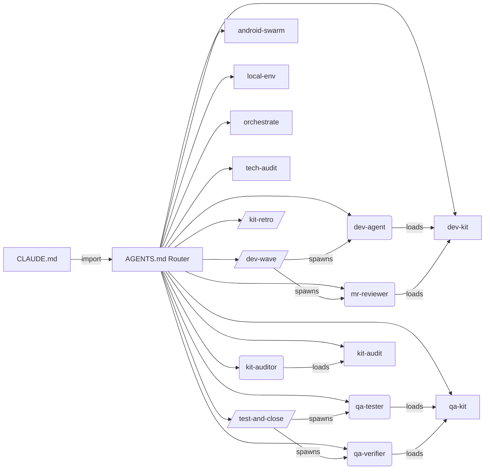
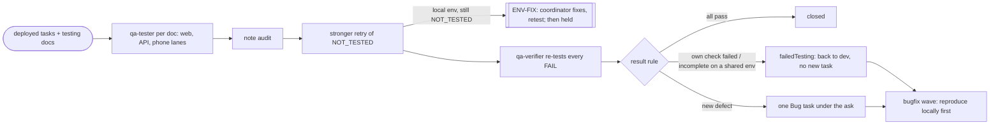
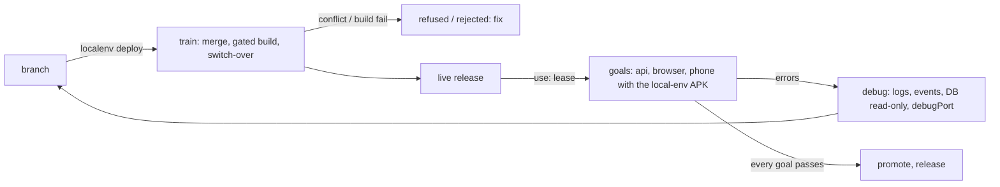
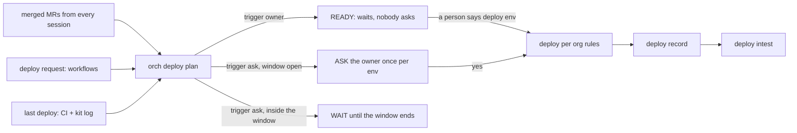

```mermaid
flowchart LR
  T([task / bug]) --> C[dev-agent: code]
  C --> G[testing-goals doc]
  G --> R{bug?}
  R -->|yes| RP[reproduce on the local env]
  R -->|no| L
  RP --> L[local test loop: deploy branch, lease, run every goal]
  L -->|goal fails, < 3 rounds| C
  L -->|3 rounds failed| SR[one stronger fix round]
  SR -->|still failing| B[[held: the coordinator decides]]
  L -.->|coordinator-only env fix| EF[[ENV-FIX: the coordinator fixes, the item waits]]
  EF -.->|done| L
  C -.->|behaviour not asked for / several paths| D[[decision request: the item waits]]
  D -.->|owner answers| C
  L -->|every goal passes| V[review + CI]
  V -->|findings / red| C
  V -->|clean, green| M[merge, producers first]
  M --> H[human testing doc + tracker promoted]
  H --> DB[merged work waits: nobody asks]
  DB -->|a person says deploy env| DP[deploy at once + record]
  DP --> IT[tracker inTest]
  IT --> HT([testers close it, or failedTesting -> back to dev])
```

# claude-crew

A multi-agent dev + QA kit for Claude Code (with ports for Codex and Antigravity) for **any project type**: any stack (JVM,
.NET, Node / web frameworks, Python, Go, Rust, mobile, native; one repo or many), any migration tool, any local env shape, test
environment, deploy mechanism and issue tracker. Everything org- or product-specific lives in git-ignored config
(`skills/dev-kit/kit.local.json`, `rules/*.local.md`); the kit itself assumes no tenants, no web + API + app trio, no database.

## The two flows
- **Dev** (every code change, one agent or a /dev-wave of many): code -> testing-goals doc -> reproduce / debug + test on the
  **local env** (loop, bounded) -> independent review + CI -> merge (producers first), human testing doc, tracker `promoted`
  (no user gate) -> merged work **waits for a person's `deploy <env>`** (nobody asks or proposes; `deploy.trigger`) -> the
  coordinator deploys at once -> `inTest` -> testers close the task, or it fails testing and comes back.
- **Test-only** (deployed tasks on a test env, on request): agent QA per testing doc (web, API, Android lanes) -> all checks
  pass: closed · an own check failed or testing incomplete: `failedTesting` (back to dev, no new task) · a new defect: one
  `[Bug]` task under the original ask.
- **Decision pauses**: an agent that would change business logic the task did not ask for, or sees several valid paths, asks;
  that item waits for the owner's answer while the rest of the wave continues.

## Install
```powershell
git clone https://github.com/prskid1000/claude-crew <workspace>/.claude
pwsh -File <workspace>/.claude/skills/orchestrate/kit.ps1 setup -WriteLocal   # git hooks, excludes, .runtime/.state, local config stubs
```
Prerequisites: PowerShell 7 (`pwsh`), Python 3.8+, git, Node 18+ (browser helper, spec runner), the git-host CLI (`glab` or
`gh`), optionally the tracker CLI (ClickUp), `gws` (Google Docs reports), the Android SDK (phone lanes). Then fill
`skills/dev-kit/kit.local.json`, `skills/qa-kit/targets.local.json` (test logins: the only place for passwords) and, for app
lanes, `skills/android-swarm/swarm.config.json`; `npm install` in `skills/qa-kit`. Update with `git pull`; after an update that
moves state, `kit.ps1 setup -Migrate` once nothing runs.

## Using it
- Ask the main session for work; the Router in `AGENTS.md` picks the flow and launches it (`/dev-wave`, `/test-and-close`,
  `/kit-retro`). The coordinator keeps one heartbeat (`orch.ps1 supervise -AutoFix -Brief` on `/loop 10m`) and acts on its flags:
  decisions, failed testing, stopped runs. After a crash or restart: `orch.ps1 recover` (the SessionStart line says so).
- Commands (each prints its usage without arguments): `skills/dev-kit/dev.ps1` (worktrees, gated checks, tracker),
  `skills/local-env/localenv.ps1`, `skills/qa-kit/qa.ps1`, `skills/android-swarm/swarm.ps1`, `skills/orchestrate/orch.ps1`
  (board, learn, track, supervise, deploy, decide, recover), `skills/orchestrate/kit.ps1` (setup, hooks), `kittool.py` (lint, flow, port, audit, cost).

## Configuration (`skills/dev-kit/kit.local.json`; every key optional; `kit.example.json` shows each)
| Key | Default | Meaning |
|---|---|---|
| `tracker` | `{ "type": "none" }` | `type` clickup / github / gitlab / jira / none; `statuses` maps the logical statuses open, inProgress, review, promoted, inTest, failedTesting, closed; `list`, `repo`, `owner`, `branchTag`, `issueType`, `subtaskType` |
| `gitHost`, `gitHostType`, `githubHost`, `gitlabGroup` | `gitlab.com`, from gitHost, `github.com`, none | the git host and the group/owner for short refs `<repo>!<iid>` |
| `repos` | none | `[{ name, aliases, checkout, target, linkFrom, linkFromByTarget, linkPaths, deploys }]`; `deploys[]` per test env: CI `branch` + `job`, `awsStack` + `region`, `ssh {host, key, repoDir, appDir, subdir, exclude, service}`, `manual`, `laneApk` |
| `reposRoot`, `worktreeRoots`, `repoAliases`, `protectedBranches` | workspace, `<repos>-wt`, `{}`, `[]` | where checkouts and worktrees live; short repo names; branches never force-pushed |
| `trackerRepos`, `trackerLists`, `productTargets` | `[]` | repos searched for a task's MRs; tracker containers for `deploy intest`; which env a path needs |
| `localEnv` | none | local envs (local-env skill): `envs.<env>.services[] {name, repo, dir, start, build, artifact, port, debugPort, health, dependsOn, hot, external}`, `tasks`, `smoke`, `db {snapshot, restore, rollback, applied, tag}`, `sandbox`, `migrations` rules, lease / idle limits |
| `deploy.trigger` | `owner` | `owner`: nobody asks or proposes a deploy, a person says `deploy <env>` and it runs end to end; `ask`: one batched ask per env (supervise DEPLOY ASK) |
| `deploy.minIntervalHours`, `deploy.planTimeoutSec` | `4`, `180` | `ask` only: one ask per test env per window (a number or `{ "default": 4, "<target>": 24 }`); `deploy plan`'s wall clock |
| `net.timeoutSec` | `60` | per git-host / tracker CLI call; transient failures retry (2 s, 6 s); tracker writes lost to the network wait in `.state/outbox.jsonl` until supervise replays them |
| `tests.<stack>.testFor` | per stack | test names `check -Touched` looks for from a changed file's `{name}` |
| `reports.type`, `driveParent` | gdocs when `gws` exists, else markdown | QA reports and testing docs: Google Docs or files |
| `qa.outOfScope` | `[]` | channels agent QA never tests (OUT_OF_SCOPE) |
| `qa.targets` | `{}` | target groups for `/test-and-close` `select` runs: `<group>: [{ lists?, repos?, nameRegex?, pathRegex?, target, localEnv? }]` (first match = the item's env) |
| `gate.keepFreeGB`, `gate.startHeapGB`, `gate.heapMinGB` | 15% of RAM (min 6), per tool, 4 | the memory gate |
| `supervise.ramActPct`, `supervise.minDiskFreeGB` | 90, 30 | heartbeat thresholds |
| `kitAudit.everyDays`, `cleanup.maxBrowserProfiles`, `memory.keepDefault`, `build.mavenOffline` | 7, 4, false, true | audit nudge, browser profiles kept, auto-memory location, Maven -o |
| `bugfixMandate`, `localOnly`, `orgTerms` | none | words for bug waves; org-only kit paths kept out of git; words the pre-push gate blocks |
| `localFiles` (example only) | — | `kit.ps1 setup -WriteLocal` writes `targets.local.json` and `swarm.config.json` from it |
Env vars: `CLAUDE_RUNTIME`, `CLAUDE_WT_ROOT`, `CLAUDE_AGENT`, `CLAUDE_GATE_KEEP_FREE_GB`, `KIT_TRACKER_TYPE`, `KIT_TRACKER_DRYRUN`,
`KIT_REPORT_TYPE`, `KIT_NET_TIMEOUT_SEC` / `KIT_NET_TRIES` / `KIT_NO_OUTBOX`, `JIRA_BASE_URL` / `JIRA_EMAIL` / `JIRA_API_TOKEN`, `ANDROID_HOME`, `ANDROID_SERIAL`, `CHROME_PATH`.
A repo whose stack is detected wrongly: `.claude-stack.json` next to its build file (`{ "commands": { "test": "make test T={tests}" } }`).

## Layout, state and safety
- Runtime output: `<kit>/.runtime/` (disposable: `work/` runs in flight, `cache/`, `logs/`); durable state: `<kit>/.state/`
  (tracking, learning signals, deploy log, tracker outbox, the `none` tracker, local-env secrets). Both git-ignored; every path is named in
  `skills/dev-kit/paths.json`. `orch.ps1 cleanup` (daily) removes only kit-created leftovers.
- Guards: the PreToolUse hook blocks `git stash`, `--no-verify`, force-pushes to shared branches, ungated heavy builds, dev
  servers by hand and `adb kill-server`. Deploys start only from a person's word; merges into deploying branches need a yes. Never production.
- Limits: one machine (the memory gate is local); the Workflow tool, hooks and the Skill tool are Claude Code-only (Codex and
  Antigravity get ported agents and manual workflow procedures).

## How the kit fits together
Generated by `kittool.py flow --readme` (the pre-commit hook keeps it current); the interactive page:
`<kit>/.runtime/cache/kit-flow.html`.
<!-- kit-graph:start map -->

<!-- kit-graph:end -->

<!-- kit-graph:start flow-dev -->

<!-- kit-graph:end -->

<!-- kit-graph:start flow-test-only -->

<!-- kit-graph:end -->

<!-- kit-graph:start flow-local-env -->

<!-- kit-graph:end -->

<!-- kit-graph:start flow-deploy -->

<!-- kit-graph:end -->

<!-- kit-graph:start skill-android-swarm -->
```mermaid
flowchart LR
  skills_android_swarm_SKILL_md[android-swarm]
  skills_android_swarm_SKILL_md -->|step A0 / L0: orch.ps1 learn -Read -Skill androi| LESSONS_md[LESSONS.md]
  skills_android_swarm_SKILL_md -->|A1-A4 (acquire, ensure, launch, release, status)| skills_android_swarm_swarm_ps1[swarm.ps1]
```
<!-- kit-graph:end -->

<!-- kit-graph:start skill-dev-kit -->
```mermaid
flowchart LR
  skills_dev_kit_SKILL_md[dev-kit]
  skills_dev_kit_SKILL_md -->|step 0: orch.ps1 learn -Read -Skill dev-kit prin| LESSONS_md[LESSONS.md]
  skills_dev_kit_SKILL_md -->|Writing standards at every step that writes text| skills_dev_kit_templates_md[templates.md]
  skills_dev_kit_SKILL_md -->|steps 1-5 (wt, stack, check, gate, tracker), CI | skills_dev_kit_dev_ps1[dev.ps1]
  skills_dev_kit_SKILL_md -->|library dot-sourced by every kit script (config,| skills_dev_kit_lib_ps1[lib.ps1]
  skills_dev_kit_SKILL_md -->|step 6 (mr, doc, finish), step 7 (merge), rebase| skills_dev_kit_devtools_py[devtools.py]
  skills_dev_kit_SKILL_md -->|step 4: the test runner check -Step test uses fo| skills_dev_kit_spec_mjs[spec.mjs]
  skills_dev_kit_SKILL_md -->|the one map of runtime (.runtime/) and durable (| skills_dev_kit_paths_json[paths.json]
  skills_dev_kit_SKILL_md -->|setup: kit.ps1 setup -WriteLocal writes kit.loca| skills_dev_kit_kit_example_json[kit.example.json]
```
<!-- kit-graph:end -->

<!-- kit-graph:start skill-kit-audit -->
```mermaid
flowchart LR
  skills_kit_audit_SKILL_md[kit-audit]
  skills_kit_audit_SKILL_md -->|step 0: orch.ps1 learn -Read -Skill kit-audit| LESSONS_md[LESSONS.md]
  skills_kit_audit_SKILL_md -->|steps 1-3 (audit setup| skills_orchestrate_kittool_py[kittool.py]
  skills_kit_audit_SKILL_md -->|step 6: Writing standards (the limits kittool.py| skills_dev_kit_templates_md[templates.md]
```
<!-- kit-graph:end -->

<!-- kit-graph:start skill-local-env -->
```mermaid
flowchart LR
  skills_local_env_SKILL_md[local-env]
  skills_local_env_SKILL_md -->|step 0: orch.ps1 learn -Read -Skill local-env| LESSONS_md[LESSONS.md]
  skills_local_env_SKILL_md -->|steps 1-6 (envs, status, deploy, wait, use, logs| skills_local_env_localenv_ps1[localenv.ps1]
  skills_local_env_SKILL_md -->|run by localenv.ps1 to class a deploy's migratio| skills_local_env_migrations_py[migrations.py]
```
<!-- kit-graph:end -->

<!-- kit-graph:start skill-orchestrate -->
```mermaid
flowchart LR
  skills_orchestrate_SKILL_md[orchestrate]
  skills_orchestrate_SKILL_md -->|step 0: orch.ps1 learn -Read -Skill orchestrate| LESSONS_md[LESSONS.md]
  skills_orchestrate_SKILL_md -->|every event row (supervise, launch, report, boar| skills_orchestrate_orch_ps1[orch.ps1]
  skills_orchestrate_SKILL_md -->|SessionStart hook (health), install / repair / m| skills_orchestrate_kit_ps1[kit.ps1]
  skills_orchestrate_SKILL_md -->|K3 (lint, flow --readme, port, cost), the kit au| skills_orchestrate_kittool_py[kittool.py]
  skills_orchestrate_SKILL_md -->|K1: conventions (file cap, budgets, script / ski| CONTRIBUTING_md[CONTRIBUTING.md]
  skills_orchestrate_SKILL_md -->|K3: its graph sections are regenerated by kittoo| README_md[README.md]
  skills_orchestrate_SKILL_md -->|K3: pwsh -File kit/tests/kit-tests.ps1 -Area are| tests_kit_tests_ps1[kit-tests.ps1]
  skills_orchestrate_SKILL_md -->|E14: a new repo or stack (path-scoped rule examp| examples_rules_md[rules.md]
  skills_orchestrate_SKILL_md -->|K4: run by git (kit.ps1 setup sets core.hooksPat| _githooks_pre_commit[pre-commit]
  skills_orchestrate_SKILL_md -->|K4: run by git (kit.ps1 setup sets core.hooksPat| _githooks_pre_push[pre-push]
```
<!-- kit-graph:end -->

<!-- kit-graph:start skill-qa-kit -->
```mermaid
flowchart LR
  skills_qa_kit_SKILL_md[qa-kit]
  skills_qa_kit_SKILL_md -->|step 0 (and H0, L0): orch.ps1 learn -Read -Skill| LESSONS_md[LESSONS.md]
  skills_qa_kit_SKILL_md -->|step 1 (seat), 2 (deployed), 3 (api, ui), 4 (ann| skills_qa_kit_qa_ps1[qa.ps1]
  skills_qa_kit_SKILL_md -->|L1 Selection (tracker list/view/owner; status -E| skills_dev_kit_dev_ps1[dev.ps1]
  skills_qa_kit_SKILL_md -->|L1 Selection (tracker list/view/owner; status -E| skills_local_env_localenv_ps1[localenv.ps1]
  skills_qa_kit_SKILL_md -->|step 3 (web: read its header first; one logged-i| skills_qa_kit_browser_mjs[browser.mjs]
  skills_qa_kit_SKILL_md -->|L0: npm install in this folder (puppeteer-core)| skills_qa_kit_package_json[package.json]
```
<!-- kit-graph:end -->

<!-- kit-graph:start skill-tech-audit -->
```mermaid
flowchart LR
  skills_tech_audit_SKILL_md[tech-audit]
  skills_tech_audit_SKILL_md -->|step 0: orch.ps1 learn -Read -Skill tech-audit| LESSONS_md[LESSONS.md]
  skills_tech_audit_SKILL_md -->|step 8: validate file (must print schema problem| skills_tech_audit_tech_audit_py[tech-audit.py]
```
<!-- kit-graph:end -->
