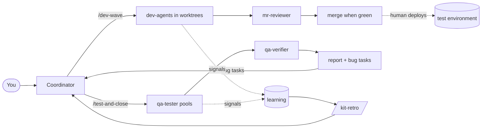

# claude-crew

**A multi-agent dev + QA crew for Claude Code: run a dozen agents on one machine that build, review, merge, test and fix in a
loop, without running out of memory or stepping on each other, and that get better every run.**

`claude-crew` is a `.claude` folder (agents, skills, rules, workflows, hooks) that follows the
[official Claude Code layout](https://code.claude.com/docs/en/claude-directory): this repo's root **is** that folder. Clone it
as your workspace's `.claude` and Claude Code can coordinate parallel dev agents and evidence-grade QA agents across any
number of repos and stacks. Install, update, contribute: [docs/install.md](docs/install.md).

The orchestration (waves, QA runs, hooks, the memory gate) is Claude Code-only, but the instructions and agent roster also
work from **Codex CLI** and **Antigravity/`agy` CLI** — see [docs/cross-cli.md](docs/cross-cli.md).

## Problems it solves

| Problem | What claude-crew does |
|---|---|
| Ten agents on one laptop = out of memory | A machine-wide **memory gate** (`gate.ps1`) queues heavy builds fairly and sizes JVM/Node/Gradle heaps to fit |
| Agents collide: shared worktree, skipped hooks, duplicate agents | Per-agent **git worktrees**, an **agent board**, a guard hook that blocks `git stash`, `--no-verify`, force-pushes |
| Agent output isn't shippable: no review, wrong merge order | `/dev-wave`: build → independent MR review → fix round → merge-when-green (producers before consumers) |
| "Tested, works" without proof, defects hidden in notes | `/test-and-close`: evidence-backed verdicts, note audit, independent re-test of every FAIL, published report |
| The same mistakes every wave | Learning signals → `LESSONS.md` → `/kit-retro` promotes stable lessons into rules |
| Mobile QA needs phones, emulators eat RAM | An **Android emulator swarm** with leased lanes that boot only when memory allows |

## How it works

Every session loads `CLAUDE.md`, whose **Router** classifies the request (first matching row wins) and names one target —
a skill, a workflow, or an agent. Each skill's `SKILL.md` says when to load it and indexes its own files; workflows spawn
agent types, which load their skill first. Details and the full routing graph: [docs/how-it-works.md](docs/how-it-works.md).

## Agents, workflows, skills

| Agent | Role |
|---|---|
| `dev-agent` | Implements one area in its own worktree, runs gated checks, opens MRs/PRs, updates the tracker |
| `mr-reviewer` | Read-only reviewer: bugs, regressions, breaking changes, missing rollbacks, scope creep |
| `qa-tester` | Runs one tester guide (web/API/Android) and returns verdicts with evidence |
| `qa-verifier` | Re-tests every FAIL and audits PASS_WITH_NOTE for hidden defects |

| Workflow | What it runs |
|---|---|
| `/dev-wave` | Parallel dev agents → review → CI gate → fix round → merge → Learn |
| `/test-and-close` | QA pools → note audit → independent verify → publish report + bug tasks → Learn |
| `/kit-retro` | Parallel analysts mine signals → lesson/rule changes for approval |

Skills (`dev-kit`, `orchestrate`, `qa-kit`, `android-swarm`, `tech-audit`) hold the rules and scripts behind each agent and
workflow — what each one does and its tools: [docs/skills.md](docs/skills.md).

## Setup

1. Clone as your workspace's `.claude` and run the installer — full steps, config files, hooks check, and first run:
   [docs/install.md](docs/install.md).
2. Edit `CLAUDE.md` (the Router template) with your CLIs, tracker workflow, org specifics.
3. Pick a tracker and report output in `skills/dev-kit/kit.local.json` — see
   [skills/dev-kit/reference/configuration.md](skills/dev-kit/reference/configuration.md).

## Usage

Running a dev wave, testing a deployed batch, phone leases, housekeeping commands: [docs/usage.md](docs/usage.md).

## Prerequisites

PowerShell 7+, git, Node 18+, Python 3.10+, Claude Code with workflows, and your stacks' build tools. Optional per feature
(`glab`/`gh`, a tracker CLI, `gws`, Android SDK, ...): [docs/prerequisites.md](docs/prerequisites.md).

## Configuration, directory layout, safety, limitations

- Config files and what they control: [docs/configuration-overview.md](docs/configuration-overview.md) (full reference:
  [skills/dev-kit/reference/configuration.md](skills/dev-kit/reference/configuration.md)).
- Folder-by-folder layout: [docs/directory-layout.md](docs/directory-layout.md).
- What the guard hook, pre-push hook and self-cleaning protect against: [docs/safety.md](docs/safety.md).
- Platform gaps and known limitations: [docs/limitations.md](docs/limitations.md).
- Token budget per agent/run: [docs/kit-cost.md](docs/kit-cost.md).

## Contributing

Issues and pull requests are welcome — see [CONTRIBUTING.md](CONTRIBUTING.md). Keep the kit generic: no org names, hosts,
paths or credentials in the kit; anything specific belongs in `*.local.json`, `CLAUDE.md` or your own skills.

## License

[MIT](LICENSE) © the claude-crew contributors.
