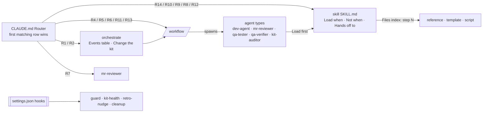
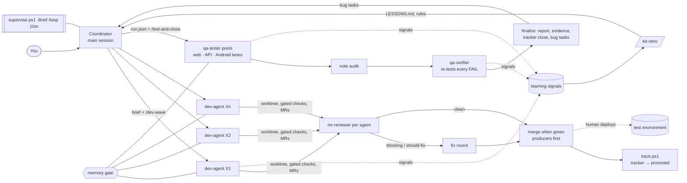

# How agents find their way: one explicit graph

Nothing in the kit is reached by fuzzy description matching. Every session loads `CLAUDE.md` (which imports `AGENTS.md`), whose **Router** is an
ordered table: classify the request, the first row whose conditions all hold wins, and it names exactly one target. Each
skill's `SKILL.md` opens with **Load when / Not when / Hands off to** and a **Files** index that binds every file in its
folder to the numbered step that reads or runs it. Workflows spawn the agent types; each agent loads its skill first. While
coordinating, the main session follows the **Events** table in the `orchestrate` skill (event -> script or workflow).

`kit-lint.py` keeps the graph honest (every skill, workflow and agent routed, every file in a Files index with its step, no
fuzzy triggers, no dangling paths, workflow `whenToUse` = its router row) and `kit-flow.py` draws it as a page
(`<runtime>/cache/kit-flow.html`: Flow, Triggers, Router & events, Files, Issues). Adding a part:
[../skills/orchestrate/reference/extending.md](../skills/orchestrate/reference/extending.md).

## Full flow

- **One machine, many agents.** Every heavy command goes through the gate. A build starts only if
  `available RAM − memory promised to running builds − its estimate ≥ keep-free`. Estimates are learned per project and
  command kind. Emulators take turns in the same queue.
- **Memory seats and extra workers.** QA testers take a memory seat (`qa-seat.ps1`) before they start, so the number of
  parallel QA agents grows and shrinks with free RAM. When a run has queued items and room, the supervisor suggests an extra
  worker run; item claims keep workers from testing the same item.
- **Model by stage.** Builds run on sonnet unless an agent is marked `complex` (strongest model); review, QA verify and note
  audit on sonnet; mechanical steps (load-run, ci, ship, close, hold, release, learn) on haiku. Override per agent/item
  (`model`) or per stage (`models`).
- **Optional stages.** `/dev-wave` `review: 'auto'` skips the review for small, non-sensitive diffs and `learn: 'auto'`
  learns only after trouble; `/test-and-close` `verify: false` sends FAILs straight to bug tasks without the independent
  re-test.
- **CI gate before merge.** After a clean review, a cheap agent waits for the MR pipelines (`pipe-wait.ps1`); a failed
  pipeline goes back to the dev agent as a blocking finding (failed job + error tail) for the fix round, so nothing is
  scheduled to merge on red.
- **Irreversible-rollback check.** `lbcheck.py` flags a Liquibase changeSet whose comment says it is not reversible /
  irreversible / has no rollback unless it carries a non-empty `<rollback>` (an empty tag fails CI just like a missing one).
- **Evidence marking.** FAIL screenshots are marked so the reviewer sees the defect at once: `annotate.ps1` (box / arrow /
  label on any image), `ui.ps1 shotmark` (Android screenshot + box around elements by text or #id in one go), `mark()` in
  `browser.mjs` (web).
- **Isolation.** One worktree per agent per repo, claims on the board (worktrees, phones, browser ports), contracts between
  agents in `<brief>.contracts.md`, which agents re-read before every push.
- **Supervision.** The coordinator keeps one cheap heartbeat (`/loop 10m`) running `supervise.ps1 -AutoFix -Brief` (flags
  only, or one `ok` line) and relies on workflow completion notifications. It covers workflows (idle or finished agents),
  the board (duplicates, stale entries), the gate (queue, waits, repeated failures), RAM/disk, guard blocks and phone leases.
  It also runs the tracker and cleanup.
- **Self-improvement.** `learn.ps1` signals → workflow Learn steps → `LESSONS.md` (≥ 2×) → `/kit-retro` promotes stable
  lessons (≥ 3×) into rules; guard blocks and gate history feed the same loop. `LESSONS.md` holds only active rules (≤ 40
  lines, `learn.ps1 -Trim`); fixed and old lessons move verbatim to `HISTORY.md` next to it, which agents never read.
